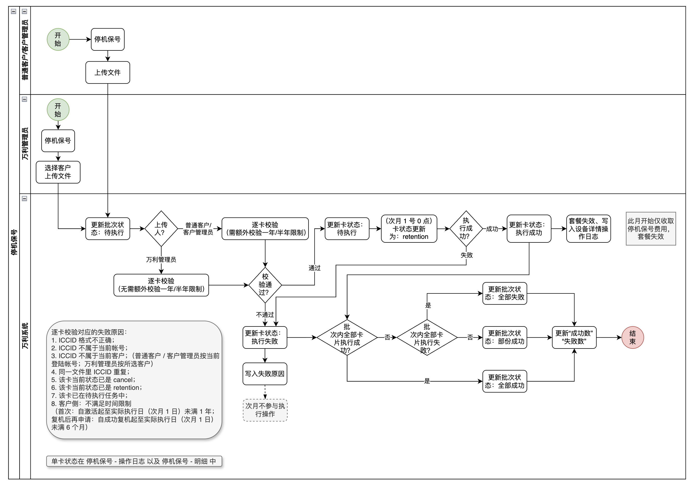
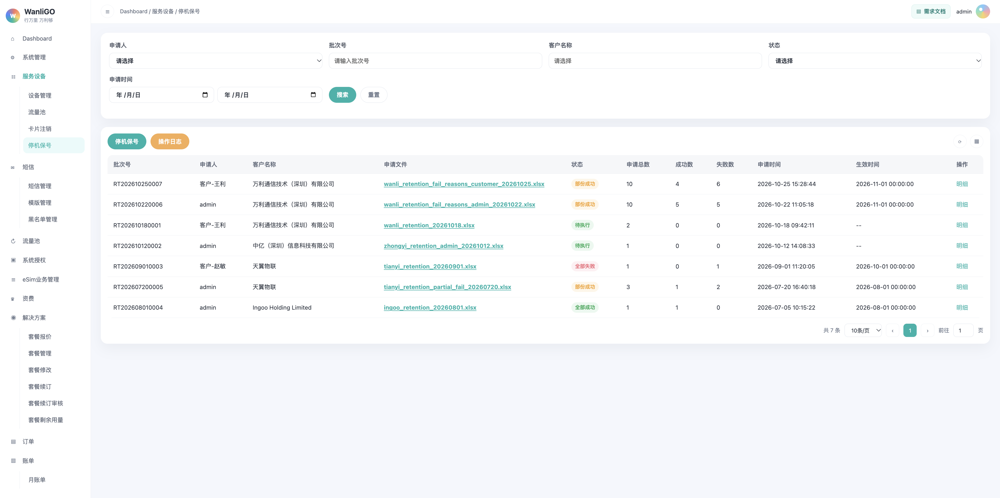
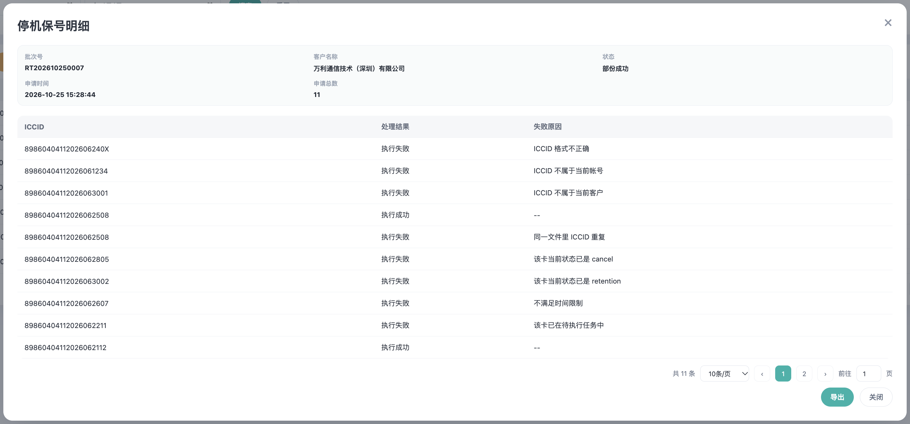
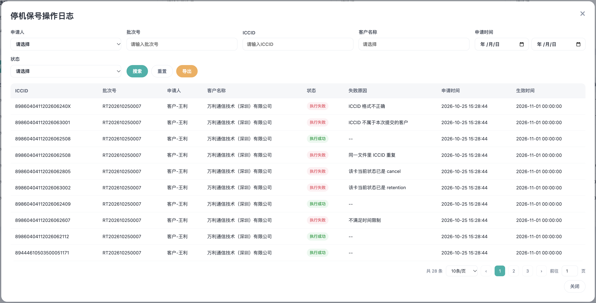

# 停机保号

# 一、需求说明

## 1.1 背景

停机保号区分主动申请与合约期到期后自动停机保号。

在「服务设备」下新增二级菜单「**停机保号**」，支持按**客户**上传 ICCID 文件发起停机保号。

以**批次**为单位管理，**不需要万利管理员审核**。

同时，套餐合约到期且未续订时，系统可自动将卡置为同一状态 `retention`（停机保号），与主动申请共用状态，但入口、生效时点、留痕不同。

**目标**：

- 客户可自助批量申请停机保号；提交后系统立即逐卡校验，通过者次月 1 日执行生效并按规则计费；不通过者当场记执行失败并写明原因。
- 合约到期未续订时自动进入停机保号，不再维护独立的 `expired` 状态。
- 停机保号费用统一来自「套餐报价」中的停机保号金额与币种。

## 1.2 范围

| 项                                                   | 说明                                                         |
| ---------------------------------------------------- | ------------------------------------------------------------ |
| 菜单与批次 | 服务设备 → 停机保号；客户上传 ICCID 文件成批次；无审核       |
| 路径 A                                               | 用户主动申请；上传后立即逐卡校验；校验通过者次月 1 日 0 点执行；主列表 + 明细 + 操作日志弹窗 |
| 路径 B                                               | 合约到期自动；到期日次日 0 点；仅设备管理操作日志            |
| 状态                                                 | 取消 `expired`；合约到期未续订与停机保号统一为 `retention`   |
| 套餐报价                                             | 卡费信息只保留一组；新增停机保号金额+币种；Price Group / Country 表去掉停机保号列 |
| 设备日志                                             | 路径 A：仅次月真正执行成功 / 失败写入设备详情日志；上传校验失败不写。 路径 B：到期任务成功 / 失败写入设备管理操作日志 |

## 1.3 流程图（主动申请）

## 1.3 路径对照表

| 对比项                                                       | 路径 A：主动申请                                             | 路径 B：合约到期自动                                         |
| ------------------------------------------------------------ | ------------------------------------------------------------ | ------------------------------------------------------------ |
| 触发                                                         | 客户 / 客户管理员 / 万利管理员上传 ICCID                     | 定时任务：旧合约已于昨日届满且未续订新套餐                   |
| 校验节奏                                                     | **上传后立即逐卡校验**； 次月 1 日 0 点仅对仍为「待执行」的卡执行 | 到点执行前复核（无上传批次概念）                             |
| 生效时点                                                     | **次月 1 日 0 点**（仅执行成功才置 `retention`）             | **合约到期日次日 0 点** （到期日当日仍算合约期内）      |
| 批次主列表                                                   | 有                                                           | **无**                                                       |
| 停机保号操作日志弹窗 | 有（ICCID 维度）                                             | **无**                                                       |
| 设备管理操作日志                                             | 有（**仅次月真正执行**成功 / 失败；上传校验失败不写）        | 有（成功 / 失败； 操作人可为「系统」，并标明「合约到期自动」） |
| 时间限制                                                     | 有（首次满 1 年；复机后再申请满 6 个月）。 **上传后校验时判定**，评估时点 = 次月 1 日 0 点； 万利管理员无此限制 | **无**                                                       |
| 提交后状态                                                   | 批次先置「待执行」；明细为「待执行」或「执行失败」； 若上传后全部失败，批次可汇总为「全部失败」 | 无批次；到点直接执行                                         |
| 单卡结果名                                                   | **三态**：待执行 / 执行成功 / 执行失败                       | 成功或失败写入设备管理操作日志（无批次明细三态）             |
| 建议任务名                                                   | （次月 1 日执行主动申请批次中仍为「待执行」的卡）            | `retentionAutoOnContractExpire`（每日 0 点）                 |

两条路径最终成功时，ICCID 状态均为 **`retention`**，关联套餐失效，之后按停机保号费计费（金额来自套餐报价）。

## 1.4 公共规则

### 1.4.1 状态：统一用 `retention`

- **去掉**状态值 `expired`。
- **合约到期未续订**与**停机保号**（主动或自动）在状态上合并为同一值 **`retention`**。
- 执行成功：状态改为 `retention`，套餐失效，该月起仅收取停机保号费用。
- 执行失败：状态保持原样，**不**改为 `retention`（也不写回已废弃的 `expired`）。

停机保号成功后，如申请复机，复机沿用已有的复机操作逻辑和生效时点，不设时间限制。

### 1.4.2 计费字段来源

停机保号月费取自「解决方案 → 套餐报价 → 添加套餐报价」中新增的「停机保号」**金额 + 币种**字段。

### 1.4.3 公共留痕位置

| 留痕                                   | 主动申请 | 合约到期自动执行 |
| -------------------------------------- | -------- | ---------------- |
| 停机保号主列表（批次）                 | ✓        | ✗                |
| 停机保号操作日志弹窗（ICCID）          | ✓        | ✗                |
| 服务设备 → 设备管理 → ICCID → 操作日志 | ✓        | ✓                |

设备管理操作日志字段示意：操作 ID、操作内容、操作人、操作时间、操作类型、操作结果。  

| 操作 ID      | 操作内容             | 操作人     | 操作时间            | 操作类型  | 操作结果          |
| ------------ | -------------------- | ---------- | ------------------- | --------- | ----------------- |
| 由实际开发定 | 合约到期自动停机保号 | admin      | 2026-11-03 18:15:54 | retention | 停机保号成功/失败 |
|              | 主动申请停机保号     | admin/张三 | 2026-11-03 18:15:54 | retention | 停机保号成功/失败 |

# 二、主动申请停机保号（路径 A ）

## 2.1 页面入口（主列表）

侧边栏：服务设备 → 停机保号。  面包屑：`Dashboard / 服务设备 / 停机保号`。  

### 2.1.1 **筛选区**

| 筛选项   | 说明                                           |
| -------- | ---------------------------------------------- |
| 申请人   | 下拉，精确匹配                                 |
| 批次号   | 文本，模糊匹配                                 |
| 客户名称 | 文本 + datalist；客户 / 客户管理员登录时不展示 |
| 状态     | 待执行、全部成功、部份成功、全部失败           |
| 申请时间 | 日期区间                                       |

**顶部按钮**：停机保号（打开申请弹窗）；操作日志（打开 ICCID 维度操作日志弹窗）。

### 2.1.2 **列表字段**

| 表头     | 说明                                                 |
| -------- | ---------------------------------------------------- |
| 批次号   | 参考格式：`RT` + `yyyyMMdd` + 4 位序号（以实现为准） |
| 申请人   | 提交人                                               |
| 客户名称 | 批次客户；客户视角隐藏整列                           |
| 申请文件 | 源文件名，可下载                                     |
| 状态     | 待执行 / 全部成功 / 部份成功 / 全部失败              |
| 申请总数 | ICCID 条数                                           |
| 成功数   | 明细为「执行成功」的条数                             |
| 失败数   | 明细为「执行失败」的条数                             |
| 申请时间 | 提交时间                                             |
| 生效时间 | 实际生效（次月 1 日 0 点）；未产生为「--」           |
| 操作     | 明细（四种批次状态下均只有「明细」）                 |

## 2.2 申请弹窗

| 字段     | 说明                                                         |
| -------- | ------------------------------------------------------------ |
| 客户名称 | 万利管理员必选；客户登录不展示，按账号客户提交               |
| 上传文件 | xls / xlsx，≤ 5MB，ICCID 列表                                |
| 下载模版 | 下载文件名为“停机保号批量模版.xlsx”，单列表格，表头字段为“ICCID” |

- 客户登录：申请弹窗**不展示**「客户名称」，按当前账号所属客户提交；主列表隐藏客户名称筛选项 与 列。主列表仅展示本人的申请记录；
- 万利管理员：申请时**必选**客户；按所选客户归属校验 ICCID。

### 2.2.1 角色与权限

数据隔离：客户仅能查看本人的操作记录。

| 操作方                                                      | 是否需要审核 | 时间限制 |
| ----------------------------------------------------------- | ------------ | -------- |
| 客户 / 客户管理员 | 不需要       | **有**   |
| 万利管理员                                                  | 不需要       | **无**   |

### 2.2.2 客户侧时间限制

客户侧：普通客户 与 客户管理员

| 场景                                                         | 条件                                                         |
| ------------------------------------------------------------ | ------------------------------------------------------------ |
| 首次停机保号                                                 | 自该卡**激活**起至**实际执行日（次月 1 日 0 点）**已满 **1 年** |
| 复机后再申请 （含曾因 合约到期 自动进入 `retention` 的卡） | 自该卡**成功复机**起至**实际执行日（次月 1 日 0 点）**已满 **6 个月** |
| 万利管理员上传的批次                                         | **不判断**上述时间限制                                       |

- 评估时点为**实际执行日（次月 1 日 0 点）**，**不以提交日为评估时点**。  
- 「曾进入 `retention`」包含主动申请成功，也包含 合约到期 自动成功。复机后再申请的半年规则，对这两种来源一视同仁。

### 2.2.3 提交后**立即逐卡校验**

- 校验通过的卡：明细为 **待执行**；  
- 校验不通过的卡：明细为 **执行失败** 并展示失败原因；失败数计入批次失败数；不参与次月 1 日置 `retention`；保持原状态，套餐不因本次操作失效。  
- 若上传后校验导致批次内全部为执行失败：批次终态可为 **全部失败** 。  
- 若既有待执行又有执行失败：批次仍为 **待执行**，失败数计入执行失败条数。
- 申请提交后不支持取消 / 撤销；（客户即使上传原本不希望停机保号的 ICCID，也不取消批次或撤销批次内的待执行任务。）

逐卡校验失败原因：

1. ICCID 格式不正确。  
2. ICCID 不属于当前帐号。
3. ICCID 不属于当前客户。（普通客户 / 客户管理员按当前登录账号所归属的客户；万利管理员按所选客户）
4. 同一文件里 ICCID 重复。  
5. 该卡当前状态已是 `cancel`。  
6. 该卡当前状态已是 `retention`。  
7. 该卡已在待执行任务中。（ICCID 已存在于待执行任务中时校验失败）
8. **客户侧**：不满足时间限制。

次月 1 日执行阶段若因状态变化等原因失败，失败原因与上表同类（如已是 `retention` / `cancel` 等），写入该卡明细「执行失败」。

### 2.2.4 次月 1 日 0 点

对明细仍为**待执行**的 ICCID 执行：

- 成功：卡状态更新为 `retention`，套餐失效，**写入设备详情操作日志**；明细 **执行成功**。自该月起仅收取停机保号费用。  
- 不成功：明细 **执行失败**，写入失败原因；卡保持原状，不改 `retention`，套餐不因本次操作失效；**写入设备详情操作日志**（停机保号失败）。  

说明：上传后校验失败的卡不会进入本步骤，因此也**不会**因上传失败写设备详情日志。

全部卡处理完成后汇总批次（全部成功 / 部份成功 / 全部失败）。

## 2.3 明细、操作日志弹窗、设备详情日志

### 2.3.1 明细

- **明细**：摘要含批次号、客户名称、状态、申请时间；表格为 ICCID、处理结果、失败原因（仅执行失败展示）；可导出 Excel。
- 点击「导出」，默认导出所有数据的所有字段（ICCID、处理结果、失败原因）。
- 需有分页支持数据量大时的展示。

### 2.3.2 操作日志

- **操作日志弹窗**：以 ICCID 为一行；含 ICCID、批次号、申请人、客户名称、状态（待执行 / 执行成功 / 执行失败）、失败原因、申请时间、生效时间等；可筛选与导出。
- **导出规则**：导出当前表格的所有字段；若已设置筛选条件，则仅导出符合当前筛选结果的数据，并包含对应表格的所有字段。

### 2.3.3 设备管理

**服务设备 - 设备管理 - ICCID - 操作日志**：

- **仅**次月 1 日真正执行时写入：执行成功 →「停机保号成功」；执行失败 →「停机保号失败」。  
- **上传后校验失败不写入**设备管理中的操作日志；只留在**批次明细**与**停机保号操作日志**弹窗。

## 2.4 状态机（批次与单卡）

### 2.4.1 批次状态

| 批次状态                                           | 含义                                                         |
| -------------------------------------------------- | ------------------------------------------------------------ |
| 待执行                                             | 上传后批次为待执行，且尚未完成次月 1 日执行后的批次汇总终态 （同批次中允许存在上传校验导致的执行失败单卡状态） |
| 全部成功 | 次月 1 日执行完成后，批次内**全部**卡片均为「执行成功」      |
| 部份成功                                           | 次月 1 日执行完成后，同时存在「执行成功」与「执行失败」； 或上传后已有「执行失败」与后续「执行成功」等混合终态 |
| 全部失败                                           | 批次内**全部**卡片均为「执行失败」（含上传后校验失败及 / 或次月 1 日执行失败） |

### 2.4.2 单卡处理结果

| 处理结果                                           | 含义                                                         |
| -------------------------------------------------- | ------------------------------------------------------------ |
| 待执行                                             | 上传后逐卡校验通过，等待次月 1 日 0 点执行                   |
| 执行成功 | 次月 1 日 0 点执行成功。状态已更新为 `retention`，套餐失效，自该月起仅收取停机保号费用；**写入**设备详情操作日志 |
| 执行失败                                           | **上传后逐卡校验不通过**，**或**次月 1 日执行不成功。不改为 `retention`（或保持原状）；写入失败原因。 其中：上传校验失败**只**写批次明细 / 停机保号操作日志；次月执行失败**另写**设备详情操作日志 |

### 2.4.3 批次与明细对照

| 批次状态（主列表） | 含义                   | 处理结果（明细 / 操作日志）                                  | 含义（单卡）             |
| ------------------ | ---------------------- | ------------------------------------------------------------ | ------------------------ |
| 待执行             | 等待次月 1 日执行汇总  | 待执行（同批也可能已有执行失败） | 上传后校验通过           |
| 全部成功           | 批次内全部卡片执行成功 | 执行成功                                                     | 状态已更新为 `retention` |
| 部份成功           | 成功与失败并存         | 执行成功 / 执行失败                                          | 按各卡实际结果           |
| 全部失败           | 全部为执行失败         | 执行失败                                                     | 见上传校验与/或次月执行  |

## 2.5 计费

1. **提交当月**：卡仍可用当前套餐；当月套餐月租（整月收取）与用量费用正常计算。  
2. **执行成功所在月起**：仅收取停机保号费用（来自套餐报价）。  

# 三、合约到期自动（路径 B ）

套餐合约到期且未续订新套餐时，系统在**合约到期日次日 0 点**自动将 ICCID 置为 `retention`。  
**无**上传入口、**无**客户侧一年限制；**不**进停机保号主列表与操作日志弹窗；留痕仅设备管理操作日志。

**举例**：合约到期日为 10 号且未续订 → **11 号 0 点**任务置 `retention`（10 号当日仍视为合约期内）。

## 3.1 触发条件与生效时点

须**同时**满足：

1. 旧套餐合约已于**上一自然日**届满（到期日当日仍视为合约期内；次日 0 点执行）。  
2. 届满时及执行前复核：该卡**未**通过续订、套餐修改等使新套餐在合约届满时或届满后**立即衔接**生效。  
3. ICCID 当前状态**非** `cancel`、**非** `retention`。

**生效时点**：合约到期日 **+1 自然日 0 点**。

## 3.2 计费

| 场景                                                        | 计费                                                         |
| ----------------------------------------------------------- | ------------------------------------------------------------ |
| 到期日当日                                                  | 卡仍按旧套餐可用                                             |
| 到期所在自然月                                              | 仍按旧套餐收**整月月租**                                     |
| 月中到期未续订（例：10-15 到期 → 10-16 0 点置 `retention`） | **到期月**收月租；**次月**起收停机保号费（到期月不收停机保号费） |
| 已置 `retention` 后的某个月，重新续订新套餐当月生效         | 该续订所在月**同时**收当月套餐月租与当月停机保号费           |

执行成功：置 `retention`，套餐失效，写设备管理操作日志「停机保号成功」。  

执行失败：状态不变；写「停机保号失败」及原因。  

**不校验**客户侧一年 / 半年限制。

## 3.3 定时任务

- 建议任务名：`retentionAutoOnContractExpire`。  
- 与「次月 1 日执行主动申请批次」**并列**的独立任务。  
- 调度：每日 **0 点**（或固定延迟数分钟错峰）。  
- **幂等**：已是 `retention` 的 ICCID 跳过，不重复写成功日志。  
- 与次月 1 日任务共用「置 `retention` + 套餐失效 + 写日志」能力，但**入口与校验分离**；次月 1 日任务不重复处理已在本任务成功的卡。  
- **执行前二次校验**：扫描与置状态之间可能隔数分钟，须再次确认续订 / 修改是否已在日切前生效，避免临期续订被误停机保号。

流程概要：

1. 每日 0 点启动 → 扫描「合约到期日 = 昨日且未衔接新套餐」的 ICCID。  
2. 候选为空则结束；否则逐张执行前复核。  
3. 通过 → 置 `retention`、套餐失效、写成功日志；不通过 → 写失败日志及原因。  
4. 处理完所有候选结束。

## 3.4 执行失败原因

1. 该卡当前状态已是 `cancel`。  
2. 该卡当前状态已是 `retention`。  
3. 执行前复核：已续订 / 已修改且新套餐应已衔接，不应再进入停机保号。  
4. 与卡片注销等同卡操作冲突且该操作已先生效（如已为 `cancel`）。

## 3.5 复机后再主动申请

- 曾因 合约到期 进入 `retention` 的卡，复机后若再走主动申请，须在**上传后逐卡校验**时判断：自**上一次成功复机**起至**实际执行日（次月 1 日 0 点）**是否已满 6 个月。  
- 未满 → 上传后明细即为 **执行失败**（「自成功复机起未满半年」）；不进入次月 1 日执行队列。  
- 评估时点仍为次月 1 日 0 点，不以提交日为准。  

# 四、套餐报价变更

入口：解决方案 → 套餐报价 → 新增（添加套餐报价）：

变更三点：

1. 「卡类型、卡费、卡币种、备注」**只保留一组**。  
2. **增加**「停机保号」：金额输入框 + 币种选择；停机保号费用取该字段。  
3. Price Group、Country 此表格**去掉**「停机保号」列。

---

# 五、示例

| 路径 | 场景                                                         | 结果                                                         |
| ---- | ------------------------------------------------------------ | ------------------------------------------------------------ |
| A    | 客户 10 月上传 2 张卡：卡 1 按实际执行日 11-01 0 点评估已激活满 1 年；卡 2 仍不满 1 年 | 上传后：卡 1 **待执行**；卡 2 **执行失败**「自激活起未满一年」。11-01 卡 1 **执行成功** → 批次**部份成功** |
| A    | 万利管理员上传                                               | 上传后**不**校验时间限制；通过者 **待执行**；次月 1 日执行置 `retention` |
| A    | 上传后均为待执行，次月 1 日全部执行成功                      | 全部 `retention`；套餐失效；设备日志成功；批次**全部成功**；自该月起仅收停机保号费 |
| A    | 次月执行后 1 张成功、1 张失败                                | 批次**部份成功**；失败原因写在该卡明细                       |
| A    | 上传后 3 张均已是 `retention`                                | 3 张均为 **执行失败**；批次汇总为**全部失败**                |
| A    | 上传后均为待执行，次月 1 日 3 张均执行失败                   | 批次**全部失败**                                             |
| A←B  | 卡曾因路径 B 进 `retention` 后复机，仅过 4 个月又主动申请    | 上传后逐卡校验（含半年）→ **执行失败**「自成功复机起未满半年」（不写设备详情日志） |
| B    | 合约到期日 2026-10-10，未续订                                | 2026-10-11 0 点置 `retention`；10 月仍收旧套餐整月月租；11 月起收停机保号费 |
| B    | 合约 10-15 到期未续订                                        | 10-16 0 点置 `retention`；10 月月租、11 月起停机保号费（到期月不收停机保号费） |
| A+B  | 9 月主动申请待执行（计划 11-01）；合约 10-15 到期未续订      | 10-16 路径 B 先置 `retention`；11-01 路径 A 该卡**执行失败**（已是 `retention`） |
| B    | 10-16 已 `retention`，10-20 续订且当月生效                   | **10 月**账单同时含当月月租与当月停机保号费                  |
| A←B  | 路径 B 进 `retention` 后 2026-06-01 复机；09-15 主动申请     | 上传后校验未满 6 个月 → **执行失败**（不写设备详情日志）；若自 12-01 起再申请且执行，已满半年，再与其他校验一并判断 |
