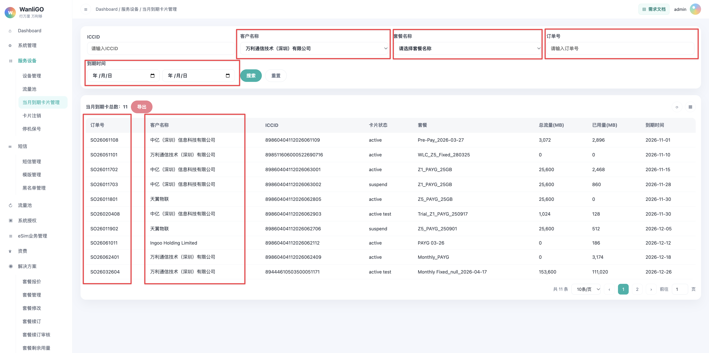

# 当月到期卡片管理

# 零、修改记录

| 版本 | 修改说明 |
| --- | --- |
| V1.0 | 1. 默认列表改为本月 + 下月到期； 2. 扩展筛选（客户名称 / 套餐名称 / 订单号、到期日起止）； 3. 列表增加订单号与客户名称列； 4. 总数与导出随默认范围及筛选结果统计 |

# 一、需求说明

## 1.1 背景

运营需**提前一月**掌握即将到期的卡片，便于续订跟进。

本次在「服务设备 → **当月到期卡片管理**」调整默认数据范围，并补强筛选与列表信息。

**目标**：

- 默认展示 **本月 + 下月** 两个月内到期的卡片；
- 筛选区增加 **客户名称**（仅万利管理员展示）、**套餐名称**、**订单号**、**到期时间**起止（日期选择器）；
- 列表增加 **订单号、客户名称** 列；
- **当月到期卡总数**、**导出** 与当前默认范围 + 筛选结果一致。

## 1.2 范围

| 角色 | 数据与筛选项 |
| --- | --- |
| 万利管理员 | 全部客户数据；展示「客户名称」筛选项与列 |
| 客户 / 客户管理员 | 仅本客户数据；不展示「客户名称」筛选项与列 |

# 二、页面变更

入口：**服务设备 → 当月到期卡片管理**。

## 2.1 默认展示范围

1. 列表默认仅包含到期日在 **本月 1 日～下月最后一日** 内的卡片（**本月 + 下月**）。
2. 范围按业务时区**当前日期**计算。
3. 用户可通过筛选区 **到期时间** 起止在默认范围内进一步收窄；未填写起止时不叠加该条件。

**举例**：当前为 2026 年 11 月时，默认范围为 **2026-11-01～2026-12-31**。

> 「当月到期卡总数」的 N 为上述默认范围下、再经筛选后的条数。

## 2.2 筛选区

在 ICCID 检索基础上增加（控件顺序如下）：

| 筛选项 | 类型 | 可见性 | 匹配方式 |
| --- | --- | --- | --- |
| ICCID | 文本 | 全部 | 模糊 |
| 客户名称 | 下拉 | 仅万利管理员 | 模糊，选择 + 输入搜索 |
| 套餐名称 | 下拉 | 全部 | 模糊，选择 + 输入搜索 |
| 订单号 | 文本 | 全部 | 模糊 |
| 到期时间 | 日期起止 | 全部 | 到期日 ∈ [开始日, 结束日]（含边界） |

## 2.3 列表

**表头列（从左到右）**：

| 列名 | 说明 |
| --- | --- |
| 订单号 | 新增。卡片关联订单号 |
| 客户名称 | 新增。卡片所属客户，仅万利管理员展示 |
| ICCID | 已有，保持现状 |
| 卡片状态 | 已有，保持现状 |
| 套餐 | 已有，保持现状 |
| 总流量(MB) | 已有，保持现状 |
| 已用量(MB) | 已有，保持现状 |
| 到期时间 | 已有，保持现状                                               |

**导出**：导出当前列表结果，列与上表一致。

# 三、示例

| 场景 | 条件 | 结果 |
| --- | --- | --- |
| 默认范围 | 2026 年 11 月进入、无筛选 | 展示到期日在 2026-11-01～2026-12-31 的卡 |
| 默认范围边界 | 到期日 2026-10-31 或 2027-01-15 | 默认列表不出现 |
| 万利管理员 | 客户 + 套餐 | 在默认范围内叠加过滤 |
| 客户账号 | — | 无客户名称筛选项 |
| 订单号 | 输入 `SO260117` | 模糊匹配订单号 |
| 到期时间 | 开始 2026-11-01、结束 2026-11-30 | 在默认范围内仅展示 11 月到期卡 |
| 导出 | 点击导出 | 8 列，与列表一致 |