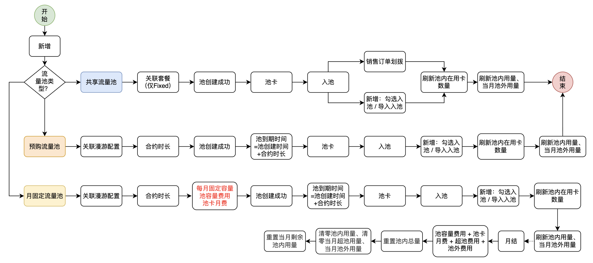
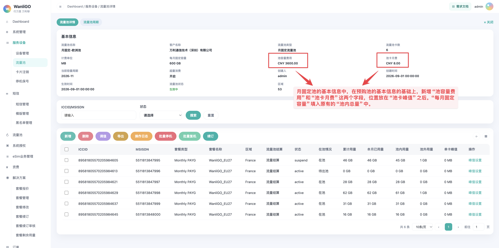
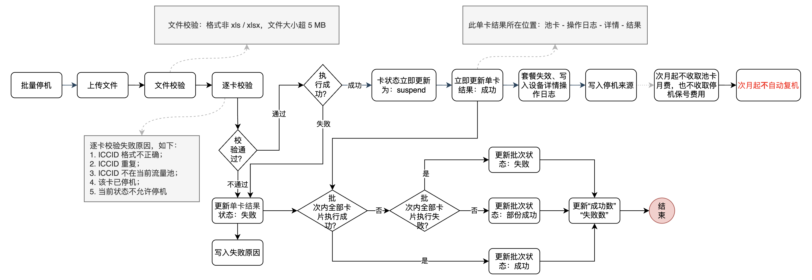
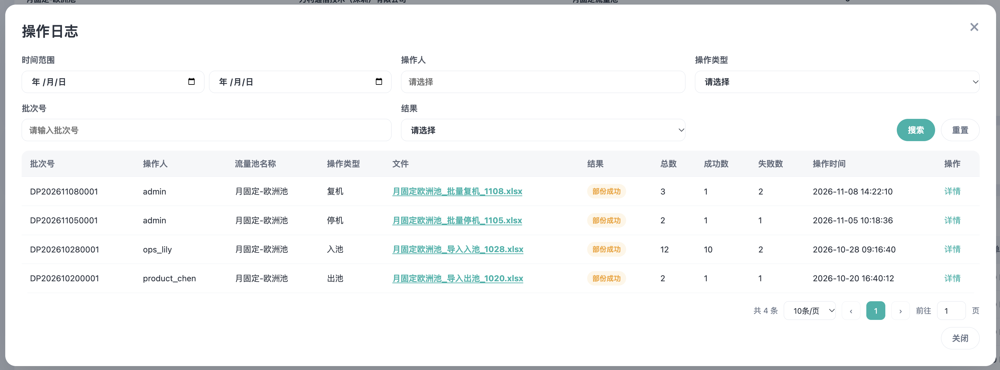

# 月固定流量池需求文档

# 零、修改记录

| 版本 | 修改说明 |
| --- | --- |
| V1.0 | 新增「月固定流量池」类型。 |

# 一、需求说明

## 1.1 需求背景

### 1.1.1 需求背景

现有「服务设备 → 流量池」包含预购流量池、共享流量池。

在**预购流量池**的基础上进行修改，得到本次新增的第三种类型「**月固定流量池**」，类似单卡套餐的 Monthly Fixed 类型。

除本文明确写出的差异外，其他规则均继承预购流量池。

池每个自然月有固定的池容量，并收取固定的池容量费用；池内卡对当月有用量的卡收取池卡月费。

月固定流量池同时支持上传文件批量停机、批量复机。

**目标**：

- 支持创建、续订月固定流量池，并按自然月重置固定容量；
- 支持配置和结算池容量费用、池卡月费；
- 支持按文件批量停机、复机，并保留操作结果；
- 不改变预购流量池、共享流量池现有逻辑。

### 1.1.2 功能清单

| 功能                                                     | 说明                                                         |
| -------------------------------------------------------- | ------------------------------------------------------------ |
| 新增流量池类型 | 流量池类型增加「月固定流量池」，主列表支持筛选和展示。       |
| 新增流量池                                               | 配置「每月固定容量」、「池容量费用」、「池卡月费」。         |
| 池卡页面                                                 | 基本信息展示每月固定容量、池容量费用、池卡月费、当前容量周期；池卡列表沿用现有字段。 |
| 续订                                                     | 配置下一合约周期的每月固定容量、池容量费用和池卡月费。       |
| 批量停机                                                 | 上传 ICCID 文件，校验通过后立即改为 `suspend`。              |
| 批量复机                                                 | 上传 ICCID 文件；对状态为 `suspend` 的卡复机。               |
| 月度容量                                                 | 每月 1 日结转上月数据后，清空月度用量并恢复固定容量。        |
| 月度计费                                                 | 收取池容量费用、有用量卡的池卡月费，以及超池、池外费用。     |
| 操作日志                                                 | 记录停机、复机的批次结果和单卡失败原因。                     |

### 1.1.3 角色与权限

| 角色                                                        | 功能权限 | 数据权限 |
| ----------------------------------------------------------- | -------- | -------- |
| 万利管理员                                                  | 所有     | 所有     |
| 客户 / 客户管理员 | 无       | 无       |

## 1.2 业务流程、状态与公共规则

### 1.2.1 业务流程

**主流程：**

新增月固定流量池 → 配置漫游、每月固定容量、池容量费用 → 卡片入池 → 累计当月用量 → 次月 1 日月结 → 重置「池内总量」为每月固定容量、清零「池内用量」、清零「当月超池用量」、清零「当月池外用量」、重置「当月剩余池内用量」。

### 1.2.2 状态流转

卡片状态统一使用 `suspend` 表示已停机。系统**新增**字段 `suspendSource`（实际命名由开发决定） 记录 **停机来源**，用于区分次月是否自动复机，不新增卡片状态值。

| 停机来源      | 触发                                                         | 次月是否自动复机                                             |
| ------------- | ------------------------------------------------------------ | ------------------------------------------------------------ |
| `quota`       | 达量自动停机，无论池内还是池外 | 是                                                           |
| `manual`      | 月固定流量池以外的手动停机                                   | 是                                                           |
| `pool_manual` | 月固定流量池批量停机成功                                     | 否，保持 `suspend`，直至本池批量复机成功 |

规则：

- 停机成功时写入对应来源，并记入设备详情操作日志。
- 月初自动复机任务只处理：卡片状态 = `suspend`，且停机来源为 `quota` 或 `manual` 的卡。来源为 `pool_manual` 的卡跳过。
- 月固定池「批量复机」仅校验卡片状态为 `suspend`，不区分停机来源；非 `suspend` 处理失败，失败原因记为「该卡当前无需复机」。
- 同一张卡多次停机时，以**最后一次停机成功**的来源为准（覆盖写入）。例如：先按池外手动停机（`manual`），再在月固定池批量停机成功，来源改为 `pool_manual`，次月不再自动复机。

| 当前情况                                                     | 触发                                                       | 结果                                                         |
| ------------------------------------------------------------ | ---------------------------------------------------------- | ------------------------------------------------------------ |
| `active`                                                     | 批量停机校验通过 | 立即改为 `suspend`，写入停机来源 `pool_manual`。停机当月已产生用量的池卡月费仍收取；自次月起不再收取池卡月费和停机保号费用。 |
| `suspend` | 批量复机成功                                               | 立即恢复为 `active`；清除或重置停机来源（不区分停机来源）。 |
| `suspend`，停机来源 `pool_manual`                            | 到达后续月初                                               | 次月起保持 `suspend`，不自动复机，不收取池卡月费和停机保号费用。 |
| `suspend`，停机来源 `quota` 或 `manual`                      | 到达次月 1 日                                              | 月初自动复机任务恢复为 `active`。                            |

### 1.2.3 规则

每月 1 日 0 点，在上月用量和费用完成结转后：

1. 容量周期切换为新自然月；
2. 池内总量恢复为当前生效的每月固定容量；
3. 池内用量、当月超池用量、当月池外用量清零；
4. 当月剩余池内用量恢复为每月固定容量。

容量重置不改变合约周期，也不新增流量池周期记录。

**计费**：

| 费用项 | 预购流量池 | 月固定流量池 |
| --- | --- | --- |
| 有用量卡的月租 | 不收取 | 不收取 |
| 有用量卡的套餐费用 | 不收取 | 不收取 |
| 池卡月费 | 不收取 | 当单卡产生用量时，每卡收取一次，不按天折算 |
| 池容量费用 | 不收取 | 每月按当前生效配置收取一次，与卡数和实际用量无关；不按天折算 |
| 超池费用 | 按预购流量池规则收取 | 沿用预购流量池 |
| 池外费用 | 按预购流量池规则收取 | 沿用预购流量池 |

对于池卡月费，同一 ICCID 同一账期只收取一次，月中入池、停机、复机不按天折算。待出池卡当月仍按本池结算，次月正式出池后不再计入。

月固定池批量停机（来源 `pool_manual`）当月，该卡已产生用量时仍收取一次池卡月费。自次月起，来源为 `pool_manual` 且仍为 `suspend` 期间不再收取池卡月费，也不收取停机保号费用。

本池批量复机成功后，自复机当月起重新按有用量收取池卡月费。

容量和池容量费用分别配置，系统不按容量自动换算费用。

## 1.3 全局复用说明

以下能力沿用平台现有页面：

| 能力 | 复用说明 |
| --- | --- |
| 搜索、重置 | 沿用现有筛选区按钮和交互。 |
| 分页、表格密度 | 沿用现有列表页。 |
| 上传文件 | 沿用现有上传区域；格式为 xls、xlsx，大小不超过 5MB。 |
| 下载模版 | 单列表格，表头为 ICCID。 |
| 导出 | 默认导出所有数据的所有字段。有筛选则导出对应筛选结果的所有字段。 |

# 二、功能

## 2.1 月固定池新增

页面入口：服务设备 - 流量池 - 新增

| 字段                                                   | 类型                                                         | 交互说明                                                     |
| ------------------------------------------------------ | ------------------------------------------------------------ | ------------------------------------------------------------ |
| 流量池类型                                             | 下拉框                                                       | 增加「月固定流量池」。                                       |
| 关联漫游配置 | 下拉框                                                       | 必填；数据来源沿用现有漫游配置。                             |
| 流量池容量                                             | 数值输入 + 单位下拉                                          | 表示每月固定容量；必填，数值大于 0；单位为 MB、GB、TB。跨月重置。 |
| 池容量费用                                             | 币种下拉 + 金额输入 | 必填；金额大于等于 0；占位文本为「请输入池容量费用」。 月固定池在月中创建、「开启」或「关闭」、以及删除时，该自然月均按整月收取「池容量费用」 |
| 池卡月费                                               | 币种下拉 + 金额输入                                          | 必填；金额大于等于 0；占位文本为「请输入池卡月费」。         |
| 合约时长                                               | 数值输入                                                     | 沿用预购流量池，默认 24 个月。                               |

创建成功后，当月池内总量及当月剩余池内用量等于所填容量，池内用量、超池用量、池外用量为 0。

## 2.2 流量池页面

| 位置                                               | 改动                                                         |
| -------------------------------------------------- | ------------------------------------------------------------ |
| 筛选区                                             | 「流量池类型」下拉框中增加「月固定流量池」枚举值             |
| 筛选区                                             | 「套餐模板」中月固定流量池按关联漫游配置匹配                 |
| 数据区                                             | 「池内总量」展示当月固定容量，取值于当前生效的流量池容量     |
| 编辑按钮 | 沿用现有编辑逻辑及界面，回显「每月固定容量」「池容量费用」和「池卡月费」，且均不允许直接修改 |

## 2.2 月固定池池卡页面

入口：流量池主列表点击「池卡」。

页签：

- 流量池详情：基本信息、筛选区、池卡列表；
- 流量池周期：沿用预购流量池，本次不新增字段。容量月度重置不新增周期记录。

- 月固定池的基本信息中，在预购池的基本信息的基础上，**新增**“池容量费用”和“池卡月费”这两个字段（币种 + 金额），位置放在“池卡峰值”之后。“每月固定容量”填入原有的“池内总量”中。
- 筛选区、数据列表区均沿用现有逻辑及展示。

### 2.2.1 页面按钮

新增 → 删除 → 调值 → 导出 → 操作日志 → 批量停机 → 批量复机 → 续订。

批量停机 和 批量复机 仅月固定流量池展示。

### 2.2.2 批量停、复机

**停机流程：**

**页面：**

  
    
   

| 校验项 | 失败处理 |
| --- | --- |
| 未上传文件、格式不是 xls/xlsx、文件超过 5MB | 阻止提交，沿用现有文件校验提示。 |
| ICCID 格式不正确 | 该行失败，失败原因记为「ICCID 格式不正确」。 |
| 同一文件 ICCID 重复 | 重复行失败，失败原因记为「ICCID 重复」。 |
| ICCID 不在当前流量池 | 该行失败，失败原因记为「ICCID 不在当前流量池」。 |

**批量停机补充校验：**

| 卡片情况 | 结果 |
| --- | --- |
| `active` | 立即改为 `suspend`，写入停机来源 `pool_manual`；生效时间为提交时间；记入设备详情操作日志。卡片仍保留在池内。 |
| `active test` | 失败，失败原因记为「当前状态不允许停机」。 |
| 已是 `suspend` | 失败，失败原因记为「该卡已停机」。 |
| 其他状态 | 失败，失败原因记为「当前状态不允许停机」。 |

**批量复机补充校验：**

仅校验卡片状态为 `suspend`，不区分停机来源。

| 卡片情况 | 结果 |
| --- | --- |
| `suspend` | 立即恢复为 `active`；清除或重置停机来源。 |
| 当前不是 `suspend` | 失败，原因「该卡当前无需复机」。 |

同一文件允许部分成功、部分失败。

### 2.2.3 续订弹窗

- 「流量池容量」作为下一合约周期的每月固定容量。
- 增加「池容量费用」配置项：
  币种下拉 + 金额输入。位于流量池容量之后；币种可回显当前币种；金额默认留空，必须重新填写，金额大于等于 0。
- 增加「池卡月费」配置项：
  币种下拉 + 金额输入。位于池容量费用之后；币种可回显当前币种；金额默认留空，必须重新填写，金额大于等于 0。

新容量、新池容量费用和新池卡月费在新合约周期生效前，不影响当前周期。

**续订生效与池容量费用：**

- 续订生效时点与预购流量池一致，见《流量池_PRD》4.7。
- 续订后，新周期在月中生效时：当月按旧周期配置收取整月池容量费用，当月不收取新周期的池容量费用；自次月起按新周期配置收取池容量费用。
- 续订后，新周期在月初自然接续生效时：当月仅按新周期配置收取池容量费用，不重复收取旧周期池容量费用。

## 2.3 操作日志

### 2.3.1 主页面

入口：月固定流量池池卡页面点击「操作日志」

弹窗只展示当前流量池的导入操作记录。月固定流量池在现有入池、出池基础上增加停机、复机。预购流量池、共享流量池不在池卡页面操作停机、复机，操作类型仍只有入池、出池。

| 位置   | 改动                                           |
| ------ | ---------------------------------------------- |
| 筛选区 | 「操作类型」下拉框中增加「停机」「复机」枚举值 |

### 2.3.2 详情

  
    
   

- 导出：默认导出所有数据的所有字段（ICCID、结果、失败原因），导出文件命名规则：“<操作类型> + <导出时的年月日>”。

## 2.4 流量池账单

入口：「月账单 → 流量池账单」。

「流量池类型」增加「月固定流量池」枚举值，其「总月租费」和「总套餐费用」为 0 。

在字段「总套餐费用」之后增加字段「池容量费用」、「总池卡月费」。

账单金额 = 池容量费用 + 总池卡月费（应收费卡数 × 单卡池卡月费） + 超池费用 + 池外费用。

# 三、示例

| 场景 | 结果 |
| --- | --- |
| 建池容量为 600GB | 当月池内总量为 600GB；池内卡数量变化不改变容量。 |
| 当月没有卡片产生用量 | 池卡月费为 0；仍收取池容量费用。 |
| 1 张卡只产生池外用量 | 该卡收取一次池卡月费，同时计算池外费用。 |
| 6 张卡中 5 张有用量 | 这 5 张卡不收月租和套餐费用，改为收取池卡月费；应收费卡数为 5。 |
| 11 月提交批量停机且校验通过 | 状态立即改为 `suspend`，来源 `pool_manual`。11 月已产生用量仍收取池卡月费；12 月起不再收取池卡月费和停机保号费用，也不自动复机。 |
| `suspend` 卡提交批量复机 | 立即恢复为 `active`，清除或重置停机来源（不校验停机来源）。复机当月起重新按有用量收取池卡月费。 |
| 先 `manual` 停机再本池批量停机成功 | 来源覆盖为 `pool_manual`，次月不自动复机。 |
| 续订月固定流量池 | 下一周期使用新填写的容量、池容量费用和池卡月费；生效时点同预购池。 |
| 月中创建月固定池 | 创建当月收取整月池容量费用。 |
| 续订新周期月中生效 | 生效月收取旧池整月池容量费用，次月起收取新池池容量费用。 |
| 续订新周期月初接续生效 | 生效月仅收取新池池容量费用。 |

计费示例：池容量费用 CNY 3,600，池卡月费 CNY 8/卡，有用量卡 5 张，超池费用 CNY 0，池外费用 CNY 120。

账单金额：`3,600 + 5 × 8 + 0 + 120 = CNY 3,760`。
