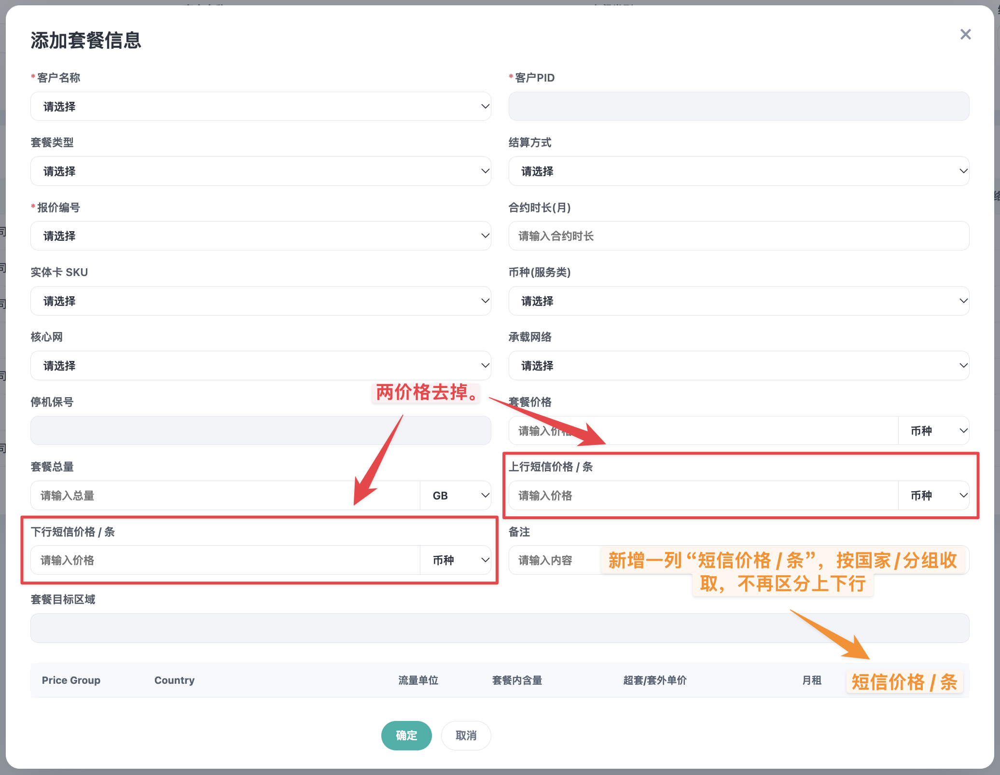

# 短信优化

# 零、修改记录

| 版本 | 修改说明 |
| --- | --- |
| V1.0 | 套餐管理「添加套餐信息」：短信能力改为套餐级开关 + Price Group 短信单价；去掉上行 / 下行分列报价；增加免费短信条数 |

# 一、需求说明

## 1.1 背景

原有「解决方案 → 套餐管理 → 新增（添加套餐信息）」在套餐层分别配置**上行短信价格 / 条**、**下行短信价格 / 条**，与报价侧按 **Price Group** 维护资费的方式不一致，也不便于与漫游区域价差对齐。

本次优化将短信能力收口为：

- 套餐层用**短信开关**控制是否开通短信使用功能；
- 单价在 **Price Group** 表中按区域（价格组）配置及展示 **短信价格 / 条** 。

**目标**：

- 简化套餐新增表单，去掉上行 / 下行两个独立价格项；
- 支持套餐级开通 / 关闭短信能力（开关，**默认关闭**）；
- 在 Price Group 表格中增加「短信价格 / 条」配置项；
-  增加「免费短信条数」。

## 1.2 范围

| 项 | 说明 |
| --- | --- |
| 变更页面 | 解决方案 → **套餐管理** → 新增（**添加套餐信息**）弹窗 |
| 表单 | 去掉「上行短信价格 / 条」「下行短信价格 / 条」；「套餐总量」后增加「短信开关」； 增加「免费短信条数」 |
| 表格 | Price Group 表中在「月租」后增加「短信价格 / 条」列 |

# 二、套餐管理变更

入口：**解决方案 → 套餐管理 → 新增**（**添加套餐信息**）。

  
    
   

1. **配置项移除：**从「添加套餐信息」表单中**移除**（含金额输入与币种下拉）：上行短信价格 / 条 和 下行短信价格 / 条；
2. **配置项新增：**
   a. 增加「短信开关」开关，默认状态为「关闭」，位置放在「套餐总量」之后。「关闭」时当前套餐不可使用短信相关功能（如发送短信、收取短信），之后支持二次修改开关状态；
   b. 增加「免费短信条数」文本输入框，位置放在「短信开关」之后。在短信使用条数超过当前值时，才开始收取短信费用。配置好之后同样支持二次修改；
3. **字段新增：**在「月租」之后增加「短信价格 / 条」，上下行短信的价格统一为一个价格，不再区分，短信价格跟漫游国家/分组关联。

> 存量套餐短信相关配置迁移规则：
>
> 1. 已配置了上下短信价格的套餐，统一取「下行短信价格」为「短信价格」，所有国家/漫游Group取同一个值；
> 2. 已开通短信功能的已有套餐，短信开关保持「开启」状态。

# 三、短信账单问题

即使实际上有使用过短信功能（如成功收发短信），「短信费用」数值始终为 0 ，「用量明细」处也没有展示详细的短信会话记录。

> 对账期内每一条成功的上行 / 下行短信 $i$：
>
> - 单价 $P_i$ = 该短信发生时，卡片所在国家所属 Price Group 的「短信价格 / 条」
> - 是否免费 $\delta_i$：将账期内成功短信按发生时间从早到晚排序，前 $N$ 条 $\delta_i = 0$，其后 $\delta_i = 1$；$N$ 为套餐「免费短信条数」。单价为 0 的短信不占用免费额度。
>
> 单卡**短信费用** = $\sum (\delta_i \times P_i)$

| 位置                                                         | 字段 / 问题                                   |
| ------------------------------------------------------------ | --------------------------------------------- |
| 账单 - 月账单                                                | 「短信费用」字段数据始终为 0                  |
| 账单 - 月账单 - 账单明细                                     | 「短信费用」字段数据始终为 0                  |
| 账单 - 月账单 - 用量明细 | 「费用类型」选择「SMS」时，无展示短信使用记录 |

# 四、示例

| 场景 | 操作 | 结果 |
| --- | --- | --- |
| 新建套餐，未改开关 | 打开「添加套餐信息」，短信开关默认 | 显示 **关闭**；提交后套餐未开通短信能力 |
| 新建套餐，开通短信 | 点击短信开关至 **开启** 后提交 | 套餐记录为开通短信；单价以所选报价的 Price Group 表为准 |
| 选择报价 WLQxxxxx | 报价编号下拉选中有效报价 | 回显 Price Group 表，**月租**右侧出现 **短信价格 / 条** 列 |
| 报价 A 的 EU 组单价 0.05、APAC 组 0.08 | 选中报价 A | 表中 EU 行 0.05，APAC 行 0.08（示例数值，以主数据为准） |
| 旧习惯填上行 / 下行价 | 打开新版新增弹窗 | **无**上行 / 下行字段；须在报价侧维护 Price Group 短信单价 |