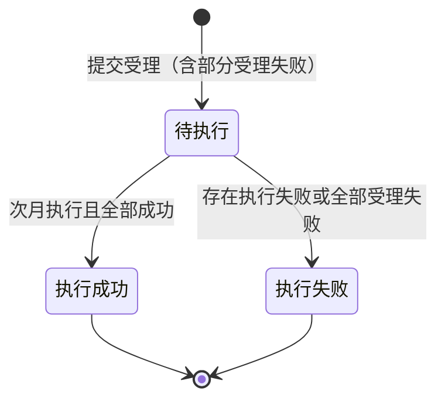

# 一、需求说明

在「服务设备」下新增二级菜单「**停机保号**」，支持按**客户**批量上传 ICCID 发起停机保号。与「卡片注销」类似，以**批次**为单位管理，但**不需要万利管理员审核**。

## 1.1 计费与生效

| 时点 | 规则 |
| --- | --- |
| **申请当月** | 卡片仍可使用当前套餐；当月套餐等费用**正常计算**。 |
| **次月 1 日 0 点起** | 停机保号**生效**：ICCID 状态更新为 **`retention`**；关联**套餐失效**；自次月起账单**仅收取「停机保号」费用**（金额来源套餐/报价配置，与账单模块衔接不在本文展开）。 |

当月提交、次月执行，与卡片注销「当月操作、次月执行」节奏一致。

## 1.2 操作主体与一年限制

| 操作方 | 审核 | 一年限制 |
| --- | --- | --- |
| **客户 / 客户管理员** | 不需要 | **有**：见 1.3 |
| **万利管理员** | 不需要 | **无** |

## 1.3 客户侧一年限制（精确口径）

- **首次**停机保号：自该卡 **激活时间**起满 **1 个自然年**（按平台激活日 0 点计）才允许申请。
- 若该卡曾**成功生效**停机保号后**复机**，再次申请停机保号：自**上一次成功生效的停机保号执行日**起满 **1 年**才允许（不再按激活时间）。
- 不满足条件的 ICCID 在受理时**明细失败**（受理失败），可同批其他卡仍待执行；批次汇总规则见第四章。
- 万利管理员操作**不受**上述限制。

## 1.4 留痕

- **停机保号主列表**（批次维度）
- **停机保号操作日志**（ICCID 维度，弹窗）
- **服务设备 → 设备管理 → 设备详情 → 操作日志**（单卡，与现有六列格式一致；操作类型含「停机保号」）

---

# 二、功能概述

## 2.1 功能清单

| 功能 | 说明 |
| --- | --- |
| 停机保号主列表 | 批次列表；筛选、明细、下载源文件。 |
| 停机保号 | 客户与万利管理员共用；客户侧隐藏「客户名称」、按登录客户带入。 |
| 停机保号明细 | 批次内每张 ICCID 处理结果与失败原因；导出 Excel。 |
| 停机保号操作日志 | 以 ICCID 为维度；筛选与导出。 |
| 设备详情 - 操作日志 | 单卡展示「停机保号」记录（操作成功 / 操作失败）。 |

## 2.2 状态流转（批次）

---

# 三、停机保号主页面

## 3.1 页面入口

侧边栏「服务设备」→「停机保号」。面包屑：`Dashboard / 服务设备 / 停机保号`。

## 3.2 筛选区

| 筛选项 | 说明 |
| --- | --- |
| 申请人 | 下拉，精确匹配。 |
| 批次号 | 文本，模糊匹配。 |
| 客户名称 | 文本 + datalist；**客户/客户管理员登录时不展示**。 |
| 状态 | 待执行、执行成功、执行失败。 |
| 申请时间 | 日期区间。 |

## 3.3 顶部按钮

| 按钮 | 说明 |
| --- | --- |
| 停机保号 | 打开申请弹窗。 |
| 操作日志 | 打开停机保号操作日志弹窗。 |

**无**审核通过 / 驳回按钮。

## 3.4 列表字段

| 表头 | 说明 |
| --- | --- |
| 批次号 | `RT` + `yyyyMMdd` + 4 位序号。 |
| 申请人 | 提交人。 |
| 客户名称 | 批次客户；客户视角列表可隐藏。 |
| 申请文件 | 源文件名，可下载。 |
| 申请总数 | ICCID 条数。 |
| 成功数 | 明细为「待执行」或「执行成功」条数。 |
| 失败数 | 「受理失败」或「执行失败」条数。 |
| 状态 | 见 4.1。 |
| 失败原因 | 执行失败时批次摘要；否则「--」。 |
| 申请时间 | 提交时间。 |
| 生效时间 | 计划/实际生效（次月 1 日 0 点）；未产生为「--」。 |
| 操作 | 明细。 |

## 3.5 操作列

各批次状态均为 **明细**（不提供模拟次月执行）。

---

# 四、状态与批次结果

## 4.1 批次状态

| 状态 | 含义 |
| --- | --- |
| 待执行 | 至少一张卡受理为待执行，且无执行期失败；等待次月 1 日执行。 |
| 执行成功 | 执行后全部为「执行成功」。 |
| 执行失败 | 全部受理失败，或存在任意执行失败 / 部分失败。 |

## 4.2 单卡处理结果（明细）

与批次状态**共用枚举名**：**待执行**、**执行成功**、**执行失败**，另加受理阶段 **受理失败**（一年限制等，不进入待执行）。

| 处理结果 | 含义 |
| --- | --- |
| 受理失败 | 提交时校验不通过（如未满一年）；不进入次月执行。 |
| 待执行 | 已受理，等待次月 1 日生效。 |
| 执行成功 | 已生效，状态 `retention`，套餐失效。 |
| 执行失败 | 执行日失败（如接口异常）。 |

---

# 五、弹窗说明

## 5.1 停机保号申请

| 字段 | 说明 |
| --- | --- |
| 客户名称 | 万利管理员必选下拉；客户登录**不展示**，按账号所属客户提交。 |
| 上传文件 | xls / xlsx，≤ 5MB，ICCID 列表。 |

提交后：满足条件的卡进入**待执行**；不满足的明细为**受理失败**并写入失败原因。提示「已受理，次月 1 日生效」或「部分 ICCID 受理失败」。

## 5.2 明细 / 操作日志 / 设备详情日志

- 明细表格：ICCID、处理结果、失败原因（受理失败 / 执行失败时展示）。
- 操作日志弹窗：字段与卡片注销操作日志对齐（ICCID、批次号、申请人、客户名称、**状态**五态、失败原因、申请时间、生效时间等）。
- **设备详情 → 操作日志**：表头为操作 ID、操作内容、操作人、操作时间、操作类型、操作结果；**停机保号**仅在终态写入，操作结果为 **操作成功** / **操作失败**（与现有非注销类日志一致）。

---

# 六、示例

**示例 1**：客户提交 2 张卡，1 张未满一年 → 批次**待执行**，成功数 1、失败数 1，失败明细「自激活起未满一年」。

**示例 2**：管理员提交 → 无一年限制，批次**待执行**，生效时间次月 1 日。

**示例 3**：次月执行后全部成功 → 批次**执行成功**，ICCID 状态 `retention`，设备操作日志「操作成功」。

---

文档版本：与原型 `index.html` / `js/app.js` 中 `retention` 模块对齐。
