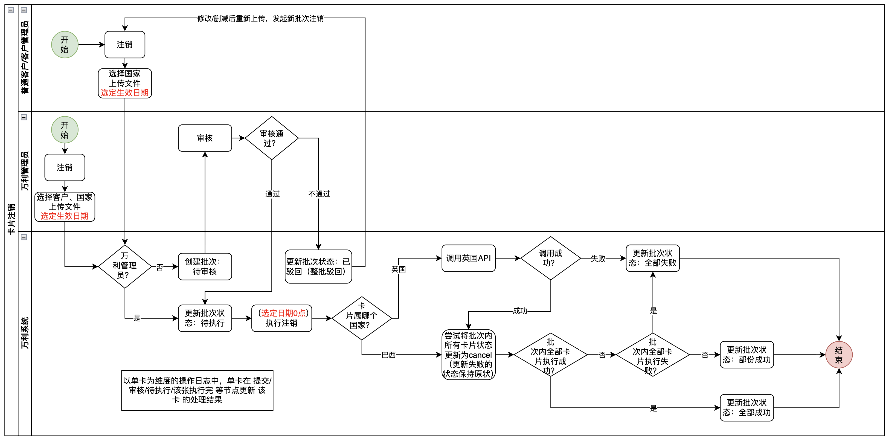
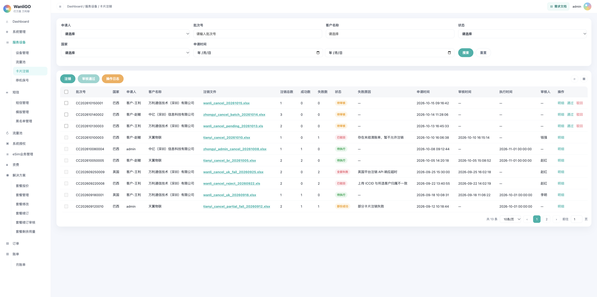
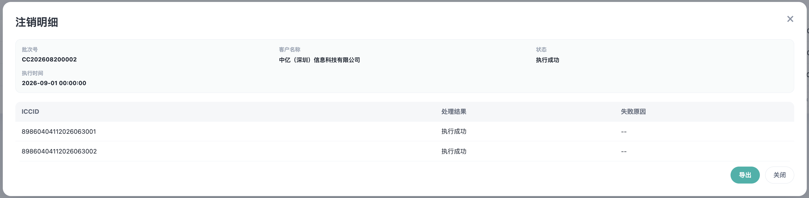
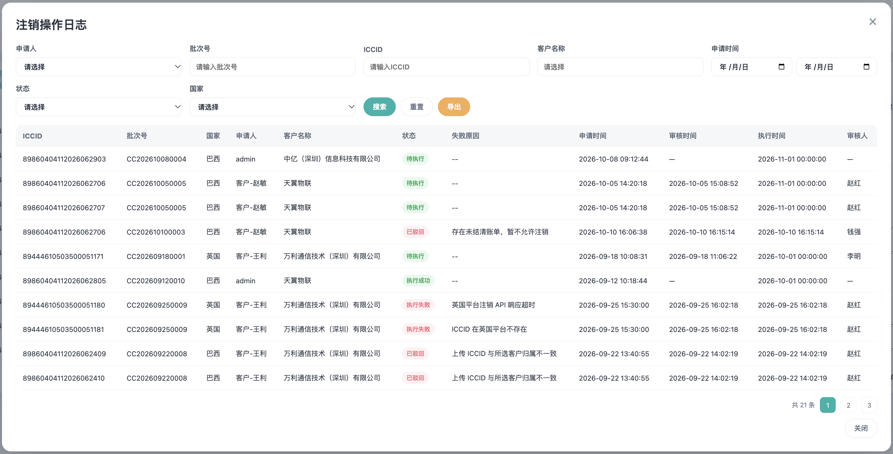
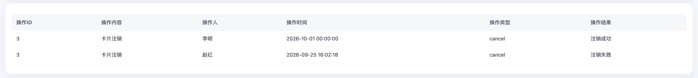

# 卡片注销需求文档

# 零、修改记录

| 版本                                     | 更新日期                                                     | 修改说明                                                     |
| ---------------------------------------- | ------------------------------------------------------------ | ------------------------------------------------------------ |
| V1.1                                     | 2026-10-23         | 1. 批次终态改为「全部成功 / 部份成功 / 全部失败」；操作日志状态同步。 2. 主列表、注销弹窗、操作日志新增「国家」（英国 / 巴西）；上传文件须全部 ICCID 属于所选国家。 |
| V1.2 | 2026-10-28 | 1. 注销弹窗在国家之后增加「注销生效时间」，只能选申请当天之后的日期，不含当天，不受合约到期日限制。 2. 注销生效日仍在该卡合约期内时，生效日所在月产生的费用在次月月结时仍需收取；在合约期之后生效注销的，则无影响。 3. 同一张卡与停机保号冲突时，先到达执行日的操作生效，后到的失败；同一自然日先注销。 |

# 一、需求说明

在「服务设备」下新增二级菜单「卡片注销」，支持按**客户**批量上传 ICCID 发起注销。注销对象为一批卡片，不是单卡菜单入口。

业务规则摘要：

- **客户**提交注销：须**管理员审核**；审核通过后进入待执行，于所选**注销生效时间**当日 0 点执行注销；执行成功后 ICCID 状态为 `cancel`，关联套餐失效，卡片永久报废不可再用。客户仅能针对当前登陆帐号下所拥有的卡片进行注销，也只能查看自己的操作记录。
- **万利管理员**提交注销：**无需审核**，受理后按所选**注销生效时间**当日 0 点执行。
- 注销范围：针对某一客户下上传文件中的 ICCID 列表（xls / xlsx）。每个批次须选择**国家**（英国 / 巴西）；文件内全部 ICCID 须属于所选国家。
- 英国卡与巴西卡受理后均进入「待执行」，所选生效日 0 点前仍可用；所选注销生效时间当日 0 点定时执行时按国别分流（8944 调英国 API 后再置 `cancel`，8955 直接置 `cancel`），批次终态为 **全部成功**、**部份成功** 或 **全部失败**。
- 注销过程须留痕：**批次列表**、**注销操作日志**（单卡维度）、**设备详情 - 操作日志**。

未在本 PRD 写明的通用能力（分页、刷新、表格密度等）与平台其他列表页保持一致。

# 二、功能概述

## 2.1 功能清单

| 功能 | 说明 |
| --- | --- |
| 卡片注销主列表 | 按批次展示注销申请/执行结果。支持筛选、审核、明细、下载源文件。 |
| 注销 | 客户与万利管理员共用同一按钮；根据登录身份决定是否走审核。弹窗在「国家」之后选择注销生效时间。 |
| 审核通过 / 驳回 | 仅对「待审核」批次；支持行内与批量勾选通过。 |
| 注销明细 | 批次内每张 ICCID 的处理结果与失败原因；支持导出 Excel。 |
| 注销操作日志 | 以 **ICCID** 为维度查看历史；支持筛选与导出。 |
| 设备详情 - 操作日志 | 单卡维度展示含「卡片注销」在内的操作记录。 |

## 2.2 业务流程图

客户提交走待审核，管理员免审直接待执行；执行日为所选注销生效时间当日 0 点，在系统侧按英国 / 巴西分支调用 API 与置 `cancel`，最后汇总为全部成功、部份成功或全部失败

## 2.3 状态流转

# 三、卡片注销主页面

## 3.1 页面入口

侧边栏一级菜单「服务设备」→ 二级菜单「卡片注销」。

顶部面包屑：`Dashboard / 服务设备 / 卡片注销`。

## 3.2 筛选区

| 筛选项 | 说明 |
| --- | --- |
| 申请人 | 下拉，精确匹配批次申请人。 |
| 批次号 | 文本，模糊匹配。 |
| 客户名称 | 文本 +  datalist，模糊匹配。（当登陆帐号为普通客户/客户管理员时，不展示此下拉框） |
| 状态 | 下拉：待审核、已驳回、待执行、全部成功、部份成功、全部失败。 |
| 国家 | 下拉：英国、巴西。精确匹配批次「国家」。 |
| 申请时间 | 日期区间，按批次「申请时间」过滤。 |

提供「搜索」「重置」。

## 3.3 顶部按钮

| 按钮 | 说明 |
| --- | --- |
| 注销 | 打开注销弹窗。客户与万利管理员共用。 |
| 审核通过 | 勾选一条或多条「待审核」批次后可用，批量通过。 |
| 操作日志 | 打开「注销操作日志」弹窗。 |

## 3.4 列表字段

| 表头字段 | 说明 |
| --- | --- |
| 勾选 | 仅「待审核」可选，用于批量审核通过。 |
| 批次号 | 系统生成的批次号。 |
| 国家 | 本批次所选国家：英国、巴西。 |
| 申请人 | 提交注销的操作人（客户账号或万利管理员）。 |
| 客户名称 | 本批次所选客户。（当登陆帐号为普通客户/客户管理员时，不展示此列） |
| 注销文件 | 上传的源文件名；**可点击下载**（样式为可下载链接/按钮）。 |
| 注销总数 | 本批次 ICCID 条数。 |
| 成功数 | 处理成功的条数。 |
| 失败数 | 明细中「处理结果 = 执行失败」或「已驳回」的条数。 |
| 状态 | 批次状态：待审核、已驳回、待执行、全部成功、部份成功、全部失败。 |
| 失败原因 | 「已驳回」展示驳回原因；「全部失败」「部份成功」展示批次失败摘要；其余为「--」。 |
| 申请时间 | 提交时间。 |
| 审核时间 | 审核通过或驳回时间；免审批次为「--」。 |
| 执行时间 | 所选注销生效时间当日 0 点；未到该时刻时展示计划值，未产生时为「--」。 |
| 审核人 | 万利审核人；免审为「--」。 |
| 操作 | 按批次状态展示操作按钮（见下节操作列）。 |

## 3.5 操作列

| 批次状态 | 操作 |
| --- | --- |
| 待审核 | 明细、通过、驳回 |
| 待执行 | 明细 |
| 已驳回 / 待执行 / 全部成功 / 部份成功 / 全部失败 | 明细 |

## 3.6 注销弹窗

| 字段 / 操作 | 说明 |
| --- | --- |
| 客户名称 | 必选，下拉。（当登陆帐号为普通客户/客户管理员时，**不**展示此下拉框。） |
| 国家 | 必选，下拉：英国、巴西。 |
| 注销生效时间 | 必选日期。只能选择申请当天之后的日期，不含当天；不受合约到期日限制可选范围。同一批次共用该日期，执行时刻为所选日 0 点。 |
| 上传文件 | 必填，xls / xlsx，≤ 5MB；列为 ICCID 列表。提交前校验：文件内**全部** ICCID 须属于所选国家（英国：`8944` 开头；巴西：`8955` 开头）；存在不属于所选国家的 ICCID 时拦截，不创建批次。 |
| 提交 | 客户：提示已提交待审核；管理员：提示已受理，并将于所选日期执行。 |

## 3.7 驳回弹窗

| 字段 | 说明 |
| --- | --- |
| 驳回原因 | 必填，最长 100 字。 |

驳回后批次「已驳回」，明细处理结果均为「已驳回」，失败原因为驳回原因；成功数 / 失败数按明细更新。

## 3.8 注销明细

| 字段 | 说明 |
| --- | --- |
| ICCID | — |
| 处理结果 | 待审核 / 已驳回 / 待执行 / 执行成功 / 执行失败 |
| 失败原因 | **仅当处理结果为「执行失败」或「已驳回」** 时展示具体原因；否则为 `--` |

底部：**导出**（Excel，三列：ICCID、注销结果、失败原因）、**关闭**。

## 3.9 注销操作日志弹窗

以 **单张 ICCID** 为一行（同一批次多条 ICCID 多行）。

**筛选：**

| 筛选项 | 说明 |
| --- | --- |
| 申请人 | 下拉 |
| 批次号 | 文本 |
| ICCID | 文本 |
| 客户名称 | 文本 + datalist |
| 申请时间 | 日期区间 |
| 状态 | 下拉：待审核、已驳回、待执行、全部成功、部份成功、全部失败 |
| 国家 | 下拉：英国、巴西 |

**表格字段：**

| 字段 | 说明 |
| --- | --- |
| ICCID | — |
| 批次号 | — |
| 国家 | 该卡所属国家：英国、巴西（与批次「国家」一致） |
| 申请人 | — |
| 客户名称 | — |
| 状态 | 与主列表批次状态一致：待审核、已驳回、待执行、全部成功、部份成功、全部失败。单卡行：成功为「全部成功」，失败为「全部失败」；筛「部份成功」时展示该批次下各卡行。 |
| 失败原因 | 状态为「全部失败」或「已驳回」时展示原因；否则为 `--` |
| 申请时间 | 批次申请时间 |
| 审核时间 | 批次审核时间 |
| 执行时间 | 所选注销生效时间当日 0 点 |
| 审核人 | 批次审核人 |

# 四、状态、受理与执行（含英/巴差异）

## 4.1 受理（客户 / 管理员与校验）

| 提交方 | 审核 | 受理后批次状态 |
| --- | --- | --- |
| 客户 | 需要 | 待审核 →（通过）→ 待执行 |
| 万利管理员 | 不需要 | 直接待执行 |

客户与管理员使用同一「注销」按钮与同一上传弹窗；系统根据当前登录身份区分是否审核。

客户 / 客户管理员上传后系统创建批次「待审核」；万利管理员审核通过，或管理员免审提交，则批次与明细均为「待执行」。此阶段对英/巴卡做校验（归属、是否允许注销、ICCID 格式等），并校验文件内全部 ICCID 属于弹窗所选「国家」，**不**调用英国注销 API；万利侧 ICCID **非** `cancel`，在所选注销生效日 0 点之前仍可使用、参与计费。

| 卡类型 | 识别规则 | 受理阶段处理 |
| --- | --- | --- |
| 英国卡 | ICCID 以 `8944` 开头 | 校验通过 → 明细「待执行」。 |
| 巴西卡 | ICCID 以 `8955` 开头 | 校验通过 → 明细「待执行」。 |

一个批次只对应一个「国家」；与所选国家不一致的 ICCID 在上传阶段即拦截，不进入待审核 / 待执行。

管理员免审：跳过「待审核」，直接更新批次与明细为「待执行」。

审核不通过：批次「已驳回」（**整批驳回**，不支持单卡驳回）；本批次内明细均为「已驳回」。客户可修改 / 删减后重新上传，须**发起新批次**注销（非原批次续跑）。

## 4.2 执行日（所选注销生效时间当日 0 点，定时任务）

所选**注销生效时间**当日 0 点对明细「待执行」的 ICCID 执行注销；先按国别分流（8944 英国 / 8955 巴西）。

注销生效时间在提交时选择：只能选申请当天之后的日期，不含当天；不按合约到期日限制可选范围。同一批次共用该日期。审核通过前不改该日期。

| 卡类型 | 执行顺序（与 `卡片注销.drawio` 一致） |
| --- | --- |
| 英国卡 `8944` | ① 调用英国注销 API；②「调用成功？」为是 → 进入置 `cancel` 步骤；为否 → 该卡记失败。③ API 成功后与其他卡一并尝试将 ICCID 置为 `cancel`（关联套餐失效），成功则明细「执行成功」。 |
| 巴西卡 `8955` | 不调用英国 API，直接进入「尝试将（该）卡状态更新为 `cancel`」；成功则明细「执行成功」，失败则保持原状态并记「执行失败」。 |

执行日对批次内卡片**逐张**尝试更新为 `cancel`；**更新失败的卡保持原状态**。**失败不重试**。

执行完成后刷新批次「成功数 / 失败数」（失败数 = 明细中「执行失败」或「已驳回」条数，与主列表字段一致）。

**批次终态（由全部明细汇总）：**

- 当批次内**全部**卡片被驳回（仅允许整批驳回）→ 批次状态为 **已驳回**。
- 当批次内**全部**卡片成功注销（明细均为「执行成功」）→ 批次状态为 **全部成功**。
- 当批次内同时存在「执行成功」与「执行失败」明细 → 批次状态为 **部份成功**。
- 当批次内**全部**卡片注销失败（明细均为「执行失败」）→ 批次状态为 **全部失败**。

## 4.3 计费与注销后卡状态

自提交/审核受理起至所选注销生效日 0 点前，卡片仍可使用、参与计费。

执行成功后，ICCID **状态 = `cancel`**，关联套餐失效，**永久报废，不可再使用**。

「当月」指该 ICCID 注销生效日所在月，按卡判断，不按批次统一。

注销生效日仍在该卡合约期内时，生效日所在月产生的费用在次月月结时仍需收取；

所选生效日已晚于该卡合约到期：则无影响，沿用合约到期后的既有计费规则。

生效日所在月之后的账单中，已是 `cancel` 的卡不再收取注销之后的费用。

## 4.4 批次与明细状态枚举

主列表「状态」为批次六态；明细「处理结果」为单卡五态。左列为批次维度，右列为单卡维度（「部份成功」仅批次有，单卡无对应态）。

| 批次状态（列表） | 含义 | 处理结果（明细） | 含义（单卡） |
| --- | --- | --- | --- |
| 待审核 | 客户已提交，等待万利管理员审核。 | 待审核 | 批次已提交、尚未审核通过；该卡尚未进入执行链路。 |
| 已驳回 | 审核驳回，不进入执行。整批驳回。 | 已驳回 | 与本批次整批驳回一致；不进入执行。 |
| 待执行 | 已受理，等待所选注销生效时间当日 0 点执行；明细均为待执行。 | 待执行 | 已审核通过或管理员免审受理，等待所选注销生效时间当日 0 点执行。 |
| 全部成功 | 执行完成后，**全部** ICCID 注销成功。 | 执行成功 | 已执行注销，ICCID 已变为 `cancel`。 |
| 部份成功 | 执行完成后，同批次内同时存在成功与失败明细。 | — | 无单卡对应态；成功卡为「执行成功」，失败卡为「执行失败」。 |
| 全部失败 | 执行完成后，**全部** ICCID 注销失败（含英国 API 失败、置 `cancel` 失败）。 | 执行失败 | 所选注销生效日执行阶段失败（非驳回）；展示具体失败原因。 |

## 4.5 注销操作日志（单卡维度）

| 能力 | 规则 |
| --- | --- |
| **注销操作日志**（弹窗，按 ICCID） | 单卡「状态 / 处理结果」在 **提交、审核（通过 / 驳回）、进入待执行、该张执行完成** 等节点，**随该卡明细更新**；不随批次状态一次性刷全部单卡行。 |

## 4.6 与停机保号（该需求还没确定，预留）

同一张卡上，注销与停机保号谁先到达执行日，谁先生效；后到的操作失败。

- 注销生效日早于该卡停机保号的次月 1 日：先注销。停机保号执行日该卡已是 `cancel`，该卡停机保号记执行失败。
- 注销生效日晚于该卡停机保号的次月 1 日：先停机保号成功，并开始收取停机保号费；到达注销生效日后再注销。注销成功后不再收取停机保号费。
- 同一自然日：先注销，该卡停机保号记执行失败。

停机保号自身仍按次月 1 日 0 点执行，一年限制与套餐报价中的停机保号费用字段不因注销生效日改变。

# 五、其他规则

## 5.1 批次号

格式：`CC` + `yyyyMMdd` + 4 位序号（示例：`CC202610150001`）（仅供参考，以实际实现为主）。

## 5.2 操作日志（设备详情）

「服务设备 - 设备管理 - ICCID」→ **操作日志** 页签。

**表头字段（从左至右）：**操作 ID、操作内容、操作人、操作时间、操作类型、操作结果。

**卡片注销写入规则：**

- 仅当该 ICCID **注销终态**为成功或失败时写入一条记录；**不**在提交、待审核、审核通过、待执行等中间节点写入。
- 操作类型为「卡片注销」时，**操作结果**仅允许 **注销成功**、**注销失败**（与明细「执行成功」「执行失败」对应；驳回、待执行等不在此页展示）。

## 5.3 权限

| 角色 | 注销 | 审核 | 查看列表/日志（数据隔离） |
| --- | --- | --- | --- |
| 客户 / 客户管理员 | 可（本客户） | 否 | 可（仅限本客户相关批次） |
| 万利管理员 | 可（免审） | 可 | 可 |

具体数据权限与现有 WanliGO 客户隔离规则一致。

# 六、示例

**示例 1：客户单卡待审核**

- 批次 `CC202610150001`，申请人「客户-王利」，1 张巴西卡，状态 **待审核**，成功数 0、失败数 0，执行时间「—」。

**示例 2：英国卡待执行**

- 审核通过后批次 **待执行**，**尚未**调用英国 API；执行时间展示所选注销生效日，例如 `2026-10-15 00:00:00`，成功数 0、失败数 0。

**示例 3：全部成功**

- 到达所选生效日后 2 张巴西卡均为「执行成功」，批次 **全部成功**，ICCID 状态 `cancel`。

**示例 4：全部失败**

- 所选生效日执行时，2 张英国卡「调用英国 API」均失败，明细「执行失败」，批次 **全部失败**，失败数 2。

**示例 5：部份成功**

- 1 张执行成功、1 张执行失败，批次 **部份成功**，失败原因「部分卡片注销失败」。

**示例 6：已驳回**

- 驳回原因「存在未结清账单，暂不允许注销」，状态 **已驳回**，明细处理结果「已驳回」，失败原因同驳回文案。

**示例 7：部份成功**（对齐流程图「全部成功？」= 否）

- 到达所选生效日后 3 张卡中 2 张置 `cancel` 成功、1 张失败；2 张明细「执行成功」、1 张「执行失败」，批次 **部份成功**，失败原因可展示「部分卡片注销失败」。
