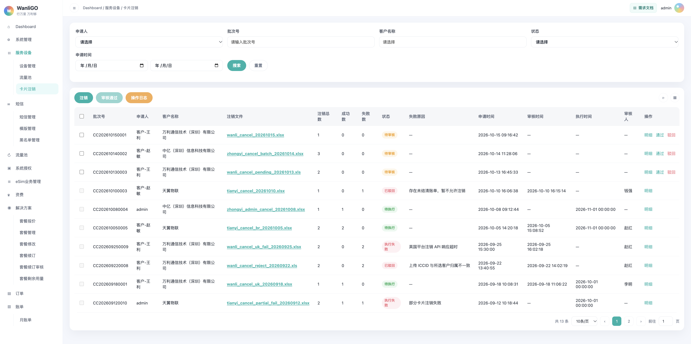
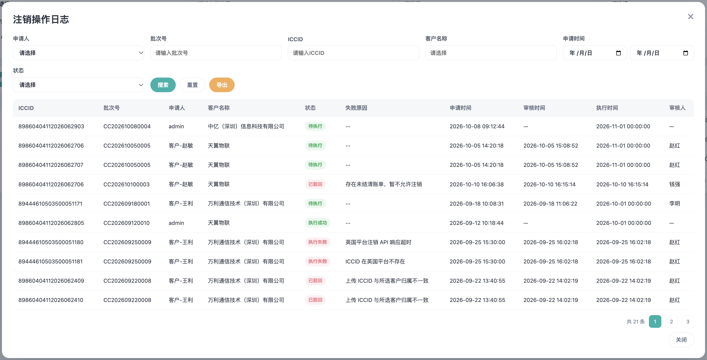

# 一、需求说明

在「服务设备」下新增二级菜单「卡片注销」，支持按**客户**批量上传 ICCID 发起注销。注销对象为一批卡片，不是单卡菜单入口。

业务规则摘要：

- **客户**提交注销：须**管理员审核**；审核通过后进入待执行，**次月 1 日 0 点**执行注销；执行成功后 ICCID 状态为 `cancel`，关联套餐失效，卡片永久报废不可再用。客户仅能针对当前登陆帐号下所拥有的卡片进行注销，也只能查看自己的操作记录。
- **万利管理员**提交注销：**无需审核**，受理后同样按**次月 1 日**执行（与当月操作、次月执行的规则一致）。
- 注销范围：针对某一客户下上传文件中的 ICCID 列表（xls / xlsx）。
- 英国卡与巴西卡在审核通过后的系统处理路径不同（见第五章）。
- 注销过程须留痕：**批次列表**、**注销操作日志**（单卡维度）、**设备详情 - 操作日志**。

未在本 PRD 写明的通用能力（分页、刷新、表格密度等）与平台其他列表页保持一致。

# 二、功能概述

## 2.1 功能清单

| 功能 | 说明 |
| --- | --- |
| 卡片注销主列表 | 按批次展示注销申请/执行结果。支持筛选、审核、明细、下载源文件。 |
| 注销 | 客户与万利管理员共用同一按钮；根据登录身份决定是否走审核。 |
| 审核通过 / 驳回 | 仅对「待审核」批次；支持行内与批量勾选通过。 |
| 注销明细 | 批次内每张 ICCID 的处理结果与失败原因；支持导出 Excel。 |
| 注销操作日志 | 以 **ICCID** 为维度查看历史；支持筛选与导出。 |
| 设备详情 - 操作日志 | 单卡维度展示含「卡片注销」在内的操作记录。 |

## 2.2 状态流转

# 三、卡片注销主页面

## 3.1 页面入口

侧边栏一级菜单「服务设备」→ 二级菜单「卡片注销」。

顶部面包屑：`Dashboard / 服务设备 / 卡片注销`。

## 3.2 筛选区

| 筛选项 | 说明 |
| --- | --- |
| 申请人 | 下拉，精确匹配批次申请人。 |
| 批次号 | 文本，模糊匹配。 |
| 客户名称 | 文本 +  datalist，模糊匹配。（当登陆帐号为普通客户/客户管理员时，不展示此下拉框） |
| 状态 | 下拉：待审核、已驳回、待执行、执行成功、执行失败。 |
| 申请时间 | 日期区间，按批次「申请时间」过滤。 |

提供「搜索」「重置」。

## 3.3 顶部按钮

| 按钮 | 说明 |
| --- | --- |
| 注销 | 打开注销弹窗。客户与万利管理员共用。 |
| 审核通过 | 勾选一条或多条「待审核」批次后可用，批量通过。 |
| 操作日志 | 打开「注销操作日志」弹窗。 |

## 3.4 列表字段

| 表头字段 | 说明 |
| --- | --- |
| 勾选 | 仅「待审核」可选，用于批量审核通过。 |
| 批次号 | 系统生成，规则见 7.1。 |
| 申请人 | 提交注销的操作人（客户账号或万利管理员）。 |
| 客户名称 | 本批次所选客户。（当登陆帐号为普通客户/客户管理员时，不展示此列） |
| 注销文件 | 上传的源文件名；**可点击下载**（样式为可下载链接/按钮）。 |
| 注销总数 | 本批次 ICCID 条数。 |
| 成功数 | 处理成功的条数。 |
| 失败数 | 明细中「处理结果 = 执行失败」或「已驳回」的条数。 |
| 状态 | 批次状态，枚举见 4.1。 |
| 失败原因 | 「已驳回」展示驳回原因；「执行失败」展示批次失败摘要；其余为「--」。 |
| 申请时间 | 提交时间。 |
| 审核时间 | 审核通过或驳回时间；免审批次为「--」。 |
| 执行时间 | 计划或实际执行时间（次月 1 日 0 点等）；未产生时为「--」。 |
| 审核人 | 万利审核人；免审为「--」。 |
| 操作 | 见 3.5。 |

## 3.5 操作列

| 批次状态 | 操作 |
| --- | --- |
| 待审核 | 明细、通过、驳回 |
| 待执行 | 明细（次月 1 日由定时任务执行，本页不提供手动触发） |
| 已驳回 / 待执行 / 执行成功 / 执行失败 | 明细 |

# 四、状态与批次结果

## 4.1 批次状态（列表「状态」）

| 状态 | 含义 |
| --- | --- |
| 待审核 | 客户已提交，等待万利管理员审核。 |
| 已驳回 | 审核驳回，不进入执行。整批驳回。 |
| 待执行 | 已受理（审核通过或管理员免审），等待次月 1 日执行；明细均为待执行。 |
| 执行成功 | 执行完成后，**全部** ICCID 注销成功。 |
| 执行失败 | 存在**任意** ICCID 注销失败（含审核后 API 失败、执行期失败、部分成功部分失败）。失败不重试。 |

**汇总规则：**

- 当批次内**全部**卡片被驳回（仅允许整批驳回）→ 批次状态为 **已驳回**。
- 当批次内**全部**卡片成功注销（明细均为「执行成功」）→ 批次状态为 **执行成功**。
- 当存在**任意**注销失败的卡片（明细「处理结果 = 执行失败」）→ 批次状态为 **执行失败**（允许与「执行成功」明细并存，即部分失败）。

## 4.2 单卡处理结果（明细「处理结果」）

明细「处理结果」与 **4.1 批次状态共用同一套五个枚举值**，表示单卡在本批次中的阶段或结果；批次状态由全部明细按 4.1 汇总得出。

| 处理结果 | 含义（单卡） |
| --- | --- |
| 待审核 | 批次已提交、尚未审核通过；该卡尚未进入执行链路。 |
| 已驳回 | 批次审核驳回（整批驳回时本批次内各卡均为该状态）；不进入执行。 |
| 待执行 | 已审核通过或管理员免审受理，等待次月 1 日执行。 |
| 执行成功 | 已执行注销，ICCID 已变为 `cancel`。 |
| 执行失败 | 审核通过后英国 API 失败、执行日失败等（非驳回）；展示具体失败原因。 |

## 4.3 执行生效与计费

- 注销当月仍可使用、参与计费等。
- **当月**提交/审核，**次月 1 日**执行注销；执行成功后状态为 `cancel`，关联套餐失效。
- 次月开始生成账单时，cancel 卡不在收取任何费用。

## 4.4 注销后卡状态

执行成功的 ICCID：**状态 = `cancel`**，永久报废，不可再使用。

# 五、注销受理与英/巴差异

## 5.1 客户 vs 万利管理员

| 提交方 | 审核 | 受理后批次状态 |
| --- | --- | --- |
| 客户 | 需要 | 待审核 →（通过）→ 待执行 |
| 万利管理员 | 不需要 | 直接待执行 |

客户与管理员使用同一「注销」按钮与同一上传弹窗；系统根据当前登录身份区分是否审核。

## 5.2 审核通过后（进入待执行前）

| 卡类型 | 识别规则 | 处理 |
| --- | --- | --- |
| 英国卡 | ICCID 以 `8944` 开头 | 调用英国注销 API；同步英国平台卡状态；确认成功后，在万利侧将对应卡置为待执行（次月再切 `cancel`）。 |
| 巴西卡 | ICCID 以 `8955` 开头 | 审核通过后直接进入待执行，不调用英国 API。 |

管理员免审提交时，按同样规则区分英国 / 巴西，只是跳过「待审核」。

## 5.3 执行日（次月 1 日）

对 待执行 明细执行注销：成功的 ICCID 更新为 `cancel`，明细「处理结果」改为「执行成功」，并刷新批次状态（执行成功 / 执行失败）。

# 六、弹窗说明

## 6.1 注销

| 字段 / 操作 | 说明 |
| --- | --- |
| 客户名称 | 必选，下拉。（当登陆帐号为普通客户/客户管理员时，**不**展示此下拉框。） |
| 上传文件 | 必填，xls / xlsx，≤ 5MB；列为 ICCID 列表。 |
| 提交 | 客户：提示已提交待审核；管理员：提示已受理、次月执行。 |

## 6.2 驳回

| 字段 | 说明 |
| --- | --- |
| 驳回原因 | 必填，最长 100 字。 |

驳回后批次「已驳回」，明细处理结果均为「已驳回」，失败原因为驳回原因；成功数 / 失败数按明细更新。

## 6.3 注销明细

| 字段 | 说明 |
| --- | --- |
| ICCID | — |
| 处理结果 | 待审核 / 已驳回 / 待执行 / 执行成功 / 执行失败（与 4.1 一致） |
| 失败原因 | **仅当处理结果为「执行失败」或「已驳回」** 时展示具体原因；否则为 `--` |

底部：**导出**（Excel，三列：ICCID、注销结果、失败原因）、**关闭**。

## 6.4 注销操作日志

以 **单张 ICCID** 为一行（同一批次多条 ICCID 多行）。

**筛选：**

| 筛选项 | 说明 |
| --- | --- |
| 申请人 | 下拉 |
| 批次号 | 文本 |
| ICCID | 文本 |
| 客户名称 | 文本 + datalist |
| 申请时间 | 日期区间 |
| 状态 | 下拉，与主列表「状态」及明细「处理结果」一致：待审核、已驳回、待执行、执行成功、执行失败 |

**表格字段：**

| 字段 | 说明 |
| --- | --- |
| ICCID | — |
| 批次号 | — |
| 申请人 | — |
| 客户名称 | — |
| 状态 | 单卡在该批次中的状态，枚举与 **4.1 / 4.2** 相同（与主列表「状态」、注销明细「处理结果」一致） |
| 失败原因 | 状态为「执行失败」或「已驳回」时展示原因；否则为 `--` |
| 申请时间 | 批次申请时间 |
| 审核时间 | 批次审核时间 |
| 执行时间 | 单卡执行或计划执行时间 |
| 审核人 | 批次审核人 |

# 七、其他规则

## 7.1 批次号

格式：`CC` + `yyyyMMdd` + 4 位序号（示例：`CC202610150001`）（仅供参考，以实际实现为主）。

## 7.2 操作日志（设备详情）

「服务设备 - 设备管理 - ICCID」→ **操作日志** 页签。

**表头字段（从左至右）：**操作 ID、操作内容、操作人、操作时间、操作类型、操作结果。

**卡片注销写入规则：**

- 仅当该 ICCID **注销终态**为成功或失败时写入一条记录；**不**在提交、待审核、审核通过、待执行等中间节点写入。
- 操作类型为「卡片注销」时，**操作结果**仅允许 **注销成功**、**注销失败**（与批次/明细五态中的「执行成功」「执行失败」对应；驳回、待执行等不在此页展示）。

## 7.3 权限（建议）

| 角色 | 注销 | 审核 | 查看列表/日志（数据隔离） |
| --- | --- | --- | --- |
| 客户 | 可（本客户） | 否 | 可（仅限本客户相关批次） |
| 万利管理员 | 可（免审） | 可 | 可 |

具体数据权限与现有 WanliGO 客户隔离规则一致。

# 八、示例

**示例 1：客户单卡待审核**

- 批次 `CC202610150001`，申请人「客户-王利」，1 张巴西卡，状态 **待审核**，成功数 0、失败数 0，执行时间「—」。

**示例 2：英国卡待执行**

- 审核通过后英国 API 已同步，批次状态 **待执行**，执行时间 `2026-10-01 00:00:00`，成功数 1、失败数 0。

**示例 3：执行成功**

- 次月执行后 2 张巴西卡均为「执行成功」，批次 **执行成功**，ICCID 状态 `cancel`。

**示例 4：执行失败**

- 2 张英国卡 API 均失败，批次 **执行失败**，失败数 2，失败原因展示批次摘要或首条失败原因。

**示例 5：部分失败**

- 1 张执行成功、1 张执行失败，批次 **执行失败**（存在失败卡），失败原因「部分卡片注销失败」。

**示例 6：已驳回**

- 驳回原因「存在未结清账单，暂不允许注销」，状态 **已驳回**，明细处理结果「已驳回」，失败原因同驳回文案。
