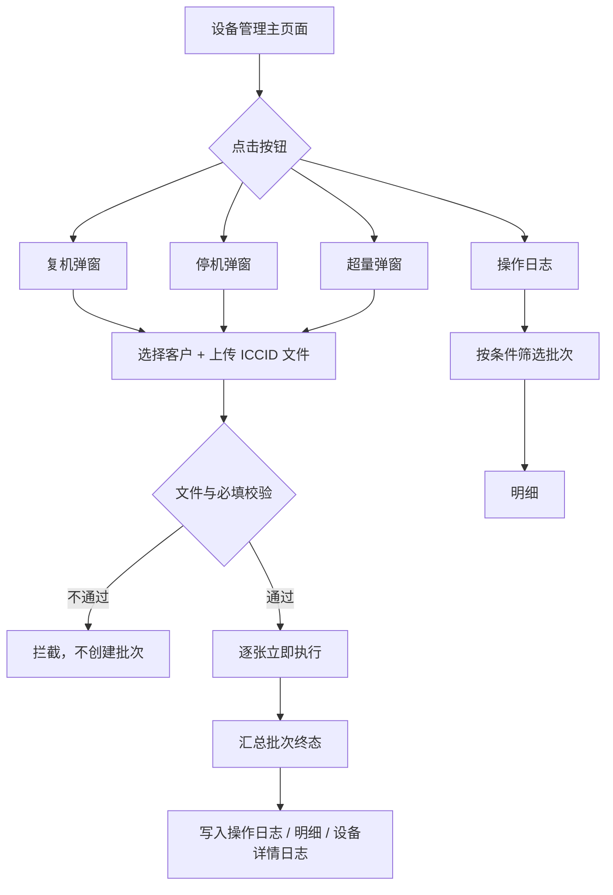
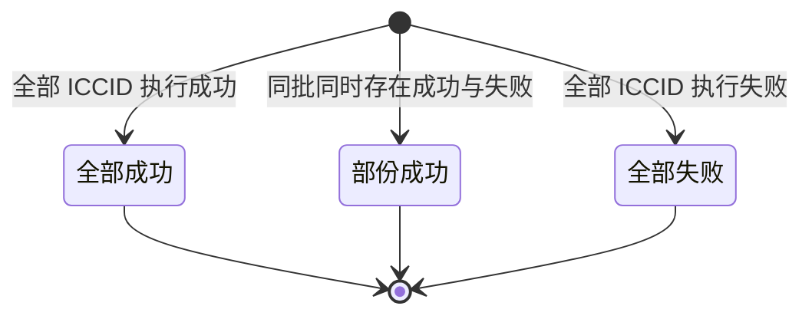

# 复机 / 停机 / 超量需求文档

# 零、修改记录

| 版本 | 更新日期                                             | 修改说明                         |
| ---- | ---------------------------------------------------- | -------------------------------- |
| V1.0 | 2026-10-23 | 新建。覆盖设备管理批量复机、停机、超量及操作日志。 |

# 一、需求说明

在「服务设备 - 设备管理」主页面工具栏提供 **复机**、**停机**、**超量** 三个批量入口。万利管理员按**客户**上传 ICCID 文件（xls / xlsx）发起操作，**无需审核，提交后立即执行、立即生效**。

三类操作共用同一套批次与操作日志，用「类型」区分。操作对象是一批卡片，不是新的二级菜单。

业务规则摘要：

- **仅万利管理员**可操作；客户 / 客户管理员不展示这三个按钮和对应操作日志。
- 每个批次必须选择**客户名称**，文件内 ICCID 须属于该客户；不属于该客户、不存在、或状态不允许的卡记该卡失败，不阻断同批其他卡。
- **复机**：将该卡状态置为 `active`。
- **停机**：将该卡状态置为 `suspend`。
- **超量**：将该卡单卡超量开关置为开启（设备列表展示为「超量(是)」）。与流量池池级超量开关不是同一入口。
- `cancel` 卡永久报废，三类操作均不允许。
- 已达目标状态（已是 `active` 再复机、已是 `suspend` 再停机、超量已开启再开超量）记该卡**执行成功**，不重复改其它字段。
- 批次终态为 **全部成功**、**部份成功** 或 **全部失败**。失败不重试；需改文件后重新上传，发起新批次。
- 留痕：**操作日志**（批次维度）、**操作明细**（ICCID 维度）、**设备详情 - 操作日志**（单卡终态）。

未在本 PRD 写明的通用能力（分页、刷新、表格密度等）与平台其他列表页保持一致。

# 二、功能概述

## 2.1 功能清单

| 功能 | 说明 |
| --- | --- |
| 复机 | 万利管理员选择客户并上传 ICCID，批量复机，立即生效。 |
| 停机 | 万利管理员选择客户并上传 ICCID，批量停机，立即生效。 |
| 超量 | 万利管理员选择客户并上传 ICCID，批量开启单卡超量，立即生效。 |
| 操作日志 | 三个按钮共用；按批次查看历史，支持筛选、下载源文件、打开明细。 |
| 操作明细 | 批次内每张 ICCID 的处理结果与失败原因；支持导出 Excel。 |
| 设备详情 - 操作日志 | 单卡维度写入复机 / 停机 / 超量终态记录。 |

## 2.2 业务流程图

## 2.3 状态流转

提交即执行，无待审核、待执行。

# 三、设备管理主页面

## 3.1 页面入口

侧边栏一级菜单「服务设备」→ 二级菜单「设备管理」。

顶部面包屑：`Dashboard / 服务设备 / 设备管理`。

三个按钮与「操作日志」均在设备管理**主列表**工具栏（未进入某张 ICCID 详情时）。「操作日志」放在「批量解锁」右侧。

## 3.2 顶部按钮

| 按钮 | 说明 |
| --- | --- |
| 复机 | 打开复机弹窗。 |
| 停机 | 打开停机弹窗。 |
| 超量 | 打开超量弹窗。 |
| 操作日志 | 打开三类操作共用的操作日志弹窗。 |

## 3.3 复机 / 停机 / 超量弹窗

三个弹窗字段相同，标题分别为「复机」「停机」「超量」。弹窗内不放说明文案。

| 字段 / 操作 | 说明 |
| --- | --- |
| 客户名称 | 必选，下拉。 |
| 上传文件 | 必填。xls / xlsx，≤ 5MB；文件列为 ICCID 列表。支持拖放或点击浏览。 |
| 确定 | 校验通过后立即执行并关闭弹窗。 |
| 取消 | 关闭，不创建批次。 |

**提交前拦截（不创建批次）：**

| 条件 | 处理 |
| --- | --- |
| 未选客户或未上传文件 | 拦截。 |
| 文件不是 xls / xlsx，或大于 5MB | 拦截。 |
| 文件内解析不到任何有效 ICCID（19～20 位数字） | 拦截。 |

解析到的 ICCID 去重后进入本批次；校验到单卡级的失败写入明细，不在上传阶段整批拦截（`cancel`、不属于该客户、ICCID 不存在等）。

## 3.4 操作日志弹窗

以**批次**为一行。复机、停机、超量共用本弹窗，用「类型」区分。

**筛选：**

| 筛选项 | 说明 |
| --- | --- |
| 操作人 | 下拉，精确匹配。 |
| 批次号 | 文本，模糊匹配。 |
| 客户名称 | 下拉，精确匹配。 |
| 类型 | 下拉：复机、停机、超量。 |
| 操作时间 | 日期选择器，含开始时间、结束时间；按批次「操作时间」过滤。 |
| 状态 | 下拉：全部成功、部份成功、全部失败。 |

提供「搜索」「重置」。搜索按当前条件查询并回到第 1 页；重置清空条件并回到第 1 页。

**表格字段（从左到右）：**

| 表头字段 | 说明 |
| --- | --- |
| 批次号 | 系统生成。 |
| 操作人 | 提交该批次的万利管理员。 |
| 客户名称 | 本批次所选客户。 |
| 文件 | 上传时的源文件名称；**可点击下载**（样式为可下载链接/按钮）。 |
| 类型 | 复机 / 停机 / 超量。 |
| 状态 | 全部成功 / 部份成功 / 全部失败。 |
| 失败原因 | 「全部失败」「部份成功」展示批次失败摘要；「全部成功」为 `--`。 |
| 操作时间 | 提交并执行完成的时间。 |
| 操作 | **明细**。 |

## 3.5 操作明细

顶部批次摘要 + ICCID 明细表。

**摘要：**批次号、客户名称、类型、状态、操作时间。

**表格：**

| 字段 | 说明 |
| --- | --- |
| ICCID | — |
| 处理结果 | 执行成功 / 执行失败 |
| 失败原因 | **仅当处理结果为「执行失败」** 时展示具体原因；否则为 `--` |

底部：**导出**（Excel，三列：ICCID、处理结果、失败原因）、**关闭**。

# 四、状态、受理与执行

## 4.1 受理与立即执行

万利管理员提交后**立即**对批次内每张 ICCID 逐张执行，无审核、无次月定时。

| 类型 | 执行成功后的卡状态 / 开关 | 不允许 |
| --- | --- | --- |
| 复机 | ICCID 状态 = `active`，状态时间更新为操作时间 | `cancel`；ICCID 不存在；不属于所选客户 |
| 停机 | ICCID 状态 = `suspend`，状态时间更新为操作时间 | `cancel`；ICCID 不存在；不属于所选客户 |
| 超量 | 单卡超量开关 = 开启 | `cancel`；ICCID 不存在；不属于所选客户 |

执行失败的卡**保持原状态 / 原超量开关**。失败不重试。

接口或平台更新失败时，该卡明细「执行失败」，并写具体失败原因（如平台接口异常）。

## 4.2 批次终态（由全部明细汇总）

- 全部明细为「执行成功」→ **全部成功**。
- 同批同时存在「执行成功」与「执行失败」→ **部份成功**。
- 全部明细为「执行失败」→ **全部失败**。

批次失败原因：部份成功可展示「部分卡片{类型}失败」或首条明细失败原因；全部失败展示导致失败的原因摘要。

## 4.3 批次与明细状态枚举

主列表（操作日志）「状态」为批次三态；明细「处理结果」为单卡两态。「部份成功」仅批次有。

| 批次状态（操作日志） | 含义 | 处理结果（明细） | 含义（单卡） |
| --- | --- | --- | --- |
| 全部成功 | 本批全部 ICCID 执行成功。 | 执行成功 | 已立即生效：复机为 `active`，停机为 `suspend`，超量为开关开启。 |
| 部份成功 | 同批同时存在成功与失败明细。 | — | 无单卡对应态；成功卡为「执行成功」，失败卡为「执行失败」。 |
| 全部失败 | 本批全部 ICCID 执行失败。 | 执行失败 | 未生效，卡保持原状；展示失败原因。 |

## 4.4 操作日志（批次维度）

| 能力 | 规则 |
| --- | --- |
| **操作日志**（弹窗，按批次） | 提交执行完成后立即写入一行；状态与失败原因按 4.2 汇总，不再随后续其它批次变化。 |
| **操作明细** | 与批次同时生成；每张 ICCID 一行，处理结果在该张执行完成时确定。 |

# 五、其他规则

## 5.1 批次号

格式：`DO` + `yyyyMMdd` + 4 位序号（示例：`DO202610230001`）（仅供参考，以实际实现为主）。

## 5.2 操作日志（设备详情）

「服务设备 - 设备管理 - ICCID」→ **操作日志** 页签。

**表头字段（从左至右）：**操作 ID、操作内容、操作人、操作时间、操作类型、操作结果。

**写入规则：**

- 仅当该 ICCID 本条操作已达终态（执行成功或执行失败）时写入一条记录。本需求提交即终态，无中间节点。
- 操作类型为「复机」「停机」或「超量」。
- 操作结果仅允许 **操作成功**、**操作失败**（与明细「执行成功」「执行失败」对应）。

# 六、示例

**示例 1：全部成功（复机）**

- 批次 `DO202610230001`，操作人 admin，客户「万利通信技术（深圳）有限公司」，类型 **复机**，2 张卡明细均为「执行成功」，批次 **全部成功**，失败原因 `--`，两张卡状态均为 `active`。

**示例 2：部份成功（停机）**

- 文件含 1 张本客户卡、1 张不存在的 ICCID。存在的卡停机成功（状态 `suspend`），另一张明细「执行失败 / ICCID 不存在」，批次 **部份成功**，失败原因「部分卡片停机失败」或「ICCID 不存在」。

**示例 3：全部失败（超量）**

- 文件内 ICCID 均不属于所选客户，明细均为「执行失败 / 卡片不属于该客户」，批次 **全部失败**，卡片超量开关不变。

**示例 4：`cancel` 不可操作**

- 某张卡状态为 `cancel`，三类操作该卡均为「执行失败」，失败原因「卡片已注销，不允许操作」；同批其他合法卡仍可成功，批次按 4.2 汇总。

**示例 5：已是目标状态**

- 卡片已是 `active` 再次复机，或超量已开启再次超量：该卡「执行成功」，状态 / 开关保持不变。
