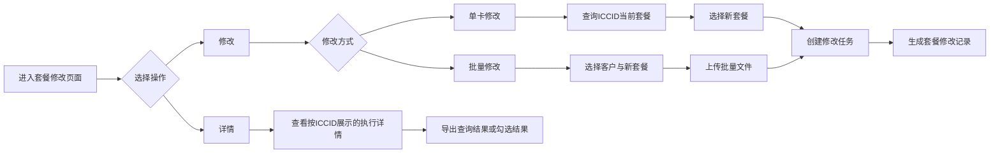
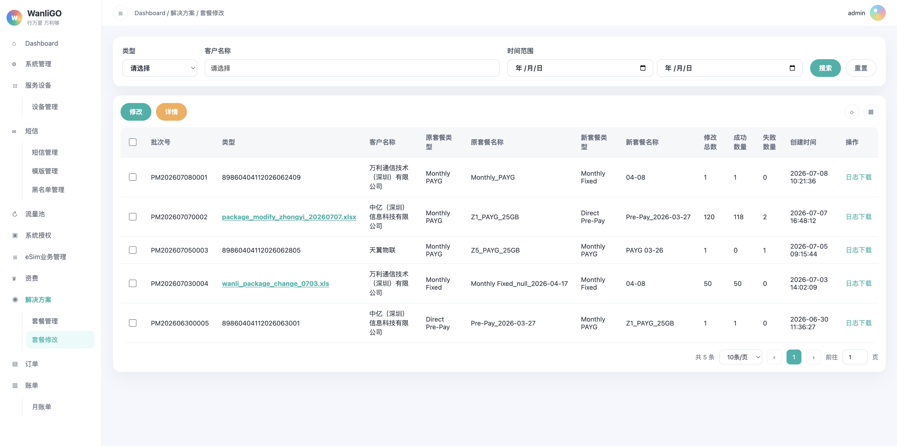
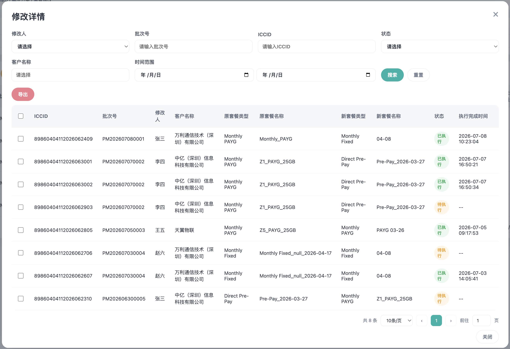

# 一、需求说明

在 WanliGO 系统「解决方案」模块下新增「套餐修改」二级菜单，用于发起单卡或批量套餐修改任务、查询套餐修改批次记录，并查看按 ICCID 维度展示的修改执行详情。

# 二、功能概述

## 2.1 总功能

套餐修改页面由「套餐修改主页面」「修改弹窗」「修改详情弹窗」组成。

| 功能 | 说明 |
| --- | --- |
| 套餐修改记录查询 | 按修改类型、客户名称和创建时间查询套餐修改批次记录。 |
| 单卡修改 | 查询指定 ICCID 的当前客户与套餐信息后，修改该卡的新套餐类型和新套餐名称。 |
| 批量修改 | 按客户上传批量修改文件，并指定批量修改后的套餐类型和套餐名称。 |
| 修改详情 | 按 ICCID 查看套餐修改执行明细，支持筛选、勾选和导出。 |
| 日志下载 | 下载指定套餐修改批次的执行日志。 |

## 2.2 整体流程

# 三、套餐修改主页面

## 3.1 页面入口

侧边栏一级菜单「解决方案」→ 二级菜单「套餐修改」。

顶部面包屑展示：`Dashboard / 解决方案 / 套餐修改`

## 3.2 原型截图

## 3.3 筛选区筛选字段及说明

| 字段 | 类型 | 说明 |
| --- | --- | --- |
| 类型 | 下拉框 | 枚举值：单卡、批量。 |
| 客户名称 | 可搜索下拉框 | 支持按当前账号可管理的客户名称选择或输入关键字搜索。 |
| 时间范围 | 日期选择器 | 包含开始日期和结束日期，按套餐修改记录的创建日期筛选。 |

筛选操作：

| 按钮 | 交互说明 |
| --- | --- |
| 搜索 | 按当前筛选条件查询记录，并重置至第 1 页。 |
| 重置 | 清空筛选条件，恢复默认记录列表，并重置至第 1 页。 |

## 3.4 数据表格列表区

表格以套餐修改批次为维度展示，一行代表一条单卡或批量修改任务。

### 3.4.1 表头字段

| 表头字段 | 说明 |
| --- | --- |
| 选择框 | 用于勾选当前记录。 |
| 批次号 | 套餐修改任务的唯一批次标识。 |
| 类型 | 单卡修改时展示对应 ICCID；批量修改时展示上传文件名称，文件名可点击下载。 |
| 客户名称 | 发起套餐修改的客户名称。 |
| 原套餐类型 | 修改前的套餐类型。枚举值：Direct Pre-Pay、Monthly PAYG、Monthly Fixed。 |
| 原套餐名称 | 修改前的套餐名称。 |
| 新套餐类型 | 修改后的套餐类型。枚举值：Direct Pre-Pay、Monthly PAYG、Monthly Fixed。 |
| 新套餐名称 | 修改后的套餐名称。 |
| 修改总数 | 当前任务涉及的卡片总数。单卡修改固定为 1。 修改总数 = 成功数量 + 失败数量。 |
| 成功数量 | 当前任务中修改成功的卡片数量。 |
| 失败数量 | 当前任务中修改失败的卡片数量。 |
| 创建时间 | 套餐修改任务创建时间，格式：YYYY-MM-DD HH:mm:ss。 |
| 操作 | 包含「日志下载」按钮。 |

默认排序规则：

- 默认按创建时间倒序展示，最新任务展示在列表顶部。
- 新建套餐修改任务后，新记录展示在列表顶部。

## 3.5 顶部操作按钮

| 按钮 | 交互说明 |
| --- | --- |
| 修改 | 点击打开「修改」弹窗，默认展示「单卡修改」Tab。 |
| 详情 | 点击打开「修改详情」弹窗。 |

## 3.6 日志下载

- 点击操作列「日志下载」后，下载该批次的套餐修改执行日志。
- 批量修改记录的类型字段展示上传文件名称，点击该文件名称可下载对应源文件。

# 四、修改弹窗

## 4.1 弹窗说明

点击主页面「修改」按钮后打开修改弹窗。弹窗包含「单卡修改」和「批量修改」两个 Tab，底部固定展示「确定」「取消」按钮。

| Tab | 说明 |
| --- | --- |
| 单卡修改 | 对单个 ICCID 发起套餐修改。 |
| 批量修改 | 通过上传文件对多个 ICCID 发起套餐修改。 |

## 4.2 单卡修改

   
     
   

### 4.2.1 字段说明

| 字段 | 类型 | 说明 |
| --- | --- | --- |
| ICCID | 文本输入框 | 必填。输入后按回车键或失焦触发查询。 |
| 当前客户名称 | 查询结果 | 根据 ICCID 查询并展示对应客户名称；未查询到时展示「无」。 |
| 当前套餐名称 | 查询结果 | 根据 ICCID 查询并展示当前套餐名称；未查询到时展示「无」。 |
| 当前套餐类型 | 查询结果 | 根据 ICCID 查询并展示当前套餐类型；未查询到时展示「无」。 |
| 新套餐类型 | 下拉框 | 必填。当前客户下拥有的套餐类型。枚举值：Direct Pre-Pay、Monthly PAYG、Monthly Fixed。 |
| 新套餐名称 | 下拉框 | 必填。选项随新套餐类型联动，仅展示该客户的该套餐类型下可选择的套餐名称。 |

### 4.2.2 交互规则

- 用户输入 ICCID 后，按回车键或点击其他区域时触发查询。
- 查询成功后，展示该 ICCID 对应的客户名称、当前套餐名称和当前套餐类型。
- 未查询到对应信息时，三个查询结果字段均展示「无」，且不可提交修改。
- 选择新套餐类型后，新套餐名称下拉框仅展示对应类型下的套餐。
- 点击「确定」后校验 ICCID、查询结果、新套餐类型和新套餐名称。
- 校验通过后创建单卡套餐修改任务，并在主页面列表顶部展示。

## 4.3 批量修改

### 4.3.1 字段说明

| 字段 | 类型 | 说明 |
| --- | --- | --- |
| 客户名称 | 下拉框 | 必填。选择本次批量修改所属客户。 |
| 新套餐类型 | 下拉框 | 必填。当前客户下拥有的套餐类型。枚举值：Direct Pre-Pay、Monthly PAYG、Monthly Fixed。 |
| 新套餐名称 | 下拉框 | 必填。选项随新套餐类型联动。 |
| 上传文件 | 文件上传 | 必填。上传包含待修改 ICCID 的 xls 或 xlsx 文件。 |
| 下载模版 | 链接按钮 | 下载批量套餐修改文件模版。 |

### 4.3.2 交互规则

- 选择新套餐类型后，新套餐名称下拉框仅展示对应类型下的套餐。
- 上传成功后展示上传文件名称。
- 点击「确定」后，校验客户名称、新套餐类型、新套餐名称和上传文件。
- 校验通过后创建批量套餐修改任务，并在主页面列表顶部展示。
- 批量记录中的类型字段展示上传文件名称，用户可点击下载该文件。

# 五、修改详情弹窗

## 5.1 弹窗说明

点击主页面「详情」按钮后打开「修改详情」弹窗。该弹窗以 ICCID 为维度展示修改执行详情：一个批次号可对应多条 ICCID 明细，一行代表一个 ICCID 的套餐修改详情。

## 5.2 筛选区筛选字段及说明

| 字段 | 类型 | 说明 |
| --- | --- | --- |
| 修改人 | 下拉框 | 套餐修改操作人的姓名。 |
| 批次号 | 文本输入框 | 支持按批次号关键字模糊搜索。 |
| ICCID | 文本输入框 | 支持按 ICCID 关键字模糊搜索。 |
| 状态 | 下拉框 | 枚举值：待执行、已执行。 待执行：套餐还没开始修改。 已执行：套餐已成功修改或修改失败。 |
| 客户名称 | 可搜索下拉框 | 支持按客户名称选择或输入关键字模糊搜索。 |
| 时间范围 | 日期选择器 | 包含开始日期和结束日期，按修改详情创建日期筛选。 |

| 按钮 | 交互说明 |
| --- | --- |
| 搜索 | 按当前筛选条件查询详情，并重置至第 1 页。 |
| 重置 | 清空筛选条件，恢复默认详情列表，并重置至第 1 页。 |
| 导出 | 未勾选时导出当前筛选条件下的全部数据；勾选后仅导出所勾选的全部数据。 |

## 5.3 数据表格列表区

| 表头字段 | 说明 |
| --- | --- |
| 选择框 | 支持勾选单条明细；表头复选框支持当前页全选和取消全选。 |
| ICCID | 被修改套餐的卡片 ICCID。 |
| 批次号 | 对应的套餐修改任务批次号。 |
| 修改人 | 发起本次套餐修改的操作人。 |
| 客户名称 | 卡片所属客户名称。 |
| 原套餐类型 | 修改前的套餐类型。 |
| 原套餐名称 | 修改前的套餐名称。 |
| 新套餐类型 | 修改后的套餐类型。 |
| 新套餐名称 | 修改后的套餐名称。 |
| 状态 | 枚举值：待执行、已执行。 |
| 执行完成时间 | 状态为已执行时展示执行完成时间，格式：YYYY-MM-DD HH:mm:ss；状态为待执行时展示「--」。 |

## 5.4 分页规则

- 修改详情列表支持分页。
- 支持展示总条数、每页条数、上一页、下一页、页码切换和跳转指定页。
- 默认每页展示 10 条，可切换 20 条 或 30 条 或 50 条。

# 六、数据校验规则

## 6.1 表单字段校验

| 场景 | 字段 | 校验规则 | 失败提示 |
| --- | --- | --- | --- |
| 单卡修改 | ICCID | 必填，需为 19 至 20 位纯数字。 | 请输入19-20位数字ICCID |
| 单卡修改 | ICCID 查询结果 | 必须查询到客户与当前套餐信息。 | 未查询到该ICCID对应套餐信息 |
| 单卡修改 | 新套餐类型、新套餐名称 | 均为必填。 | 请选择新套餐类型和新套餐名称 |
| 批量修改 | 客户名称、新套餐类型、新套餐名称 | 均为必填。 | 请选择客户名称、新套餐类型和新套餐名称 |
| 批量修改 | 上传文件 | 必填，仅支持 xls、xlsx。 | 请上传批量修改文件 / 仅支持上传 xls、xlsx 文件 |

## 6.2 文件校验

| 校验项 | 规则 |
| --- | --- |
| 文件格式 | 仅支持 xls、xlsx。 |
| 文件大小 | 不超过 5MB。 |
| 必填字段 | 文件内需包含 ICCID。 |
| 字段格式 | ICCID 需为 19 至 20 位纯数字。 |

# 七、其他补充说明

## 7.1 全局通用交互规则

| 操作 | 交互说明 |
| --- | --- |
| 搜索 | 按当前筛选条件查询列表，并重置至第 1 页。 |
| 重置 | 清空当前筛选条件，恢复默认查询结果，并重置至第 1 页。 |
| 导出 | 未勾选时导出当前筛选条件下所有查询结果；勾选时仅导出所勾选数据。 |
| 分页 | 支持总条数、每页条数、页码切换、上一页/下一页及跳转指定页。 |

## 7.2 状态枚举值统一规范

| 类型 | 枚举值 |
| --- | --- |
| 套餐修改类型 | 单卡、批量 |
| 套餐类型 | Direct Pre-Pay、Monthly PAYG、Monthly Fixed |
| 修改详情状态 | 待执行、已执行 |
| 修改人 | 套餐修改操作人的姓名。 |
