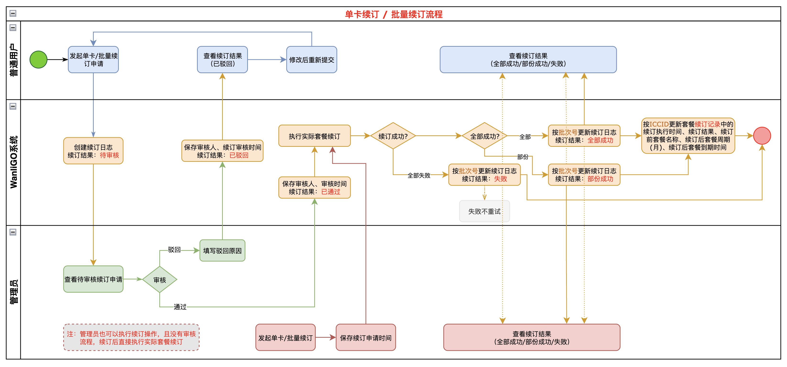
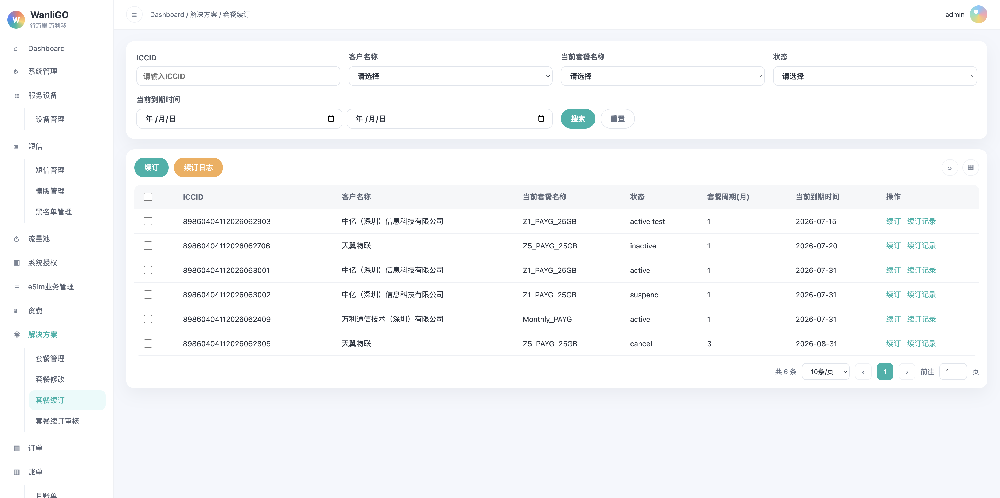
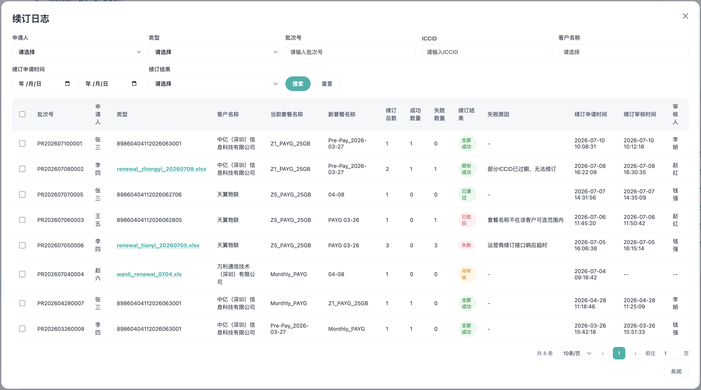
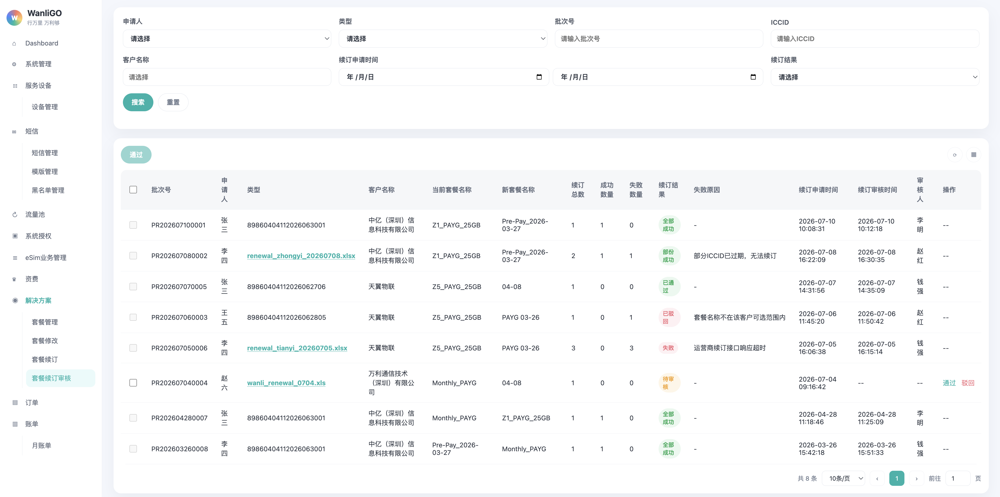

# 一、需求说明

在 WanliGO 系统「解决方案」模块下新增「套餐续订」和「套餐续订审核」二级菜单。

- 「套餐续订」面向普通用户与管理员，用于发起单卡或批量套餐续订、查询单卡续订结果及查看续订日志。
- 「套餐续订审核」仅面向管理员，用于审核普通用户提交的续订申请。普通用户不展示该菜单，也不可通过地址或接口访问审核数据与审核操作。

# 二、功能概述

## 2.1 总功能

| 功能 | 说明 |
| --- | --- |
| 套餐续订查询 | 以 ICCID 为维度查询卡片当前套餐和当前到期时间，并可查看该卡的续订记录。 |
| 单卡续订 | 输入 ICCID 查询当前套餐与当前到期时间后，选择新套餐发起续订申请。 |
| 批量续订 | 选择客户和新套餐，上传包含 ICCID 的批量文件后创建续订申请。 |
| 续订日志 | 以批次号为维度查看申请、审核和批量执行的汇总状态。 |
| 套餐续订审核 | 管理员对待审核的单卡或批量续订申请进行通过或驳回处理。 |

## 2.2 整体流程

## 2.3 续订结果状态流转

### 2.3.1 批次结果与 ICCID 结果映射

| 续订日志批次结果 | ICCID 续订记录结果 | 处理规则                                        |
| ---------------- | ------------------ | ----------------------------------------------- |
| 待审核           | 处理中             | 申请已提交，等待审核；不更新当前生效套餐信息。  |
| 已通过           | 处理中             | 审核通过后，异步任务尚未完成。                  |
| 已驳回           | 已驳回             | 批次内全部 ICCID 更新为已驳回，并记录驳回原因。 |
| 全部成功         | 成功               | 批次内全部 ICCID 续订成功。                     |
| 部份成功         | 成功或失败         | 按每个 ICCID 的实际执行结果分别记录。           |
| 失败             | 失败               | 批次内全部 ICCID 续订失败，并记录失败原因。     |

# 三、套餐续订页面

## 3.1 页面入口

侧边栏一级菜单「解决方案」→ 二级菜单「套餐续订」。

顶部面包屑展示：`Dashboard / 解决方案 / 套餐续订`

## 3.2 筛选区

| 字段 | 类型 | 说明 |
| --- | --- | --- |
| ICCID | 文本输入框 | 支持按 ICCID 关键字搜索。 |
| 客户名称 | 下拉框 | 支持选择当前账号可管理的客户。 |
| 当前套餐名称 | 下拉框 | 按卡片当前套餐名称筛选。 |
| 状态 | 下拉框 | 按卡片当前业务状态筛选。枚举值：active、active test、suspend、cancel、inactive。 |
| 当前到期时间 | 日期范围选择器 | 包含开始日期和结束日期，按当前到期时间筛选。 |

| 按钮 | 交互说明 |
| --- | --- |
| 搜索 | 按当前筛选条件查询，并重置至第 1 页。 |
| 重置 | 清空筛选条件，恢复默认列表，并重置至第 1 页。 |

## 3.3 数据表格列表区

表格以 ICCID 为维度展示；一行代表一张卡当前生效的套餐信息。

| 表头字段 | 说明 |
| --- | --- |
| 选择框 | 用于勾选当前卡片记录。 |
| ICCID | 卡片的 ICCID。 |
| 客户名称 | 卡片所属客户。 |
| 当前套餐名称 | 发起本次续订时的套餐名称。 |
| 状态 | 卡片当前业务状态。枚举值：active、suspend、active test、cancel、inactive。 |
| 套餐周期(月) | 当前套餐的套餐周期，单位为月。 |
| 当前到期时间 | 当前生效套餐的到期日期。注：套餐到期时间按自然日。 示例：2026-08-16 激活（生效）、套餐周期为 3 个月时，则到期时间为 2026-11-16。 |
| 操作 | 包含「续订」「续订记录」按钮。点击「续订」仅打开单卡续订弹窗；点击「续订记录」查看该 ICCID 的历史续订记录。 |

## 3.4 顶部操作按钮

| 按钮 | 交互说明 |
| --- | --- |
| 续订 | 打开续订弹窗，默认展示「单卡续订」Tab。 |
| 续订日志 | 打开「续订日志」弹窗。 |

## 3.5 操作列续订

- 点击指定 ICCID 所在行的「续订」按钮后，打开单卡续订弹窗。
- 弹窗仅展示「单卡续订」内容，不展示「批量续订」Tab。
- 系统自动带入当前行 ICCID，并查询回显当前套餐名称和当前到期时间。
- 用户选择新套餐名称并提交后，普通用户创建待审核申请；管理员直接进入异步续订执行流程。

## 3.6 续订记录弹窗

点击主表操作列「续订记录」后打开。弹窗顶部回显当前行的 ICCID 和客户名称，表格以续订执行时间倒序展示该 ICCID 的历史续订记录，最新记录展示在最上方。

| 表头字段 | 说明 |
| --- | --- |
| 续订执行时间 | 该 ICCID 的实际续订执行完成时间；待审核、已通过但未执行或已驳回时展示「--」。 |
| 续订结果 | 枚举值：处理中、成功、失败、已驳回。批量续订的部份成功按该 ICCID 的实际执行结果展示成功或失败。 |
| 续订前套餐名称 | 发起该次续订时的当前套餐名称。 |
| 续订后套餐名称 | 仅续订成功时展示实际生效套餐；否则展示「--」。 |
| 续订后套餐周期(月) | 仅续订成功时展示新套餐周期；否则展示「--」。 |
| 续订后套餐到期时间 | 仅续订成功时展示；按该次成功续订的生效时间叠加新套餐周期计算。 |

续订成功后，新套餐立即更新为卡片的当前套餐，当前到期时间同步更新。续订记录保留本次操作的前后套餐快照，不因后续续订而被覆盖。

# 四、续订弹窗

## 4.1 弹窗说明

续订弹窗包含「单卡续订」与「批量续订」两个 Tab，底部展示「确定」「取消」按钮。

从主表操作列点击「续订」时，仅展示「单卡续订」内容，不展示批量续订 Tab。

## 4.2 单卡续订

  
    
   

| 字段 | 类型 | 说明 |
| --- | --- | --- |
| ICCID | 文本输入框 | 必填；输入后按回车或失焦查询。 |
| 当前套餐名称 | 查询结果 | 根据 ICCID 展示；未查询到时展示「无」。 |
| 当前到期时间 | 查询结果 | 根据 ICCID 展示；未查询到时展示「无」。 |
| 新套餐名称 | 下拉框 | 必填；展示当前客户可选择的套餐名称。 |

交互规则：

- 未查询到 ICCID 对应的套餐信息时，不允许提交。
- 普通用户点击「确定」后创建续订申请，续订日志批次结果为「待审核」；不直接执行套餐续订。
- 管理员点击「确定」后直接进入异步续订执行流程，无需进入审核页面。

## 4.3 批量续订

| 字段 | 类型 | 说明 |
| --- | --- | --- |
| 客户名称 | 下拉框 | 必填。 |
| 新套餐名称 | 下拉框 | 必填；仅展示所选客户可选择的套餐名称。 |
| 上传文件 | 文件上传 | 必填；上传包含待续订 ICCID 的 xls 或 xlsx 文件。 |

交互规则：

- 普通用户点击「确定」后创建批量续订申请，生成唯一批次号，批次结果为「待审核」，等待管理员整批审核。
- 管理员提交批量续订申请后，直接进入异步续订执行流程，无需进入审核页面。

# 五、续订日志弹窗

## 5.1 弹窗说明

点击「续订日志」后打开。列表以批次号为维度，一行代表一条单卡或批量续订申请。筛选区每行展示 5 个筛选项或输入项，整体最多占两行。

## 5.2 筛选字段

| 字段 | 类型 | 说明 |
| --- | --- | --- |
| 申请人 | 下拉框 | 发起续订申请的用户（客户）。 |
| 类型 | 下拉框 | 枚举值：单卡、批量。 |
| 批次号 | 文本输入框 | 支持按批次号关键字搜索。 |
| ICCID | 文本输入框 | 仅单卡申请支持按 ICCID 搜索。 |
| 客户名称 | 可搜索下拉框 | 支持按客户名称选择或关键字搜索。 |
| 续订申请时间 | 日期范围选择器 | 按申请创建时间筛选。 |
| 续订结果 | 下拉框 | 枚举值：待审核、已通过、已驳回、全部成功、部份成功、失败。 |

## 5.3 表头字段

| 表头字段 | 说明 |
| --- | --- |
| 选择框 | 用于勾选当前记录。 |
| 批次号 | 续订申请的唯一批次标识。 |
| 申请人 | 提交续订申请的用户。 |
| 类型 | 单卡续订时展示 ICCID；批量续订时展示源文件名称，文件名可点击下载。 |
| 客户名称 | 申请所属客户。 |
| 当前套餐名称 | 申请时的当前套餐名称。 |
| 新套餐名称 | 申请续订的新套餐名称。 |
| 续订总数 / 成功数量 / 失败数量 | 批量任务的汇总数量；单卡续订总数固定为 1。续订总数 = 成功数量 + 失败数量。 |
| 续订结果 | 展示批次级申请、审核或执行汇总结果。 枚举值：待审核、已通过、已驳回、全部成功、部份成功、失败。 |
| 失败原因 | 管理员在驳回时填写的原因或执行失败时对应的原因；其他状态展示「--」。 |
| 续订申请时间 | 申请创建时间，格式：YYYY-MM-DD HH:mm:ss。 |
| 续订审核时间 | 管理员完成审核时的时间；待审核时展示「--」。 |
| 审核人 | 审核人姓名。待审核时展示「--」。 |

## 5.4 批次状态说明

| 状态 | 说明 |
| --- | --- |
| 待审核 | 普通用户已提交申请，等待管理员处理。 |
| 已通过 | 管理员已审核通过，等待或正在由系统创建并执行异步续订任务。 |
| 已驳回 | 管理员拒绝申请，必须记录驳回原因。 |
| 全部成功 | 批次内全部 ICCID 续订成功。 |
| 部份成功 | 批次内同时存在成功与失败的 ICCID。 |
| 失败 | 批次内全部 ICCID 续订失败。 |

# 六、套餐续订审核页面

## 6.1 页面入口与权限

侧边栏一级菜单「解决方案」→ 二级菜单「套餐续订审核」。

顶部面包屑展示：`Dashboard / 解决方案 / 套餐续订审核`

权限规则：

- 仅管理员角色拥有菜单可见权限、页面访问权限、列表查询权限和审核操作权限。
- 普通用户不展示「套餐续订审核」菜单；即使直接访问页面地址或调用接口，也应返回无权限结果。

## 6.2 筛选与表格

> 审核页面复用「解决方案 - 套餐续订 - 续订日志」的筛选字段和表格内容，并额外提供「操作」列（通过和驳回）。
> 列表默认按续订申请时间倒序展示。

| 表头字段 | 说明 |
| --- | --- |
| 基础信息 | 展示选择框、批次号、申请人、类型、客户名称、当前套餐名称、新套餐名称、续订总数、成功数量、失败数量、续订结果、失败原因和续订申请时间。 |
| 续订审核时间 | 审核完成时间；待审核时展示「--」。 |
| 审核人 | 已完成申请审核对应的审核人；枚举值：李明、赵红、钱强。 |
| 操作 | 仅续订结果为「待审核」的记录展示「通过」「驳回」按钮；其他记录展示「--」。 |

## 6.3 审核操作

### 6.3.1 单条通过

- 点击操作列「通过」后，弹出二次确认：`是否确认通过此续订申请？`
- 确认后更新批次结果为「已通过」，记录审核时间和审核人。
- 系统随后创建异步续订任务；批次内各 ICCID 的续订结果更新为「处理中」。

### 6.3.2 批量通过

- 顶部提供「通过」按钮，初始为不可点击状态。
- 仅「待审核」记录可勾选；勾选一条、多条或全选后，顶部「通过」按钮变为可点击。
- 点击后弹出二次确认：`是否确认通过 x 条续订申请？`
- 确认后逐条更新已选申请为「已通过」，记录相同的审核时间和审核人。

### 6.3.3 驳回

- 点击操作列「驳回」后，弹出「填写驳回原因」弹窗。
- 「驳回原因」为必填文本输入框，最大长度建议为 100 字。
- 提交后更新批次结果为「已驳回」，保存审核时间、审核人和驳回原因。
- 批次内全部 ICCID 的续订结果更新为「已驳回」，但不覆盖此前已成功生效的套餐信息。

# 七、数据校验规则

| 场景 | 字段 | 校验规则 | 失败提示 |
| --- | --- | --- | --- |
| 单卡续订 | ICCID | 必填，需为 19 至 20 位纯数字。 | 请输入19-20位数字ICCID |
| 单卡续订 | ICCID 查询结果 | 必须查询到当前套餐和当前到期时间。 | 未查询到该ICCID对应套餐信息 |
| 单卡续订 | 新套餐名称 | 必填。 | 请选择新套餐名称 |
| 批量续订 | 客户名称、新套餐名称 | 均为必填。 | 请选择客户名称和新套餐名称 |
| 批量续订 | 上传文件 | 必填，仅支持 xls、xlsx，文件不超过 5MB。 | 请上传批量续订文件 |
| 审核驳回 | 驳回原因 | 必填，最大长度 100 字。 | 请输入驳回原因 |

# 八、其他补充说明

## 8.1 异步任务规则

- 批量续订采用异步任务执行，并以 ICCID 作为最小执行与落库粒度。
- 批次内所有 ICCID 子任务结束后，才汇总更新批次日志为「全部成功」「部份成功」或「失败」。
- 失败的 ICCID 不自动重试；如需再次续订，应新建申请批次，保留原批次全量审计记录。
- 同一 ICCID 存在「处理中」的续订申请时，应阻止重复提交，避免到期时间重复累加。

## 8.2 分页规则

- 套餐续订主列表、续订日志和套餐续订审核列表均支持分页。
- 支持展示总条数、每页条数、页码切换、上一页、下一页和跳转指定页。
- 默认每页展示 10 条。
