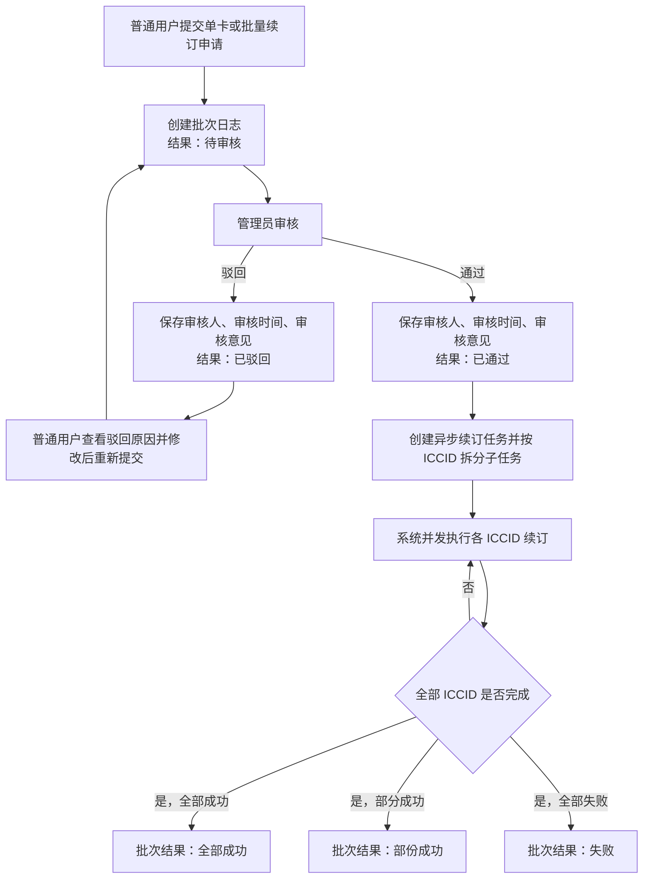
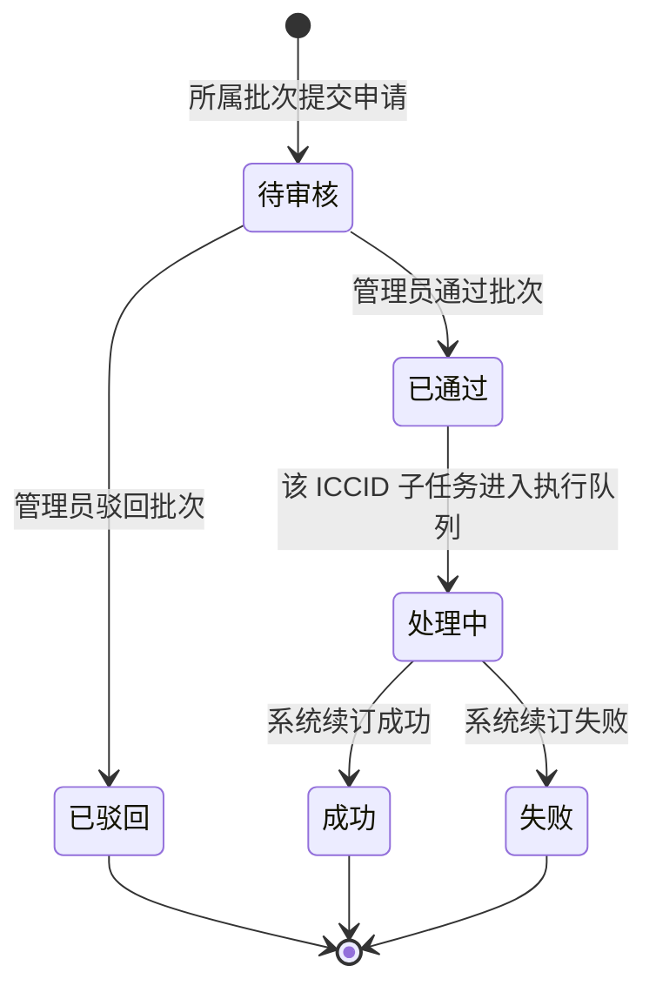
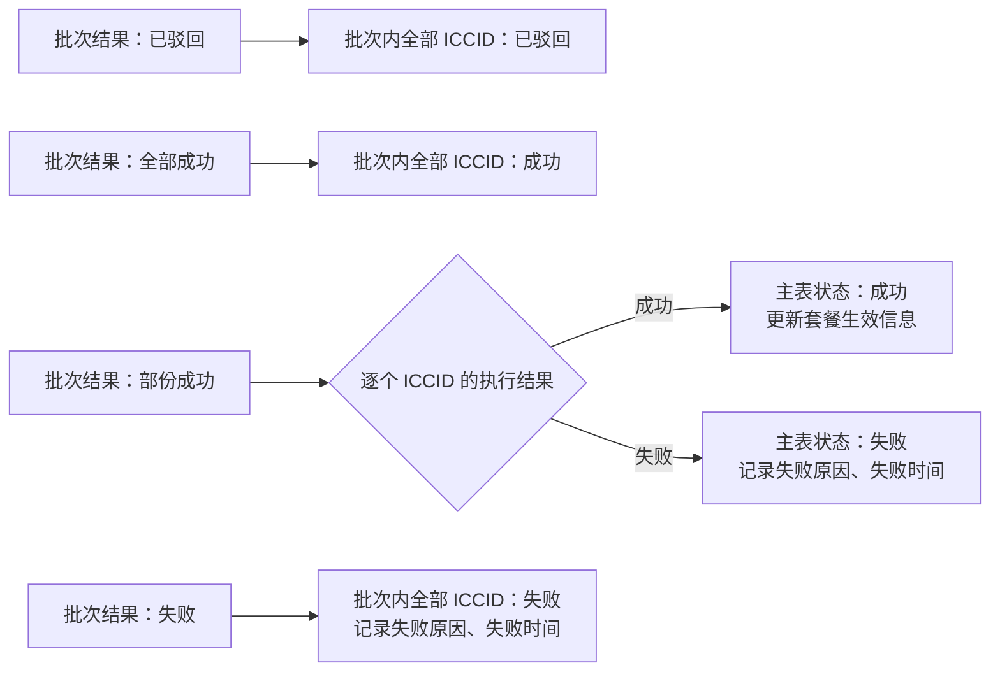

# 套餐续订审批流程

## 状态设计原则

- **续订日志按批次号维度**：反映申请审批状态和批量任务的聚合执行结果。
- **续订主表按 ICCID 维度**：反映每张卡本次续订的真实处理状态；“部份成功”只能存在于批次日志中，不能直接写入单张卡。
- **套餐生效信息与申请状态分离**：续订时间、新套餐名称、新套餐周期和新到期时间仅在该 ICCID 执行成功后更新；待审核、已驳回或执行失败均不得覆盖上一次已生效的续订信息。

## 批次续订日志状态流转（以批次号为维度）

## 续订主表状态流转（以 ICCID 为维度）

## 批次结果与 ICCID 结果映射

## 异步批量任务处理规则

1. 普通用户提交批量申请后，系统应先创建批次记录和每个 ICCID 的子任务记录，二者初始状态均为“待审核”。
2. 管理员按整批审核。审核通过后，批次日志更新为“已通过”；每个 ICCID 子任务进入“处理中”，由异步任务逐个执行。
3. 每个 ICCID 独立落库执行结果。任务运行期间，用户可在主表看到实际进度，避免长时间只显示批次级状态而无法了解单卡情况。
4. 所有子任务结束后，系统根据成功与失败数量汇总更新批次日志：全成功为“全部成功”、部分成功为“部份成功”、全失败为“失败”。
5. 已驳回或执行失败的 ICCID 不自动重试；失败原因、失败时间、批次号应可查询。若需再次续订，普通用户应发起新的申请批次。

## 审核与体验规则

1. 审核记录必须保存审核人、审核时间和审核意见；管理员驳回时，审核意见必填。
2. 普通用户在“已驳回”后可基于原申请修改续订信息并重新提交；重新提交应创建新的申请版本或新批次，以保留历史审计记录。
3. 同一 ICCID 已存在“待审核”“已通过”或“处理中”的申请时，应阻止或明确提示重复提交，避免并发续订导致到期时间重复累加。
4. 对批量任务，续订日志应展示总数、成功数、失败数和当前处理进度；主表应支持按批次号筛选并查看单卡失败原因，降低排查成本。
