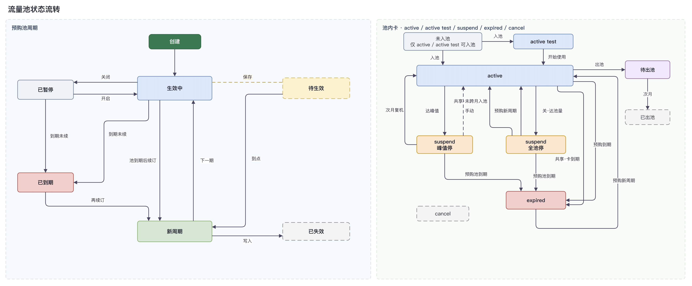
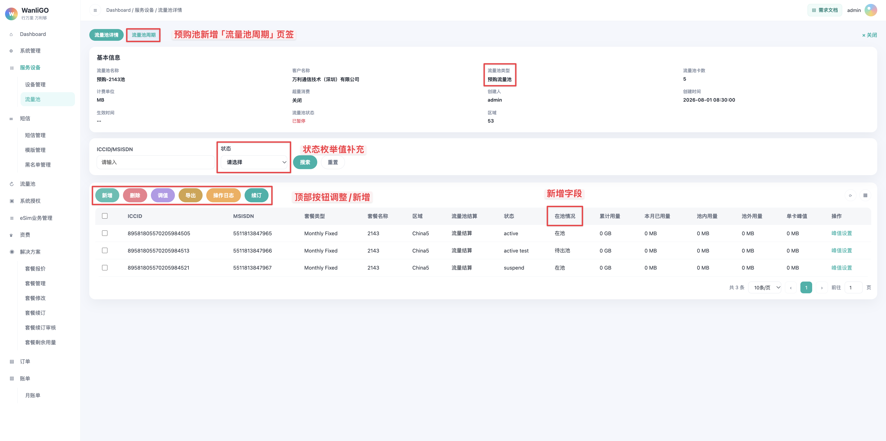
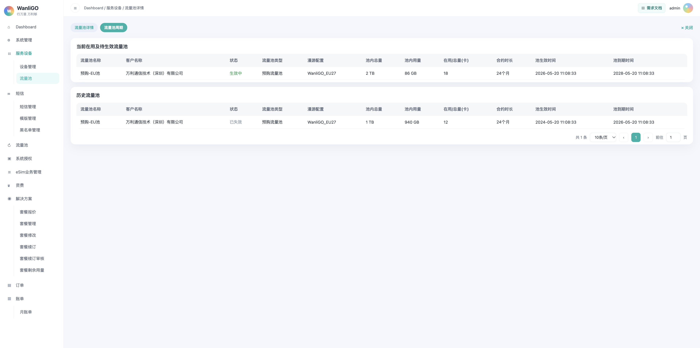
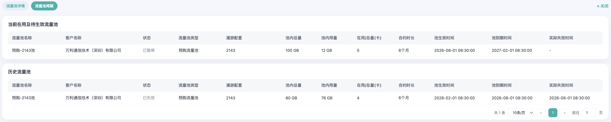
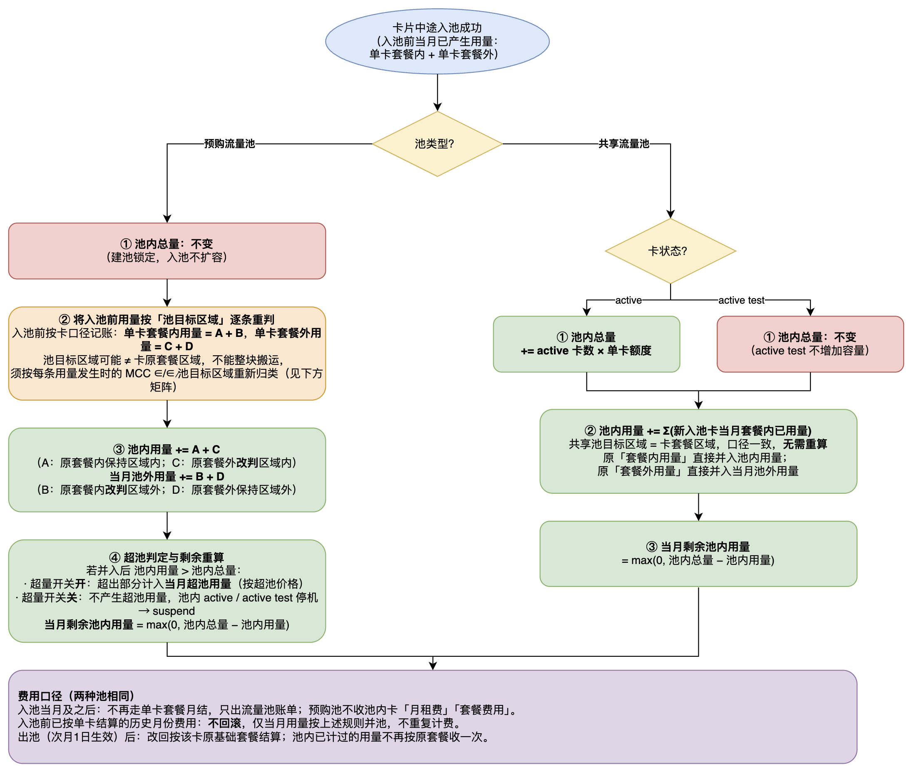
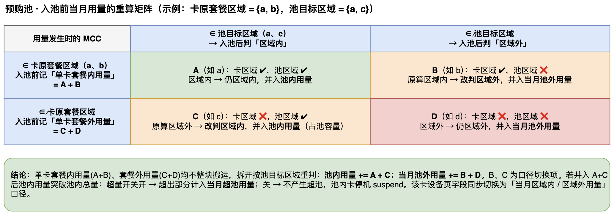
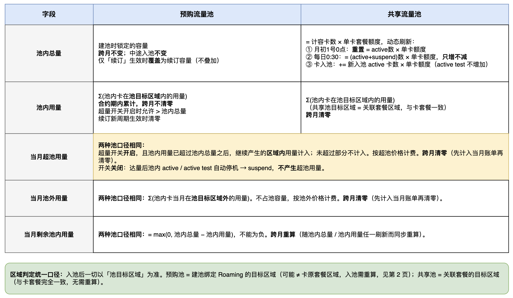
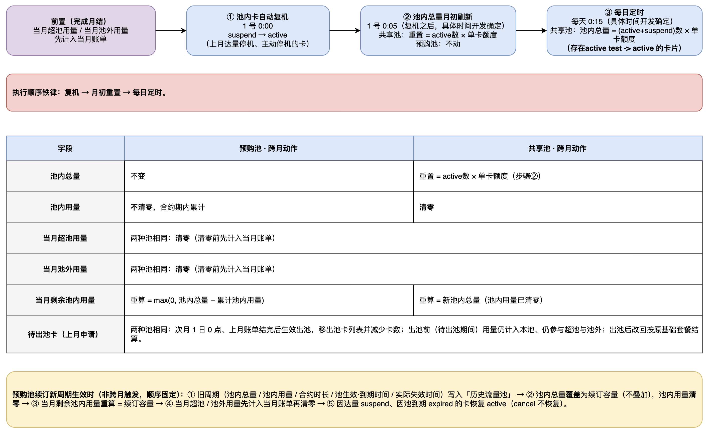

# 流量池

# 一、需求说明

在现有「服务设备-流量池」上补齐预购 / 共享建池规则、入池限制、出池留痕、操作日志、续订，以及池级用量与账单口径。不新增菜单。

权限规则：

- 仅万利管理员可组池、移卡、续订；
- 客户及客户管理员均不无权限。

# 二、功能概述

## 2.1 总功能

| 功能 | 说明 |
| --- | --- |
| 卡到期时间调整 | 卡套餐无论在池内还是池外，都有套餐到期时间： 1. Fixed / PAYG：出货日（划拨成功对应的时间）+ 合约时长 = 套餐到期时间。 2. Pre-Pay：套餐激活时间 + 合约时长 = 套餐到期时间。 |
| 池到期时间 | 仅预购池有池到期时间；共享池没有。共享池内单卡套餐已到期且未续订，该卡停机，状态改为 expired。 |
| 新增流量池改造 | 1. 按流量池类型联动字段：预购池不再关联套餐，改为关联漫游配置并展示漫游明细；合约时长默认 24 个月，支持修改； 2. 共享池由之前允许 Pre-Pay 和 Fixed 改为仅支持绑定 Fixed 套餐。 |
| 主列表 | 新增字段「当月超池用量」「池到期时间」，定义见 3.2。 |
| 池卡状态 | 筛选与列表「状态」改为 active、active test、suspend、cancel、expired； 状态后增加字段「在池情况」，见 4.2。 |
| 入池限制 | 明确预购 / 共享允许的套餐类型、禁止入池状态，以及中途入池扣量规则，见 2.3、4.5。 |
| 入池入口 | 三个入口：「订单-销售订单」选池划拨（已实现，「套餐名称」改为非必选）、池卡页「新增 - 勾选入池」「新增 - 导入入池」，见 4.5.1。 |
| 中途入池 | 预购池不改池内总量，入池前已产生的当月用量按池目标区域重判后并入池级字段；共享池刷新池内总量并直接并入。详见 4.5.2。 |
| 流量池开关 | 流量池状态关闭时：禁止一切入口新入池（见 4.5.1）、不可续订（见 4.3）、不再累计用量，周期行状态展示「已暂停」（见 4.4.1）。 |
| 共享池池内总量刷新 | 月初 1 号重置、每日 0:30 只增不减、卡入池即时刷新三类触发；执行顺序铁律：自动复机 → 月初刷新 → 每日定时。详见 3.3.3。 |
| 测试用量 | 卡进池后将剩余测试用量（若有）清零，进池后使用池内流量；开始使用则立即激活。见 2.3。 |
| 套餐修改限制 | 已在池内的卡片不支持套餐修改。见 2.3。 |
| 新增弹窗 | 原「新增」「导入」按钮合并为「新增」，弹窗含「勾选入池」「导入入池」两个 Tab，见 4.5.3。 |
| 删除 | 新增「删除」按钮（位于「新增」之后），通过导入 Excel 将池内卡片移出当前流量池；当月不出池，「在池情况」更新为「待出池」，操作留痕。详见 4.6。 |
| 操作日志 | 按当前流量池查看记录。只记录导入入池和导入出池，不记录单卡操作。可按批次号和结果筛选。详见 4.7。 |
| 续订 | 仅预购池在池卡页展示「续订」：刷新（覆盖）池内总量并延长合约时长；支持待生效续订与额度用尽后的提前生效。详见 4.8。 |
| 流量池周期 | 仅预购池在池卡页展示页签，页内为「当前在用及待生效流量池」和「历史流量池」，新增「实际失效时间」字段，见 4.4。共享池无池到期时间，不展示。 |
| 入池后单卡字段 | 卡入池后，卡详情-设备页「当月套餐内用量(MB)」改为「当月区域内用量(MB)」，「当月套餐外用量(MB)」改为「当月区域外用量(MB)」；字段取值见 5.1.3。 |
| 用量与账单 | 明确池级字段公式、超量开关行为（开启计超池用量 / 关闭达量停机）、入池后单卡字段取值，以及预购 / 共享当月账单构成，见第五章。 |
| 数据校验 | 新增流量池、入池 / 出池、预购池续订各场景的必填校验与失败提示，见 6.1。 |

## 2.2 整体流程

## 2.3 两种流量池

| | 预购流量池 | 共享流量池 |
| --- | --- | --- |
| 含义 | 先预购额度，再往里导卡 | 相同套餐的卡把单卡额度拿出来共用 |
| 容量 | 创建时锁定，不随卡数增加 | 入池激活总卡数 × 单卡套餐额度 |
| 允许入池的卡状态 | 仅 active、active test | 同左 |
| 禁止入池的卡状态 | `suspend` / `cancel` / `expired`（合约已过期且未续订） | 同左 |
| 停机卡与容量 | 容量固定，与停机张数无关 | 当月停的还计入容量；上月已停的不计入 |
| 建池绑定 | 不绑卡套餐；绑 Roaming，再选目标区域 | 必须绑套餐 |
| 目标区域 | 建池时自选；结算只认池的区域 | 跟关联套餐走，选定即锁死 |
| 允许入池的卡类型 | PayG、Fixed | Fixed |
| 禁止入池的卡类型 | Pre-Pay | PayG、Pre-Pay |
| 池内多种套餐 | 可以（除 Pre-Pay）；统一按池价计费，单卡套餐不再收费 | 不可以。同一池内套餐名称 + 类型必须完全一致 |
| 池到期时间 | = 池生效时间 + 合约时长（默认 24 月），与池内有没有卡无关；相加规则见 4.8.1。列表展示「池到期时间」。 | 无池到期时间，默认永久有效（除非将池内全部卡片停机），列表展示「--」。卡套餐到期处理见 2.1。 |
| 测试用量 | 进池后将该卡的剩余测试用量（若有）清零；即进池后使用池内流量，不可再使用测试用量；开始使用则立即激活 | 同左 |
| 套餐修改 | 已在池内的卡片不支持套餐修改 | 同左 |
| 中途入池 | 不改变「池内总量」；入池前已产生的当月用量须并入池级字段，计算见 4.5.2 | 刷新「池内总量」= 当前值 + 新入池 active 卡数 × 单卡额度（active test 不增加）；入池前已产生的当月用量并入规则同见 4.5.2 |

# 三、流量池主页面

## 3.1 页面入口

侧边栏一级菜单「服务设备」→ 二级菜单「流量池」。

顶部面包屑展示：`Dashboard / 服务设备 / 流量池`

## 3.2 列表字段调整

相对现有列表，字段更名与新增如下。共享流量池对应的套餐类型只能是 Fixed。

| 表头字段 | 说明 |
| --- | --- |
| 套餐/漫游配置 | 将「套餐」文本改为「套餐/漫游配置」。共享池展示 Fixed 套餐名称；预购池展示关联漫游配置。 |
| 池内总量 | 预购池为建池锁定容量；共享池按激活卡数 × 单卡套餐额度。 |
| 池内用量 | -- |
| 当月超池用量 | 新增字段，位于「池内用量」之后。超量开关开启时，当月超出池内总量部分的用量；开关关闭时不产生。跨月清零。 |
| 当月池外用量 | Σ(池内卡当月在池目标区域外的用量)，不占池容量。跨月清零。 |
| 当月剩余池内用量 | `max(0, 池内总量 − 池内用量)`。跨月清零。 |
| 在用/总量(卡) | 保持现状。 |
| 池到期时间 | 新增字段，位于「创建时间」之前。仅预购流量池展示 = 创建时间 + 合约时长(月)，相加规则见 4.8.1。 共享流量池展示「--」。 |

## 3.3 新增流量池弹窗

预购池不再关联套餐，改为关联漫游配置并展示漫游明细；合约时长默认 24 个月，支持修改。

共享池除池内套餐改为仅支持 Fixed、无池到期时间（卡套餐到期时间见 2.1）之外，其他保持不变。

### 3.3.1 弹窗说明

字段随「流量池类型」和「关联套餐」类型联动显示或隐藏。

字段排列顺序：

- 预购池：流量池名称 → 客户名称 → 流量池类型 → 关联漫游配置 → 超池价格、池外价格、流量池容量、流量池状态 → 池目标区域 → 合约时长(月) → 关联漫游明细 → 备注。
- 共享池：保持不变。流量池名称 → 客户名称 → 流量池类型 → 关联套餐 → 超池价格、池外价格、卡总数量、流量池状态 → 套餐目标区域 → 关联套餐明细 → 备注。

### 3.3.2 预购流量池

| 说明 | 具体 |
| --- | --- |
| 建池规则 | 1. 绑定 Roaming，选择目标区域。 2. 填写池内总量（创建后锁定）和合约时长（默认 24 月）。 3. 配置池外价格、超池价格、超量开关。 |
| 选择「预购流量池」后 | 1. 不再关联卡套餐：隐藏「关联套餐」，展示「关联漫游配置」。 2. 展示可编辑「合约时长(月)」，默认 24。 3. 选定漫游配置后回显「池目标区域」（选定后锁死），并展示「关联漫游明细」；未选定时不展示。 |

| 字段 | 类型 | 说明 |
| --- | --- | --- |
| 关联漫游配置 | 下拉框 | 必填。取值于所选客户所属的「Roaming文件」。 |
| 超池价格 | 币种 + 金额 | 必填。 |
| 流量池容量 | 数值 + 单位 | 必填。创建后锁定为池内总量。单位枚举：MB、GB、TB。 |
| 合约时长(月) | 文本输入框 | 默认 24，可修改，须为大于等于 1 的整数。 |
| 池目标区域 | 只读标签 | 跟随关联漫游配置回显。字段名用「池目标区域」，不用「套餐目标区域」。 |
| 关联漫游明细 | 只读表格 | 选定具体漫游配置后展示。标题用「关联漫游明细」，不用「关联套餐明细」。 |

关联漫游明细列与关联套餐明细相同：

| 表头字段 | 说明 |
| --- | --- |
| Price Group | 该漫游配置下的价格组。 |
| Country | 该价格组覆盖的国家或区域。 |
| 流量单位 | 如 MB。 |
| 套餐内含量 | 价格组内含量。 |
| 超套单价 | 超出含量后的单价。 |
| 月租 | 月租金额。 |

### 3.3.3 共享流量池

| 字段 | 类型 | 说明 |
| --- | --- | --- |
| 关联套餐 | 下拉框 | 必填。仅展示所选客户所属的 type = Fixed 的套餐。 |
| 合约时长(月) | - | 共享池不展示此字段。 |

建池规则：

- 仅允许 Fixed；必须绑定套餐，池内卡套餐名称 + 类型必须与该套餐完全一致。

共享池在月初、新卡入池时都需要刷新「池内总量」，规则如下表：

| **刷新时机** | **触发点** | **计容口径** | **池内总量动作** | **作用** |
| --- | --- | --- | --- | --- |
| **月初 1 号凌晨 0 点刷新**（未实现） | 在所有卡完成月结更新之后 | 仅统计状态为 active 的卡片 | 重置：池内总量 = active 数 × 单卡额度 | 归零重算，校准本月基数 |
| **每日定时**（已有？） | 每天凌晨 0 点 30 分，执行 1 次 | active + suspend | 池内总量 = (active 数 + suspend 数) × 单卡额度； | 跟随复机/入池扩容，不回收；覆盖 active test → active 的卡片 |
| **卡入池** | 卡中途入池时 | 新增该卡；允许入池：active 和 active test | 池内总量 = 当前值 + 新入池 active 卡数 × 单卡额度（active test 入池不增加）； 池内用量 = 当前值 + Σ(新增单卡套餐内已用量)； 当月剩余池内用量 = max(0, 池内总量 − 池内用量) | 纳入正式池用 |

> **执行顺序铁律：池内卡片自动复机 → 池内总量月初刷新（重置）→ 每日定时任务（跟随）。**

# 四、流量池详情（池卡）页面

共享流量池池卡页面：

预购流量池池卡页面：

## 4.1 页签

池卡页顶部页签：

| 页签 | 展示条件 | 说明 |
| --- | --- | --- |
| 流量池详情 | 预购 / 共享均展示 | 当前池基本信息 + 池卡筛选与列表。 |
| 流量池周期 | 仅预购流量池 | 见 4.4。共享池无池到期时间（卡套餐到期时间见 2.1），无此页签。 |

关闭按钮位于页签行右侧，返回流量池主列表。（保持原状）

## 4.2 状态与在池情况

筛选与列表「状态」枚举值：active、active test、suspend、cancel、expired。

在「状态」之后增加「在池情况」。两个字段独立：申请出池不改卡片状态，当月仍可用的卡状态保持 active。

| 在池情况 | 说明 |
| --- | --- |
| 在池 | 当月未申请出池。 |
| 待出池 | 已申请出池，当月仍在池卡列表中，次月生效后离开。期间用量仍计入本池，见 4.6.1。 |

## 4.3 顶部操作按钮

顺序：新增、删除、调值、导出、操作日志、续订。

| 按钮 | 交互说明 |
| --- | --- |
| 新增 | 原「导入」与「新增」合并为「新增」，弹窗含「勾选入池」「导入入池」两个 Tab（见 4.5.3）。仅作按钮/弹窗合并，不改变其他逻辑或功能。 |
| 删除 | 新增按钮，位于「新增」之后，浅红色。打开「池内设备移除」弹窗，见 4.6。 |
| 调值 | 不变，保持现状。 |
| 导出 | 不变，保持现状。 |
| 操作日志 | 位于导出之后。打开当前流量池的入池 / 出池操作日志，见 4.7。 |
| 续订 | 仅预购流量池展示，位于操作日志之后。打开预购池续订弹窗，见 4.8。流量池状态关闭时不可续订。 |

## 4.4 流量池周期

仅预购流量池展示（展示条件见 4.1），页签与「流量池详情」并列。

页面自上而下两张卡片，表头相同，从左到右为：流量池名称、客户名称、状态、流量池类型、漫游配置、池内总量、池内用量、在用/总量(卡)、合约时长、池生效时间、池到期时间、实际失效时间。

### 4.4.1 当前在用及待生效流量池

存放当前周期，以及已保存、尚未到生效时间的下一期。

| 行 | 说明 |
| --- | --- |
| 当前周期 | 展示一行。流量池状态开启时「状态」为「生效中」；关闭时为「已暂停」。 关闭后禁止新入池，不再累计用量；到期和续订仍按 4.8.1。到达池到期时间且没有待生效续订、新周期尚未生效时，「状态」为「已到期」。额度用尽只停卡，当前行仍按流量池开关显示「生效中」或「已暂停」。 |
| 待生效 | 一个预购流量池同时只能有一个待生效行。存在待生效续订时展示（见 4.8.1），否则不展示。「状态」为「待生效」；池内用量、在用/总量(卡)展示「-」；池内总量、合约时长取该次续订填写的值；池生效时间、池到期时间按 4.8.1 计算。 |

### 4.4.2 历史流量池

存放已被新周期替换的预购周期，一行代表一个已结束的周期，「状态」为「已失效」。没有历史周期时展示「暂无数据」。新周期生效时将切换前的周期写入本表，见 4.8.1。

### 4.4.3 表头字段

| 表头字段 | 说明 |
| --- | --- |
| 流量池名称 | 该周期对应的池名称。 |
| 客户名称 | 该周期对应的客户。 |
| 状态 | 当前周期：生效中、已暂停、已到期。待生效周期：待生效。历史周期：已失效。 |
| 流量池类型 | 预购流量池。 |
| 漫游配置 | 该预购池关联的漫游配置。 |
| 池内总量 | 该周期的池内总量。待生效周期取续订填写的容量。 |
| 池内用量 | 该周期的池内用量。待生效周期展示「-」。 |
| 在用/总量(卡) | 该周期的在用卡数；无总量时只展示在用卡数。待生效周期展示「-」。 |
| 合约时长 | 该周期的合约时长，单位为月。待生效周期取续订填写的合约时长。 |
| 池生效时间 | 该周期的生效时间，计算见 4.8.1。 |
| 池到期时间 | 该周期的到期时间，计算见 4.8.1。历史行保持切换前原定的到期时间。 |
| 实际失效时间 | 该周期不再作为当前有效周期的时间。生效中、已暂停、待生效展示「-」；已到期等于该行池到期时间；提前生效写入历史时，取提前生效的操作时间；按原到期时间切换、或到期后才续订再写入历史时，取上一期池到期时间。 |

## 4.5 入池

### 4.5.1 入池

入口：

1. 「订单-销售订单」选池划拨；（已实现）（「套餐名称」改为非必选）
2. 「服务设备-流量池-池卡」- 新增 - 勾选入池；
3. 「服务设备-流量池-池卡」- 新增 - 导入入池。

流量池状态为关闭时，以上入口都禁止新入池。

### 4.5.2 中途入池

卡片中途入池时，池级字段刷新规则（两种池通用的并入前提：卡片在入池前当月已产生用量）：

- **预购池**：不改变「池内总量」。入池前已产生的当月用量按下文区域重判后并入：「池内用量」+= 重判后属池目标区域内的用量；「当月池外用量」+= 重判后属池目标区域外的用量；「当月剩余池内用量」= max(0, 池内总量 − 池内用量)。
- **共享池**：「池内总量」= 当前值 + 新入池 active 卡数 × 单卡额度（active test 不增加）；「池内用量」= 当前值 + Σ(新入池卡当月套餐内已用量)；「当月剩余池内用量」= max(0, 池内总量 − 池内用量)。共享池目标区域与卡套餐一致，无需区域重判。

**预购池为什么要区域重判**：预购池的卡片目标区域以池的为准，而池目标区域可能 ≠ 卡原套餐区域。

示例：某单卡目标区域为 a、b，预购池目标区域为 a、c。该卡入池前产生的用量由 A、B、C、D 组成：

- A：单卡区域 ✔，池区域 ✔
- B：单卡区域 ✔，池区域 ❌
- C：单卡区域 ❌，池区域 ✔
- D：单卡区域 ❌，池区域 ❌

入池后，原本算区域内的 B 改为区域外，原本算区域外的 C 改为区域内。即须按每条用量发生时的 MCC 与池目标区域重新归类：池内用量并入 A + C，当月池外用量并入 B + D。

### 4.5.3 按钮合并

将原有的「新增」与「导入」按钮合并为「新增」。点击池卡页「新增」后，弹窗含「勾选入池」「导入入池」两个 Tab，默认打开「勾选入池」。

  
    
   

**导入入池 Tab**

从原「导入」弹窗迁入。上传包含 ICCID 的文件后，将文件中的卡片加入当前流量池。

- 已在本池的 ICCID 记为失败，失败原因：`ICCID已在本池`。
- 成功加入的卡片写入池卡列表，并增加流量池卡数。
- 无论全部成功、部份成功或全部失败，均记入操作日志；未选择文件时不记日志。
- 中途入池对池级字段的刷新规则见 4.5.2。

## 4.6 池内设备移除弹窗

### 4.6.1 定义

移除 = 把池内卡从当前流量池移除出去，通过新增的「删除」按钮打开「池内设备移除」完成。

- 申请出池后将对应卡片的「在池情况」改为「待出池」。
- 当月不能出。次月 1 日 0 点、上月账单结完再生效：卡片从池卡列表消失，流量池卡数减少。
- 操作必须留痕，记录在「操作日志」中。
- 待出池期间，用量仍计入当前流量池，仍参与超池和池外；共享池仍计入应收费卡数。
- 出池后改回按该卡原基础套餐结算；池内已经计过的用量，不再按原套餐收一次。
- `suspend`、`expired`、`cancel` 离池后保持原状态，不因出池改变。
- 池内卡套餐已到期且未续订的处理见 2.1（卡套餐到期时间计算同见 2.1）。

### 4.6.2 弹窗说明

点击池卡页「删除」后打开，弹窗标题为「池内设备移除」。底部展示「确定」「取消」按钮；提供文件上传和模版下载。文件要求：xls 或 xlsx，大小不超过 5MB。

### 4.6.3 导入出池

上传包含 ICCID 的文件后，将文件中属于本池的卡片的在池情况记为「待出池」。

- 不在本池的 ICCID 记为失败，失败原因：`ICCID不在本池`。
- 同一文件中重复出现的 ICCID 记为失败，失败原因：`ICCID重复`。

## 4.7 操作日志弹窗

### 4.7.1 弹窗说明

点击池卡页「操作日志」后打开。仅展示当前流量池的入池 / 出池记录，且仅记录导入入池和导入出池的操作，一行代表一次操作。

不记录：单卡入池、单卡出池、调值、峰值设置、未勾选新增入池、未选文件导入、确认框取消。

### 4.7.2 筛选区

| 字段 | 类型 | 说明 |
| --- | --- | --- |
| 时间范围 | 日期范围选择器 | 包含开始日期和结束日期，按操作时间筛选。 |
| 操作人 | 可输入下拉框 | 支持选择或关键字搜索。 |
| 操作类型 | 下拉框 | 枚举值：入池、出池。 |
| 批次号 | 文本输入框 | 按批次号关键字筛选。 |
| 结果 | 下拉框 | 枚举值：部份成功、失败、成功。 |

| 按钮 | 交互说明 |
| --- | --- |
| 搜索 | 按当前筛选条件查询，并重置至第 1 页。 |
| 重置 | 清空筛选条件，恢复当前池全部日志。 |

### 4.7.3 表头字段

| 表头字段 | 说明 |
| --- | --- |
| 批次号 | 本次导入操作的批次号。 |
| 操作人 | 实际操作账号。 |
| 流量池名称 | 操作当时的流量池名称。 |
| 操作类型 | 枚举值：入池、出池。 |
| 文件 | 导入的文件名，可点击下载（见 4.7.5）。 |
| 结果 | 枚举值：成功、部份成功、失败。 |
| 总数 | 本次提交的卡片数，等于成功数 + 失败数。 |
| 成功数 | 入池或出池成功的张数。 |
| 失败数 | 未处理成功的张数。 |
| 操作时间 | 格式：YYYY-MM-DD HH:mm:ss。 |
| 操作 | 「详情」。 |

结果计算规则：

| 结果 | 条件 |
| --- | --- |
| 成功 | 成功数 > 0 且失败数 = 0 |
| 部份成功 | 成功数 > 0 且失败数 > 0 |
| 失败 | 成功数 = 0 |

### 4.7.4 详情弹窗

点击「详情」后打开，列出本次操作涉及的每张卡。底部提供「导出」按钮，导出本次操作的全部详情，列与下表一致。

| 表头字段 | 说明 |
| --- | --- |
| ICCID | 本次提交的 ICCID。 |
| 结果 | 枚举值：成功、失败。 |
| 失败原因 | 成功时展示「-」；失败时展示具体原因。 |

失败原因枚举：

| 文案 | 场景 |
| --- | --- |
| ICCID已在本池 | 导入入池，该卡已经在当前池里。 |
| ICCID不在本池 | 导入出池，该卡不在当前池里。 |
| ICCID重复 | 导入出池，同一文件里同一 ICCID 出现多次。 |

### 4.7.5 导入文件下载

导入记录点击文件名，下载当时上传的源文件，文件名与上传时一致。源文件只含上传时的 ICCID 列，不包含导入结果和失败原因。

## 4.8 续订弹窗

> 此处续订的是预购池的合约时长和池容量。共享池没有池到期时间，不展示续订。

### 4.8.1 续订说明

续订的是当前这个池的下一期，不新建流量池。池到期后，按钮仍可点击。

**首期**

生效时间 = 池创建时间。池到期时间 = 创建时间 + 合约时长。

合约时长按自然月相加，保留起始时间的时分秒；目标月没有对应日期时，取该月最后一天的同一时分秒。本规则适用于本节全部「起始时间 + 合约时长」，包括创建时间、操作时间、上一期池到期时间。

举例：生效时间 2026-10-09 10:12:00，合约时长 3 月，则池到期时间 = 2027-01-09 10:12:00。

**池到期前，额度用尽**

池到期之前，超量开关关闭，且池内用量达到池内总量时：

- 池内 `active`、`active test` 自动停机，状态改为 `suspend`，卡留在池内。
- `cancel`、`suspend`、`expired` 保持不变。
- 此时尚未续订的，不切换下一期。

**续订何时生效**

1. 出现上述停机后、原池到期前再续订：新周期提前生效。生效时间 = 操作时间，新的池到期时间 = 操作时间 + 本次填写的合约时长，不等到上一期池到期时间。因额度用尽被改为 `suspend` 的卡，在生效时恢复为 `active`。
2. 超量开关开启时，用量达到或超过池内总量，都不提前生效。
3. 到期时刻、以及到期之前的续订：生效时间 = 上一期池到期时间，新的池到期时间 = 上一期池到期时间 + 本次填写的合约时长。点确定后只保存待生效续订，到生效时间再切换。第 1 条已提前生效的，不按本条等待。
4. 到期之后再续订：生效时间 = 操作时间，新的池到期时间 = 操作时间 + 本次填写的合约时长。上一期到期时间到操作时间之间没有有效周期。

**到达池到期时间**

- 已有待生效续订：直接进入新周期，不把卡改为 `expired`。
- 没有待生效续订：池内 `active`、`active test`、`suspend` 改为 `expired` 并停机；`cancel` 保持不变。卡留在池内，不自动出池。旧周期剩余额度作废，不结转。

**新周期生效时，按这个顺序处理**

1. 先把切换前的周期写入「流量池周期」页的「历史流量池」，包含池内总量、池内用量、合约时长、池生效时间、池到期时间，同时写入实际失效时间（取值见 4.4.3）。
2. 再把池内总量覆盖为本次填写的容量，池内用量清零。
3. 当月剩余池内用量按 `max(0, 池内总量 − 池内用量)` 重算，即更新为本次填写的容量。
4. 当月超池用量、当月池外用量先计入当月账单，再清零。
5. 因额度用尽被改为 `suspend` 的卡，以及因本池到期被改为 `expired` 的卡，恢复为 `active`；`cancel` 不恢复。

### 4.8.2 预购流量池续订

在池上续订：刷新（覆盖）池内总量，不在原有基础上叠加，同时延长合约时长。新周期生效后，将续订前的周期写入「流量池周期」页的「历史流量池」。

| 字段 | 类型 | 说明 |
| --- | --- | --- |
| 流量池名称 | 只读文本 | 回显当前流量池名称，不可修改。 |
| 客户名称 | 只读文本 | 回显当前流量池对应客户，不可修改。 |
| 流量池容量 | 数值 + 单位 | 必填。单位枚举：MB、GB、TB。 |
| 合约时长 | 数值 | 必填，默认 24 个月，可修改。 |

# 五、术语与定义

## 5.1 用量规则

- 区域内：用量发生时 MCC 在池目标区域内 → 扣池内总量额度。
- 区域外：不在池目标区域内 → 不占池内容量，按池外价格。
- 超量：须超量开关开启。池内用量已超过池内总量之后，继续产生的区域内用量计入「当月超池用量」，按超池价格计费；「当月剩余池内用量」不能为负。超量开关开启时，预购池「池内用量」允许大于「池内总量」。
- 超量开关关闭时不产生超池用量：池内用量达到池内总量后自动停机，处理与复机时间见 4.8.1「池到期前，额度用尽」。

### 5.1.1 池级字段

### 5.1.2 跨月字段刷新

**跨月（月初 1 号）刷新时序与字段重置**

### 5.1.3 入池后单卡字段

账单口径见 5.2（入池后只出流量池账单；预购池月租费、套餐费用的收取规则同见 5.2）。设备页字段仍按下表取值。

卡入池后，该卡的「服务设备 - 设备管理 - ICCID(卡详情) - 设备」中的字段「当月套餐内用量(MB)」改为「当月区域内用量(MB)」，「当月套餐外用量(MB)」改为「当月区域外用量(MB)」。

| 字段 | 预购池 × PayG | 预购池 × Fixed | 共享池 × Fixed |
| --- | --- | --- | --- |
| 当月已用量 | 当月区域内用量 + 当月区域外用量 | 同左 | 同左 |
| 套餐总量 | N/A | N/A | 取值于「解决方案 - 套餐报价 - 新增（添加套餐报价）」中的套餐总量 |
| 当月区域内用量(MB) | 当月命中池目标区域内产生的用量 | 同左 | 同左 |
| 套餐剩余用量 | N/A | N/A | N/A |
| 当月区域外用量(MB) | 当月池目标区域外产生的用量 | 同左 | 同左 |

- 预购池结算只认池目标区域：上表「目标区域」= 池目标区域，不是卡原套餐区域。
- 共享池目标区域跟关联套餐，与卡套餐目标区域一致。

## 5.2 账单规则

进池后只出流量池账单，当月及之后不再走单卡套餐月结。待出池期间的用量仍计入本池账单，见 4.6.1。

| | 预购池 | 共享池 |
| --- | --- | --- |
| 当月账单 | 超池费用 + 池外费用。Fixed、PAYG 都不收「月租费」和「套餐费用」。中途入池的，入池当月及之后不收；被移除出池的次月之后再按单卡收取 | 超池费用 + 池外费用 +（单卡的「月租费」+「套餐费用」）× 应收费卡数 |
| 超池费用 | 当月超池用量 × 超池单价 | 同左 |
| 池外费用 | 当月池外用量 × 池外单价（所有在池目标区域外的用量统一按池外单价计费） | 同左 |
| 月租 | 不收 | 状态除 `cancel`、`active test` 外都收 |
| 套餐费用 | 不收 | 应收费卡收取，并计入当月账单 |

# 六、补充说明

## 6.1 数据校验规则

| 场景 | 字段 | 校验规则 | 失败提示 |
| --- | --- | --- | --- |
| 新增流量池 | 关联套餐 | 共享流量池必填，且仅 Fixed。 | 请选择关联套餐 |
| 新增流量池 | 关联漫游配置 | 预购流量池必填。 | 请选择关联漫游配置 |
| 新增流量池 | 超池价格 | 当前可见时必填币种和金额。 | 费用不能为空 |
| 新增流量池 | 流量池容量 | 预购流量池必填数值和单位。 | 容量不能为空 |
| 新增流量池 | 卡总数量 | 共享流量池必填。 | 卡总数量不能为空 |
| 新增流量池 | 合约时长(月) | 预购流量池必填，且为大于等于 1 的整数。 | 请输入有效时长 |
| 勾选入池 | 勾选 | 至少勾选一张待入池设备。 | 请先勾选需要加入流量池的卡片 |
| 导入入池 / 导入出池 | 上传文件 | 必填，仅支持 xls、xlsx，不超过 5MB。 | 请上传导入文件 |
| 预购池续订 | 流量池容量 | 必填。 | 请输入流量池容量 |
| 预购池续订 | 容量单位 | 必填。 | 请选择容量单位 |
| 预购池续订 | 合约时长 | 必填，且大于等于 1。 | 请输入有效时长 |

## 6.2 其他补充说明

### 6.2.1 状态与边界（速查，详见对应章节）

| 项 | 规则 |
| --- | --- |
| 测试用量 | 未激活卡进池后将剩余测试用量清零，开始使用立即激活。见 2.3。 |
| 套餐修改 | 池内卡不允许改套餐。见 2.3。 |
| 出池生效 | 次月 1 日 0 点、上月账单结完。见 4.6.1。 |
| 出池后结算 | 原基础套餐；待出池期间费用仍算在池上；池内已计过的不再收一次；`suspend`、`expired`、`cancel` 离池后保持不变。见 4.6.1。 |
| 到期未续（仅预购池） | 单卡停机，不自动出池。见 4.8.1。 |
