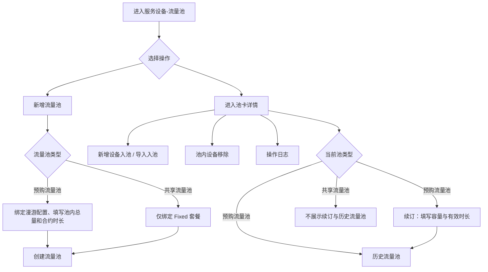
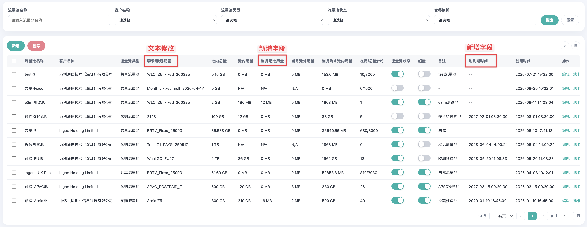
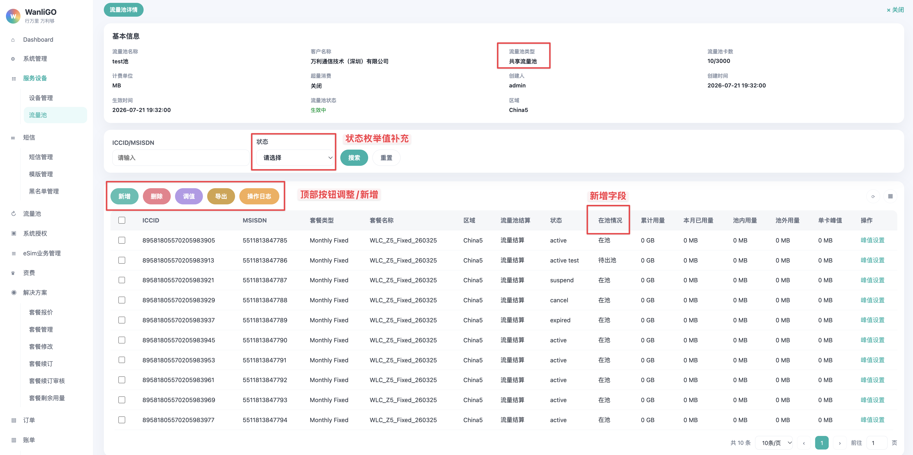
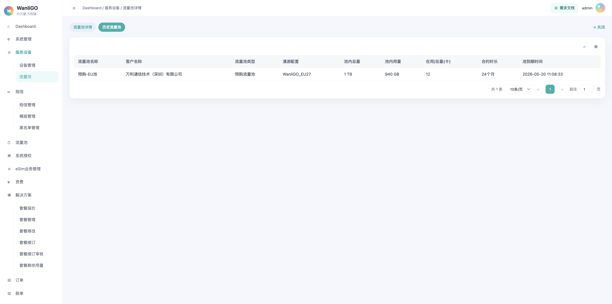

<style>
@media print {
  table {
    break-inside: auto !important;
    page-break-inside: auto !important;
  }
  tr {
    break-inside: avoid !important;
    page-break-inside: avoid !important;
  }
}
</style>

# 一、需求说明

在现有「服务设备-流量池」上补齐预购 / 共享建池规则、入池限制、出池留痕、操作日志、续订，以及池级用量与账单口径。不新增菜单。

权限规则：

- 仅万利管理员可组池、移卡、续订。
- 客户及客户管理员不能组池、移卡、续订。

# 二、功能概述

## 2.1 总功能

| 功能 | 说明 |
| --- | --- |
| 卡到期时间调整 | <span style="color:red;font-weight:bold;">类型为 PAYG 和 Fixed 的套餐，不再有到期时间。</span> <br />Pre-Pay 的套餐到期时间 = 按套餐激活时间 + 合约时长。 |
| 新增流量池改造 | 1. 按流量池类型联动字段：预购池不再关联套餐，而是关联漫游配置，并展示漫游明细；合约时长默认24个月，并支持修改；<br />2. 共享池之前允许 Pre-Pay 和 Fixed 的卡入池，现在改为仅支持绑定 Fixed 套餐。 |
| 主列表 | 新增字段“当月超池用量”、“池到期时间”，见 3.2。<br />当月超池用量：超量开关开启时超出池内总量部份的用量。 |
| 池卡状态 | 筛选与列表「状态」改为 active、active test、suspend、cancel、expired。状态后增加字段「在池情况」。 |
| 入池限制 | 明确预购 / 共享允许的套餐类型、禁止入池状态，以及中途入池扣量规则。 |
| 新增弹窗 | 按钮合并到「新增」弹窗中，其含「新增设备入池」「导入入池」两个 Tab。 |
| 删除 | 1. 新增「删除」按钮，位于「新增」之后，通过导入Excel文件将池内对应卡片移出当前流量池；<br />2. 当月不出池，「在池情况」更新为「待出池」，操作留痕。 |
| 操作日志 | 按当前流量池查看记录。只记录导入入池和导入出池，不记录单卡操作。可按批次号和结果筛选。 |
| 续订 | 仅预购池在池卡页展示「续订」：增加池容量并延长有效时长。共享池页面不展示续订入口。 |
| 历史流量池 | 仅预购池在池卡页展示页签，记录续订前的池快照。共享池无到期时间、默认永久有效，不展示。 |
| 用量与账单 | 明确池级字段公式、入池后单卡字段取值，以及预购 / 共享当月账单构成。 |

## 2.2 整体流程



## 2.3 两种流量池

| | 预购流量池 | 共享流量池 |
| --- | --- | --- |
| 含义 | 先预购额度，再往里导卡 | 相同套餐的卡把单卡额度拿出来共用 |
| 容量 | 创建时锁定，不随卡数增加 | 入池激活总卡数 × 单卡套餐额度 |
| 允许入池的卡状态 | active、active test | active、active test |
| 停机卡与容量 | 容量固定，与停机张数无关 | 当月停的还计入容量；上月已停的不计入 |
| 建池绑定 | 不绑卡套餐；绑 Roaming，再选目标区域 | 必须绑套餐 |
| 目标区域 | 建池时自选；结算只认池的区域 | 跟关联套餐走，选定即锁死 |
| 允许入池 | PayG、Fixed | Fixed |
| 禁止入池 | Pre-Pay | PayG、Pre-Pay |
| 池内多种套餐 | 可以（除 Pre-Pay）；统一按池价计费，单卡套餐不再收费 | 不可以。同一池内套餐名称 + 类型必须完全一致 |
| 有效期 | 建池启用当下起算 + 合约时长（默认 2 年），与有没有卡无关。列表展示「池到期时间」 | 无到期时间，默认永久有效（除非将池内全部卡片停机）。列表「池到期时间」展示「--」 |

预购池目标区域覆盖单卡：单卡入池后，使用目标区域以预购池为准。例：卡目标区域 a、b、c，池目标区域 a、b，入池后使用目标区域为 a、b。

# 三、流量池主页面



## 3.1 页面入口

侧边栏一级菜单「服务设备」→ 二级菜单「流量池」。

顶部面包屑展示：`Dashboard / 服务设备 / 流量池`

## 3.2 列表字段调整

相对现有列表，字段更名与新增如下。共享流量池对应的套餐类型只能是 Fixed。

| 表头字段 | 说明 |
| --- | --- |
| 套餐/漫游配置 | 将「套餐」文本改为“套餐/漫游配置”。<br />共享池展示 Fixed 套餐名称；预购池展示关联漫游配置。 |
| 池内总量 | 预购池为建池锁定容量；共享池按激活卡数 × 单卡套餐额度。<br />卡片入池后，若卡已产生用量，则池内总量 = 当前池内总量 - 卡区域内已用量； |
| 当月超池用量 | 新增字段，位于「池内用量」之后。当月超出池内总量的部分。跨月清零。超量开关关闭时不产生超池用量。 |
| 当月池外用量 | Σ(池内卡当月在池目标区域外的用量)，不占池容量。跨月清零。 |
| 当月剩余池内用量 | `max(0, 池内总量 − 池内用量)`。跨月清零。 |
| 在用/总量(卡) | 保持现状。 |
| 池到期时间 | <span style="color:red;font-weight:bold;">新增字段</span>，位于「创建时间」之前。仅预购流量池展示，计算公式：创建时间 + 合约时长(月)。共享流量池无到期时间，展示「--」。 |

## 3.3 新增流量池弹窗

预购池不再关联套餐，而是关联漫游配置，并展示漫游明细；合约时长默认24个月，并支持修改；

共享池除了池内套餐改为仅支持 Fixed、无到期时间之外，其他保持不变。


### 3.3.1 弹窗说明

字段随「流量池类型」和「关联套餐」类型联动显示或隐藏。

字段排列顺序：

预购池：流量池名称 → 客户名称 → 流量池类型 → 关联漫游配置 → 超池价格、池外价格、流量池容量、流量池状态 → 池目标区域 → 合约时长(月) → 关联漫游明细 → 备注。

共享池：保持不变。流量池名称 → 客户名称 → 流量池类型 → 关联套餐 → 超池价格、池外价格、卡总数量、流量池状态 → 套餐目标区域  → 关联套餐明细 → 备注。

### 3.3.2 预购流量池

| 说明                 | 具体                                                         |
| -------------------- | ------------------------------------------------------------ |
| 建池规则             | 1. 绑定 Roaming，选择目标区域。 <br />2. 填写池内总量（创建后锁定）和合约时长（默认 2 年）。 <br />3. 配置池外价格、超池价格、超量开关。 |
| 选择「预购流量池」后 | 1. <span style="color:red;font-weight:bold;">不再关联卡套餐。</span> <br />2. 隐藏「关联套餐」，展示「关联漫游配置」。 <br />3. 展示可编辑「合约时长(月)」，默认 24。 <br />4. 选定漫游配置后回显「池目标区域」，选定后锁死。 <br />5. 选定漫游配置后展示「关联漫游明细」。未选定漫游配置时不展示。 |

| 字段 | 类型 | 说明 |
| --- | --- | --- |
| 关联漫游配置 | 下拉框 | 必填。取值于所选客户所属的「Roaming文件」。 |
| 超池价格 | 币种 + 金额 | 必填。 |
| 流量池容量 | 数值 + 单位 | 必填。创建后锁定为池内总量。单位枚举：MB、GB、TB。 |
| 合约时长(月) | 文本输入框 | 默认 24，可修改，须为大于等于 1 的整数。 |
| 池目标区域 | 只读标签 | 跟随关联漫游配置回显，字段名称不用「套餐目标区域」。 |
| 关联漫游明细 | 只读表格 | 选定具体漫游配置后展示。标题为「关联漫游明细」，不用「关联套餐明细」。 |

关联漫游明细列与关联套餐明细相同：

| 表头字段 | 说明 |
| --- | --- |
| Price Group | 该漫游配置下的价格组。 |
| Country | 该价格组覆盖的国家或区域。 |
| 流量单位 | 如 MB。 |
| 套餐内含量 | 价格组内含量。 |
| 超套单价 | 超出含量后的单价。 |
| 月租 | 月租金额。 |

### 3.3.3 共享流量池

| 字段         | 类型   | 说明                                             |
| ------------ | ------ | ------------------------------------------------ |
| 关联套餐     | 下拉框 | 必填。仅展示所选客户所属的 type = Fixed 的套餐。 |
| 合约时长(月) | -      | 当为共享池时，去掉此信息。                       |

建池规则：

- 仅允许 Fixed。
- 必须绑定套餐；池内卡套餐名称 + 类型必须与该套餐完全一致。

共享池在月初、新卡入池时都需要<span style="color:red;font-weight:bold;">刷新「池内总量」</span> ，具体规则如下表：

| **刷新时机**                     | **触发点**               | **计容口径**                             | **池总量动作**                                               | **作用**                                                    |
| -------------------------------- | ------------------------ | ---------------------------------------- | ------------------------------------------------------------ | ----------------------------------------------------------- |
| **月初 1 号凌晨0点刷新**(未实现) | 在所有卡完成月结更新之后 | 仅统计状态为 active 的卡片               | 重置：池内总量 = active数 × 单卡额度                         | 归零重算，校准本月基数                                      |
| **每日定时**（已有？）           | 每天凌晨0点30分，执行1次 | active + suspend                         | 池内总量 = （active数 + suspend） × 单卡额度；<br />只增不减：新值 > 现值才更新 | 跟随复机/入池扩容，不回收；存在 active test → active 的卡片 |
| **卡入池**                       | 卡中途入池时             | 新增该卡 允许入池：active 和 active test | 当前池内总量 + 新入池且状态为active的卡数 x 单卡额度 - Σ(单卡套餐内已用量) | 纳入正式池用                                                |

> 月初 1号，必须先月初刷新（重置）→ 后每日定时（跟随）。若颠倒，每日先把 suspend 卡计入撑大池总量，月初想按"只算active"压回，会因"只增不减"永远压不回来，池总量虚高。
>
> 次月自动复机操作必须在池内总量刷新之前完成。
>
> 执行顺序铁律：池内卡片自动复机 → 池内总量月初刷新 → 每日定时任务

# 四、流量池详情（池卡）页面

共享流量池池卡页面：



预购流量池池卡页面：


## 4.1 页签

池卡页顶部页签：

| 页签 | 展示条件 | 说明 |
| --- | --- | --- |
| 流量池详情 | 预购 / 共享均展示 | 当前池基本信息 + 池卡筛选与列表。 |
| 历史流量池 | 仅预购流量池 | 见 4.4。共享流量池无到期时间，默认永久有效，故无此页签。 |

关闭按钮位于页签行右侧，返回流量池主列表。（保持原状）

## 4.2 状态与在池情况

筛选与列表「状态」枚举值：active、active test、suspend、cancel、expired。

在「状态」之后增加「在池情况」。两个字段独立。申请出池不改卡片状态；当月仍可用的卡，状态保持 active。

| 在池情况 | 说明 |
| --- | --- |
| 在池 | 当月未申请出池。 |
| 待出池 | 已申请出池，当月仍在池卡列表中，次月生效后离开。 |

## 4.3 顶部操作按钮

顺序：新增、删除、调值、导出、操作日志、续订。

| 按钮 | 交互说明 |
| --- | --- |
| 新增 | 将原来的「导入」按钮和「新增」按钮合并到「新增」按钮中。即「新增」弹窗中含「勾选入池」「导入入池」两个 Tab。仅作按钮/弹窗合并，不改变其他逻辑或功能。 |
| 删除 | 新增按钮，位于「新增」之后。浅红色按钮。打开「池内设备移除」弹窗，见 4.6。 |
| 调值 | 不变，保持现状。 |
| 导出 | 不变，保持现状。 |
| 操作日志 | 打开当前流量池的入池 / 出池操作日志。位于导出之后。 |
| 续订 | <span style="color:red;font-weight:bold;">仅预购流量池展示</span>，位于操作日志之后。打开预购池续订弹窗。共享流量池不展示该按钮。 |

## 4.4 历史流量池



仅当前流量池类型为「预购流量池」时展示。页签与「流量池详情」并列。

切换后仅展示本池历次续订前的快照列表。一行代表一次已被续订替换的预购周期。从未续订过时展示「暂无数据」。预购续订成功后，将续订前的池信息写入本列表。

| 表头字段 | 说明 |
| --- | --- |
| 流量池名称 | 快照对应的池名称。 |
| 客户名称 | 快照对应的客户。 |
| 流量池类型 | 固定为「预购流量池」。 |
| 漫游配置 | 固定为当前预购池关联的漫游配置。 |
| 池内总量 | 续订前的池内总量。 |
| 池内用量 | 续订前的池内用量。 |
| 在用/总量(卡) | 续订前的在用卡数；无总量时只展示在用卡数。 |
| 合约时长 | 该预购周期的合约时长，单位为月。 |
| <span style="color:red;font-weight:bold;">池到期时间</span> | 第 1 期：建池时间 + 第 1 期合约时长；<br />第 2 期及以后：上一期池到期时间 + 本期合约时长 |

## 4.5 入池

### 4.5.1 入池

入口：

1. 「订单-销售订单」选池划拨；（已实现）（<span style="color:red;font-weight:bold;">「套餐名称」改为非必选 </span>）
2. 「服务设备-流量池-池卡」- 新增 - 勾选入池；
3. 「服务设备-流量池-池卡」- 新增 - 导入入池。

#### 4.5.1.1 按钮合并

将原有的「新增」与「导入」按钮合并到一个按钮「新增」中。点击池卡页「新增」后弹窗页面中，有两个 Tab 页面：「勾选入池」和「导入入池」两个 Tab。默认打开「勾选入池」。

<div style="display: flex; justify-content: center; gap: 10px;">  
    
   </div>

**导入入池 Tab**

从原「导入」弹窗迁入。提供文件上传和模版下载。文件要求：xls 或 xlsx，大小不超过 5MB。

上传包含 ICCID 的文件后，将文件中的卡片加入当前流量池。

- 已在本池的 ICCID 记为失败，失败原因：`ICCID已在本池`。
- 成功加入的卡片写入池卡列表，并增加流量池卡数。
- 无论全部成功、部份成功或全部失败，均记入操作日志。未选择文件时不记日志。


==入池限制：==

| 项 | 规则 |
| --- | --- |
| 预购池允许 | PayG、Fixed |
| 预购池禁止 | Pre-Pay |
| 共享池允许 | Fixed |
| 共享池禁止 | PayG、Pre-Pay |
| 允许入池状态 | `active` / `active test` |
| 禁止入池状态 | `suspend` / `cancel` / `expired`（合约已过期且未续订） |
| 测试用量 | <span style="color:red;font-weight:bold;">进池后将该卡的剩余测试用量清零</span>；即进池后则使用池内流量，不可再使用测试用量；开始使用则立即激活 |
| 已入池卡 | 不允许修改套餐 |

中途入池：将该卡当月已用量扣进池。公式：

```
当前池内总量 = 现池内总量 - 单卡当月已用量
```

预购池创建锁定的池内总量不因卡数变化。本条按可消耗额度处理：把该卡当月已用量并入池内用量，剩余用量同步减少；当月不再另出单卡套餐账。

## 4.6 池内设备移除弹窗


### 4.6.1 定义

移除 = 把池内卡从当前流量池移除出去。通过新增的「删除」按钮打开「池内设备移除」完成。

- 申请出池后将对应卡片的「在池情况」改为「待出池」。
- 当月不能出。次月 1 日 0 点、上月账单结完再生效，将卡片从池卡列表消失，并减少流量池卡数。
- 操作必须留痕，记录在「操作日志」中。
- 出池后改回按该卡原基础套餐结算。
- 池内卡到期且未续订：单卡直接停机，不自动出池。预购池、共享池相同。

### 4.6.2 弹窗说明

点击池卡页「删除」后打开。弹窗标题为「池内设备移除」。底部展示「确定」「取消」按钮。提供文件上传和模版下载。文件要求：xls 或 xlsx，大小不超过 5MB。

### 4.6.3 导入出池

上传包含 ICCID 的文件后，将文件中属于本池的卡片的在池情况记为「待出池」。

- 不在本池的 ICCID 记为失败，失败原因：`ICCID不在本池`。
- 同一文件中重复出现的 ICCID 记为失败，失败原因：`ICCID重复`。

## 4.7 操作日志弹窗


### 4.7.1 弹窗说明

点击池卡页「操作日志」后打开。仅展示当前流量池的入池 / 出池记录，仅记录导入入池和导入出池的操作。一行代表一次操作。

不记录：单卡入池、单卡出池、调值、峰值设置、未勾选新增入池、未选文件导入、确认框取消。

### 4.7.2 筛选区

| 字段 | 类型 | 说明 |
| --- | --- | --- |
| 时间范围 | 日期范围选择器 | 包含开始日期和结束日期，按操作时间筛选。 |
| 操作人 | 可输入下拉框 | 支持选择或关键字搜索。 |
| 操作类型 | 下拉框 | 枚举值：入池、出池。 |
| 批次号 | 文本输入框 | 按批次号关键字筛选。 |
| 结果 | 下拉框 | 枚举值：部份成功、失败、成功。 |

| 按钮 | 交互说明 |
| --- | --- |
| 搜索 | 按当前筛选条件查询，并重置至第 1 页。 |
| 重置 | 清空筛选条件，恢复当前池全部日志。 |

### 4.7.3 表头字段

| 表头字段 | 说明 |
| --- | --- |
| 批次号 | 本次导入操作的批次号。 |
| 操作人 | 实际操作账号。 |
| 流量池名称 | 操作当时的流量池名称。 |
| 操作类型 | 枚举值：入池、出池。 |
| 文件 | 导入的文件名，可点击下载。 |
| 结果 | 枚举值：成功、部份成功、失败。 |
| 总数 | 本次提交的卡片数，等于成功数 + 失败数。 |
| 成功数 | 入池或出池成功的张数。 |
| 失败数 | 未处理成功的张数。 |
| 操作时间 | 格式：YYYY-MM-DD HH:mm:ss。 |
| 操作 | 「详情」。 |

结果计算规则：

| 结果 | 条件 |
| --- | --- |
| 成功 | 成功数 > 0 且失败数 = 0 |
| 部份成功 | 成功数 > 0 且失败数 > 0 |
| 失败 | 成功数 = 0 |

### 4.7.4 详情弹窗


点击「详情」后打开，列出本次操作涉及的每张卡。底部提供「导出」按钮，导出本次操作的全部详情，列与下表一致。

| 表头字段 | 说明 |
| --- | --- |
| ICCID | 本次提交的 ICCID。 |
| 结果 | 枚举值：成功、失败。 |
| 失败原因 | 成功时展示「-」。失败时展示具体原因。 |

失败原因枚举：

| 文案 | 场景 |
| --- | --- |
| ICCID已在本池 | 导入入池，该卡已经在当前池里。 |
| ICCID不在本池 | 导入出池，该卡不在当前池里。 |
| ICCID重复 | 导入出池，同一文件里同一 ICCID 出现多次。 |

### 4.7.5 导入文件下载

操作日志只记录导入入池和导入出池。单卡加入、单卡移出都不记日志。

导入记录点击文件名，下载当时上传的源文件，文件名与上传时一致。源文件只含上传时的 ICCID 列，不包含导入结果和失败原因。 |

## 4.8 续订弹窗


### 4.8.1 弹窗说明

仅预购流量池在池卡页展示「续订」。共享流量池页面不展示续订入口。

注销卡（cancel）不可续订。

预购池内卡片到期后未续订：单卡停机，不自动出池。

续订生效时间：在旧池到期后立即生效。

> 新预购池一创建即生效，创建时间就是生效时间。池内若有剩余额度，到期后直接清零，不结转。
>
> 续订只能在原到期时间上延长合约时长，并在原预购池到期后立即生效。额度若在到期前用完，新预购池也不提前生效。

### 4.8.2 预购流量池续订

在池上续订：刷新池内总量，不在原有的池内总量基础上进行叠加，同时延长池有效时长。确定后将续订前的池信息写入「历史流量池」。

| 字段 | 类型 | 说明 |
| --- | --- | --- |
| 流量池名称 | 只读文本 | 回显当前流量池名称，不可修改。 |
| 客户名称 | 只读文本 | 回显当前流量池对应客户，不可修改。 |
| 流量池容量 | 数值 + 单位 | 必填。单位枚举：MB、GB、TB。 |
| 有效时长 | 数值 | 必填，默认 24 个月，可修改。 |

# 五、术语与定义

## 5.1 用量规则

区域内：用量发生时 MCC 在池目标区域内 → 扣池内总量额度。  
区域外：不在池目标区域内 → 不占池内容量，按池外价格。

超量：须超量开关开启，并记「当月超池用量」。「当月剩余池内用量」不能为负。超量部分按超池价格。超量开关关闭时，池内用量达到池内总量后停机，不产生超池用量。

超量开关开启时，预购池「池内用量」允许大于「池内总量」。

### 5.1.1 池级字段

| 字段 | 预购池 | 共享池 |
| --- | --- | --- |
| 池内总量 | 跨月不变 | 跨月刷新 |
| 池内用量 | 跨月不清零。Σ(池内卡在池目标区域内的用量)，合约期内累计。超量开关开启时允许大于池内总量 | 跨月清零 |
| 当月超池用量 | 跨月清零。`max(0, 池内用量 − 池内总量)`；池内用量跨月累计时，按 `max(0, 当月区域内用量 − 月初剩余池内用量)` | 跨月清零。`max(0, 池内用量 − 池内总量)` |
| 当月池外用量 | 跨月清零。Σ(池内卡当月在池目标区域外的用量)，不占池容量 | 同左 |
| 当月剩余池内用量 | 跨月清零。`max(0, 池内总量 − 池内用量)` | 同左 |

### 5.1.2 入池后单卡字段

入池后只出流量池账单，当月及之后不再走单卡套餐月结。设备页字段仍按下列取值。

当卡入池后，该卡的「服务设备 - 设备管理 - ICCID(卡详情) - 设备」中的字段「当月套餐内用量(MB)」改为「当月区域内用量(MB)」，「当月套餐外用量(MB)」改为「当月区域外用量(MB)」。

入池后，卡的剩余测试用量清零。

**预购池 × PayG**

| 字段 | 公式 |
| --- | --- |
| 当月已用量 | 当月区域内用量 + 当月区域外用量 |
| 套餐总量 | N/A |
| 当月区域内用量(MB) | 当月命中池目标区域内产生的用量 |
| 套餐剩余用量 | N/A |
| 当月区域外用量(MB) | 当月池目标区域外用量 |

**预购池 × Fixed**

| 字段 | 公式 |
| --- | --- |
| 当月已用量 | 当月区域内用量 + 当月区域外用量 |
| 套餐总量 | N/A |
| 当月区域内用量(MB) | 当月命中池目标区域内产生的用量 |
| 套餐剩余用量 | N/A |
| 当月区域外用量(MB) | 当月池目标区域外产生的用量 |

预购池结算只认池目标区域。上表「目标区域」= 池目标区域，不是卡原套餐区域。

**共享池 × Fixed**

| 字段 | 公式 |
| --- | --- |
| 当月已用量 | 当月区域内用量 + 当月区域外用量 |
| 套餐总量 | 取值于「解决方案 - 套餐报价 - 新增（添加套餐报价）」中的套餐总量 |
| 当月区域内用量(MB) | 当月命中池目标区域内产生的用量 |
| 套餐剩余用量 | N/A |
| 当月区域外用量(MB) | 当月池目标区域外产生的用量 |

共享池目标区域跟关联套餐，与卡套餐目标区域一致。

## 5.2 账单规则

进池后只出流量池账单，当月及之后不再走单卡套餐月结。

| | 预购池 | 共享池 |
| --- | --- | --- |
| 当月账单 | 超池费用 + 池外费用。池额度已预付，不按卡收套餐月租 | 固定套餐费 × 应收费卡数 + 超池费用 + 池外费用 |
| 超池费用 | 当月超池用量 × 超池单价（按产生用量的 MCC/价格拆分） | 同左 |
| 池外费用 | 当月池外用量 × 池外单价 | 同左 |
| 月租 | 不收 | 状态除 `cancel`、`active test` 外都收 |

# 六、补充说明

## 6.1 数据校验规则

| 场景 | 字段 | 校验规则 | 失败提示 |
| --- | --- | --- | --- |
| 新增流量池 | 关联套餐 | 共享流量池必填，且仅 Fixed。 | 请选择关联套餐 |
| 新增流量池 | 关联漫游配置 | 预购流量池必填。 | 请选择关联漫游配置 |
| 新增流量池 | 超池价格 | 当前可见时必填币种和金额。 | 费用不能为空 |
| 新增流量池 | 流量池容量 | 预购流量池必填数值和单位。 | 容量不能为空 |
| 新增流量池 | 卡总数量 | 共享流量池必填。 | 卡总数量不能为空 |
| 新增流量池 | 合约时长(月) | 预购流量池必填，且为大于等于 1 的整数。 | 请输入有效时长 |
| 新增设备入池 | 勾选 | 至少勾选一张待入池设备。 | 请先勾选需要加入流量池的卡片 |
| 导入入池 / 导入出池 | 上传文件 | 必填，仅支持 xls、xlsx，不超过 5MB。 | 请上传导入文件 |
| 预购池续订 | 流量池容量 | 必填。 | 请输入流量池容量 |
| 预购池续订 | 容量单位 | 必填。 | 请选择容量单位 |
| 预购池续订 | 有效时长 | 必填，且大于等于 1。 | 请输入有效时长 |

## 6.2 其他补充说明

### 6.2.1 状态与边界

| 项 | 规则 |
| --- | --- |
| 测试用量 | 未激活卡进池后无测试用量；开始使用立即激活 |
| 套餐修改 | 池内卡不允许改套餐 |
| 出池生效 | 次月 1 日 0 点、上月账单结完 |
| 出池后结算 | 原基础套餐 |
| 到期未续 | 单卡停机，不自动出池 |
